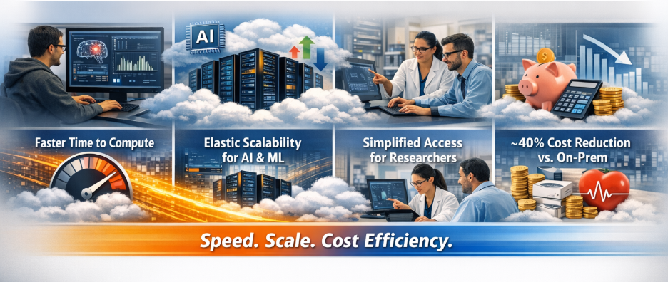

High-performance computing (HPC), artificial intelligence (AI), and machine learning (ML) are now foundational to modern healthcare research. From large-scale neuroimaging analysis and multimodal data fusion to advanced simulations and model training, research teams require compute environments that are not only powerful, but also flexible, governed, and cost-effective.

Yet many healthcare and research organizations remain constrained by traditional on‑premises HPC environments, which are often times legacy systems that were designed for predictable workloads but struggle to keep pace with today’s bursty, exploratory, and AI-driven research demands.

The **Centre for Addiction and Mental Health (CAMH)**, Canada’s largest mental health teaching hospital, faced this challenge head-on. In partnership with **Improving** and **Google Cloud**, CAMH deployed the **Research Accelerator Portal**, which is a cloud-native application that allows researchers to effortlessly provision, deploy, and manage HPC, AI, and ML resources in the cloud for compute-heavy research workflows. This solution now complements CAMH’s on‑premises HPC cluster, enabling researchers to scale faster, innovate more freely, and reduce costs by **approximately 40% compared to equivalent on‑prem solutions.**

## **The On‑Prem HPC Challenge in Healthcare Research**

On‑premises HPC clusters remain critical assets for many research institutions, particularly in healthcare, where data sensitivity, governance, and compliance are important considerations. However, industry research consistently highlights several structural limitations of relying exclusively on on‑prem infrastructure:

- **High upfront capital expenditure (CapEx)** for specialized hardware, GPUs, and storage
- **Underutilization risk**, where expensive systems sit idle outside peak usage periods
- **Limited elasticity**, making it difficult to support short‑term, compute‑intensive workloads
- **Lengthy provisioning cycles**, which slow experimentation and iteration

Healthcare organizations pursuing advanced analytics and AI frequently struggle with infrastructure rigidity and rising operational costs when scaling on‑prem environments, particularly as workloads become more data‑ and compute‑intensive. Similarly, independent research comparing cloud and on‑prem HPC environments shows that acquisition, maintenance, power, and staffing costs make large‑scale on‑prem clusters expensive to scale sustainably.

For AI and ML workloads, these challenges are amplified. Forrester research highlights that organizations attempting to support AI innovation on traditional infrastructure often face higher costs and slower time to value compared to cloud‑based approaches that offer elasticity and managed services.

## **CAMH’s Research Computing Reality**

At CAMH, the **Krembil Centre for Neuroinformatics (KCNI)** and Research Informatics team support a rapidly growing portfolio of data‑intensive mental health research. While CAMH already operated a robust on‑prem HPC cluster, several pressures were emerging:

- **Bursty and exploratory workloads** that required short‑term access to large amounts of compute
- **New AI and ML use cases** require hardware configurations not available on‑prem
- **Researchers without cloud engineering expertise** need a simpler way to access advanced resources

Rather than replacing its existing HPC environment, CAMH sought to **extend it**—adding a governed cloud option that aligned with institutional controls while reducing operational friction for researchers.

## **The Research Accelerator Portal: Cloud as a Complement**

#### Google Cloud had developed an initial research deployment portal concept, but in its early form, it required refinement to meet real‑world research needs. Improving worked closely with KCNI and Google Cloud to transform this prototype into a **production‑grade Research Accelerator Portal**. **Key enhancements included:**

- Hardening and stabilizing the portal for day‑to‑day research use
- Simplifying the user experience so non‑expert users could launch compute via a web interface
- Aligning governance, access controls, and workflows with CAMH’s institutional requirements
- Ensuring the portal complemented—not disrupted—existing on‑prem HPC operations

The result is a secure, user‑friendly platform that provides **on‑demand access to scalable Google Cloud compute resources**, tightly integrated with CAMH’s research ecosystem.

## **Measurable Impact: Speed, Scale, and Cost Efficiency**

Within the KCNI / Research Informatics environment, the Research Accelerator Portal has delivered clear, our research accelerator portal delivered tangible benefits to CAMH, that included:

#### **Faster Time to Compute**

Provisioning that once required manual intervention and long lead times can now be completed rapidly through a guided web interface, accelerating experimentation and iteration.

#### **Elastic Scalability for AI and ML**

Researchers can scale compute resources up for time‑sensitive analyses and scale down when work is complete, an approach well‑suited to modern AI and ML workflows.

#### **Simplified Access for Researchers**

By abstracting cloud complexity, the portal enables a broader range of researchers to leverage advanced computing without deep cloud engineering expertise.

#### **~40% Cost Reduction vs. On‑Prem**

Most notably, CAMH realized an estimated **40% reduction in cost compared to equivalent on‑prem infrastructure**, aligning with broader industry findings that cloud‑based HPC can significantly reduce total cost of ownership when used for elastic and bursty workloads.

This outcome reinforces independent analyses showing that cloud HPC often delivers better cost efficiency for non‑continuous workloads by eliminating idle capacity and shifting spend from CapEx to usage‑based OpEx models.

## **Why This Matters for Healthcare and Research Leaders**

CAMH’s experience highlights a critical lesson for healthcare organizations: **the future of research computing is hybrid by design**.

Rather than choosing between on‑prem or cloud, leading institutions are combining both—using on‑prem HPC for steady‑state workloads while leveraging cloud platforms like Google Cloud for elasticity, AI acceleration, and rapid innovation. Forrester research underscores that this convergence of AI and HPC is becoming essential to unlocking advanced analytics at scale.

## **Advancing Research Through Governed Innovation**

By collaborating with Improving and Google Cloud, CAMH transformed an early‑stage portal concept into a production‑ready Research Accelerator Portal that now plays a central role in advancing mental health research. The solution extends CAMH’s existing HPC environment, accelerates AI‑ and ML‑driven discovery, and delivers meaningful cost savings—without sacrificing governance or security.

If you are a **researcher**, **CIO**, or **healthcare leader** facing the limitations of traditional HPC environments, now is the time to rethink how research computing is delivered.

The Google Cloud Research Accelerator Portal demonstrates how governed, cloud‑native platforms can **reduce costs, accelerate discovery, and empower researchers, **all while integrating seamlessly with existing infrastructure.

[**Click to learn more**](https://www.improving.com/research-accelerator-portal/healthcare/#contact) about how our research accelerator portal can help streamline your research workflows and accelerate innovation across your organization.
