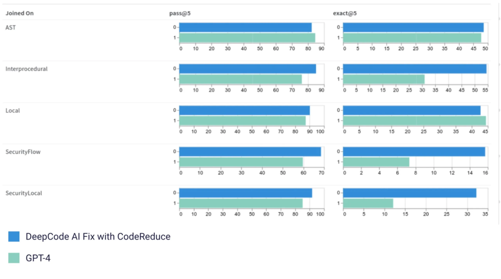
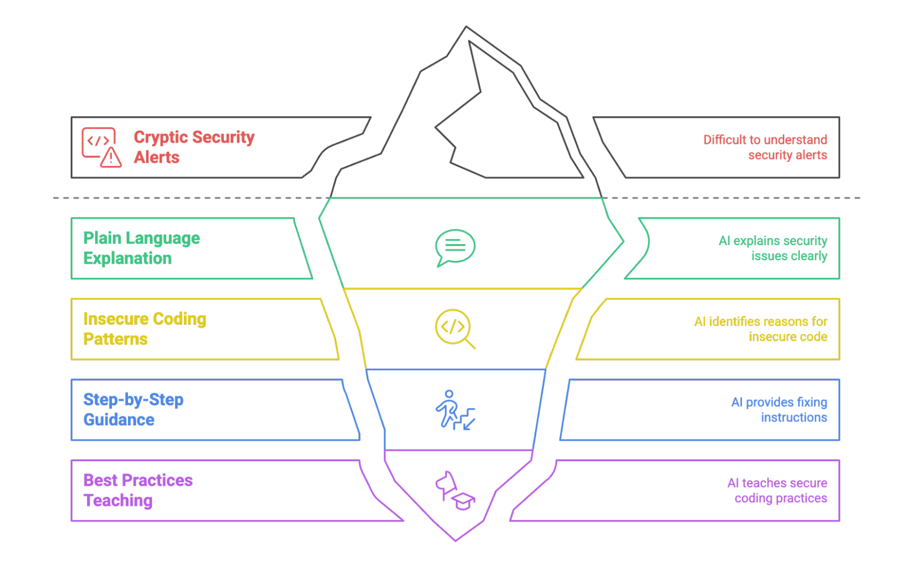

Software development is accelerating, and AI is helping drive that shift. Developers today use tools like GitHub Copilot, ChatGPT, and CodeWhisperer to generate code faster than ever. But that speed introduces a new challenge: reviewing and securing code at the same pace. As codebases grow and change rapidly, traditional security workflows are becoming a bottleneck.

Manual reviews and tools like SAST and DAST are still essential, but they struggle with scale, context, and remediation speed. With growing volumes of code—and more of it written by AI—organizations need faster, more intelligent ways to spot and fix security flaws.

That’s where AI is starting to change how application security works. Modern tools don’t just detect vulnerabilities; they suggest fixes, explain issues in plain language, and integrate into developer workflows. In this article, we’ll explore how AI is being used in application security: how it detects and fixes vulnerabilities, how teams are adopting these tools today, where they fall short, and what the future of AI-powered security looks like.

## How AI is changing AppSec for the better

AI is reshaping application security by going beyond traditional detection methods. While tools like SAST and DAST focus on identifying and classifying vulnerabilities, AI systems apply deeper code understanding to offer context-aware, actionable solutions. The result is faster detection, smarter triage, and, increasingly, automated remediation. Here are the key ways AI is improving AppSec today:

### Automated vulnerability detection and prioritization

AI systems use large language models (LLMs) and machine learning to understand code structure, data flow, and intent. The in-depth understanding of the code enables LLMs to perform more accurate vulnerability detection and intelligent prioritization based on severity and exploitability.

### Real-time code review support

Unlike traditional post-commit scanning, AI tools integrate directly into IDEs and CI pipelines, supporting true “shift-left” security. Programs like GitHub Copilot with CodeQL, Snyk IDE plugins, and Qwiet AI provide inline feedback during development, highlighting insecure code patterns, explaining the risk, and suggesting fixes as developers write or review code, all within their existing workflow.

### From detection to remediation

A significant advancement is AI’s ability to suggest and apply fixes. Traditional tools stopped at flagging issues; AI tools now provide actionable solutions, transforming the security workflow from “here’s a problem” to “here’s how to fix it.”.

### Context-aware autofixing

One of the most impactful features of AI-based security tools is their ability to generate targeted fixes on their own. Autofix systems typically follow a structured process:

1. Review code: Submit the buggy code snippet to AI for analysis
2. Add context: Provide security rules and best practices
3. Find the problem: Analyze code flow and data to understand the security flaw
4. Create a fix: Write new code that fixes the issue while keeping the program working

AI security fixing focuses just on the flawed parts rather than rewriting whole functions. Several companies offer tools with this ability, such as:

[Snyk DeepCode AI Fix](https://snyk.io/blog/ai-code-security-snyk-autofix-deepcode-ai/) blends LLMs with static analysis techniques. It started with [Google’s T5 model](https://research.google/blog/exploring-transfer-learning-with-t5-the-text-to-text-transfer-transformer/) but now uses [StarCoder](https://huggingface.co/blog/starcoder), which is trained on fixed security issues. [Snyk’s CodeReduce technology](https://snyk.io/blog/deepcode-ai-vulnerability-autofixing/) focuses the AI only on vulnerable code sections, achieving up to 20% better accuracy than GPT-4 while reducing false positives. The MergeBack system ensures clean integration of fixes into existing codebases.

mage source: [Snyk blog post](https://snyk.io/blog/ai-code-security-snyk-autofix-deepcode-ai/)

[Qwiet AI’s AutoFix](https://qwiet.ai/platform/autofix/) employs multiple AI agents working with [Code Property Graph (CPG)](https://qwiet.ai/platform/code-property-graph/). CPG maps how an app works, showing data flow and code structure in one view. This approach excels at complex vulnerabilities like race conditions and SQL injection attacks.

[GitHub Copilot AutoFix](https://docs.github.com/en/code-security/code-scanning/managing-code-scanning-alerts/responsible-use-autofix-code-scanning#about-copilot-autofix-for-code-scanning) provides real-time fix suggestions directly within code editors for vulnerabilities detected by [CodeQL](https://codeql.github.com/) analysis. It helps developers apply secure coding patterns as they write, reducing context switching and improving fix speed within familiar workflows.

[CodeRabbit](https://www.coderabbit.ai/) offers AI-assisted code reviews directly inside GitHub pull requests. It can identify security issues, suggest context-aware fixes, and support developer feedback loops, all without leaving the GitHub UI. In our recent [AI webinar with CodeRabbit](https://www.infracloud.io/webinars/the-modern-10x-engineer-code-generation-&-beyond/), SMEs shared how CodeRabbit brings AI to your code reviews, helping you save up to 50% of the time spent on manual reviews.

### Reducing false positives with code context

Traditional scanners often produce noisy results due to a limited understanding of code behavior. AI tools improve precision by analyzing:

- How data flows through functions and modules
- Whether input is sanitized or validated
- Common secure coding patterns
- The difference between theoretical risks and exploitable flaws

### Natural language guidance for developers

AI transforms cryptic security alerts into actionable guidance by:

- Explaining problems in plain language
- Highlighting why a coding pattern is insecure
- Providing step-by-step fixing guidance
- Teaching the best practices as you work

For example, in a real [GitHub pull request](https://github.com/techmaharaj/aws-s3-config/pull/1), CodeRabbit provided comprehensive feedback like:

*“CRITICAL: Fix severe security misconfigurations in S3 bucket. The current configuration has several critical security issues: Public read access is enabled via ACL, CORS policy allows requests from any origin, All headers are allowed. These settings could lead to unauthorized access, data leakage, and potential abuse of your S3 resources.”*

The AI then provided specific code fixes, explained security implications, and suggested architectural improvements, going far beyond simple vulnerability detection to deliver thorough code review guidance that helps developers understand both the problem and the solution.

Similarly, GitHub Copilot can suggest fixes inline while offering natural language explanations based on CodeQL analysis. These insights help developers understand the vulnerability and apply a fix without leaving their coding environment.

Together, these advancements are helping teams fix bugs earlier, reduce the time spent on triage, and maintain secure code with less manual overhead. With these advancements in place, let’s look at how organizations are putting AI-powered security into practice today.

## How organizations are using AI for AppSec in 2025

Organizations are integrating AI security tools across multiple deployment patterns:

**Development environment integration:** Teams embed AI security tools directly into IDEs like VS Code, IntelliJ, and Visual Studio. Developers receive real-time vulnerability alerts and fix suggestions as they write code, with tools like GitHub Copilot Security and Snyk’s IDE extensions leading adoption.

**CI/CD pipeline integration:** Organizations integrate AI security scanning into continuous integration workflows. Tools analyze code commits, pull requests, and builds automatically, blocking deployments when critical vulnerabilities are detected. [Companies report 55% faster secure coding with GitHub Copilot](https://github.com/features/copilot) and [up to 60% faster vulnerability remediation with Snyk](https://snyk.io/case-studies/komatsu/).

**Security review automation:** Security teams use AI tools to augment manual code reviews, automatically flagging potential issues for human verification. This hybrid approach combines AI speed with human expertise for critical decision-making.

**Legacy code remediation:** Organizations apply AI tools to scan and fix vulnerabilities in existing codebases. [Qwiet AI reports up to 95% reduction in fix times](https://qwiet.ai/platform/autofix/) for common vulnerability patterns when applied to legacy systems.

**Training and knowledge transfer:** Development teams use AI-generated explanations and fix suggestions as learning tools, building security expertise while addressing immediate vulnerabilities.

Current adoption focuses on common vulnerability types, SQL injection, cross-site scripting (XSS), authentication flaws, and unsafe data handling, where AI tools demonstrate the highest accuracy and reliability.

## Challenges in real-world adoption

Despite promising capabilities, AI security tools bring several challenges when it comes to real-world adoption:

**Fix quality and accuracy:** While 80% accuracy represents substantial progress, the 20% failure rate poses serious risks. Incomplete or incorrect fixes can introduce new vulnerabilities or break application functionality.

**System-level context gaps:** Many tools can now analyze folders or multiple files, but limitations remain, especially in large codebases or microservice environments. Suggested fixes may work in isolation but fail when applied to interconnected systems without broader context.

**Integration complexity:** Organizations struggle to incorporate AI security tools into existing approval workflows, security policies, and compliance requirements. Inconsistent output formats and a lack of standardized reporting (like SARIF) complicate integration.

**Privacy and data handling concerns:** Some tools rely on cloud-based large language models, which may pose privacy or compliance risks when analyzing proprietary or sensitive code. Organizations in regulated industries like finance, defence, and government may hesitate to adopt tools that transmit code to external servers without clear guarantees around data use and retention.

**Explainability and developer confidence:** Developers are more likely to act on AI suggestions when they understand the rationale. While tools like GitHub Copilot and CodeRabbit offer inline explanations, others still operate as black boxes, making it harder to trust automated changes, particularly in high-stakes systems.

**Performance variability:** AI tool effectiveness varies significantly across vulnerability types, programming languages, and architectural patterns. Tools that excel at web application vulnerabilities may struggle with embedded systems or cryptographic implementations.

## What comes next: safer, smarter agents

The AI security landscape is evolving toward more sophisticated, context-aware solutions:

**Comprehensive code understanding:** AI-powered code analysis tools like CodeRabbit and GitHub Copilot with CodeQL already analyze multiple files and modules to understand broader code structure. The next wave will strengthen this by incorporating cross-service logic, dependency resolution, and deeper architectural insights.

**Intelligent workflow integration:** AI tools are increasingly embedded directly into pull requests, CI/CD pipelines, and IDEs. For example, CodeRabbit runs within GitHub PRs and suggests fixes without disrupting the review flow. Expect tighter integration with issue trackers, approval workflows, and policy engines..

**Conversational security assistance:** Chat-based interfaces enable developers to iterate on fixes through natural language, refining solutions collaboratively with AI guidance.

**Organization-specific learning:** Advanced systems will adapt to company-specific coding standards, architectural patterns, and security policies, providing increasingly tailored recommendations over time.

**Enhanced risk prioritization:** Improved scoring systems will consider business context, data sensitivity, and threat landscape to help teams focus on the most critical vulnerabilities first.

**More features**: Developers want to fine-tune how tools behave. Features like alert suppression, scoped scanning, policy configuration, and dependency-aware analysis are becoming standard expectations, not optional extras.

## Conclusion: shifting security left, with intelligence

AI-powered application security tools represent a fundamental shift from reactive detection to proactive remediation. By automating vulnerability discovery and suggesting context-aware fixes, AI tools empower developers to address security issues earlier in the development lifecycle, reducing both costs and risks.

I hope this overview helped clarify how AI is being used in application security currently and what the next wave of technology could bring to the AppSec side. To learn more about the latest in AI, [reach out to us!](https://improving.com/contact)
