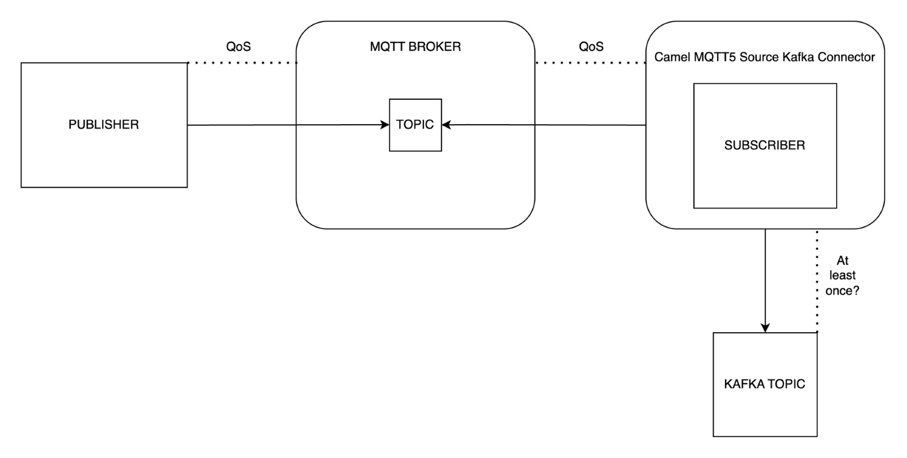
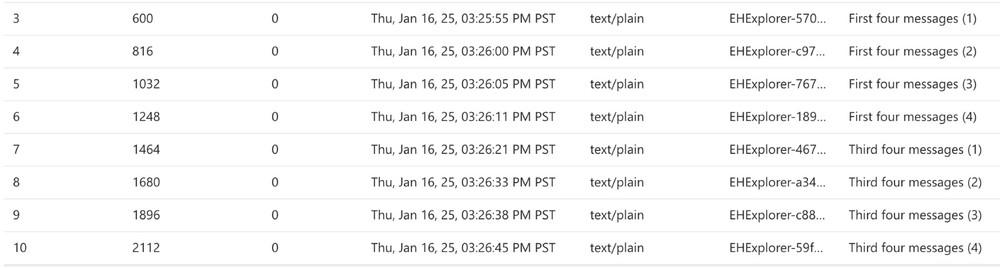
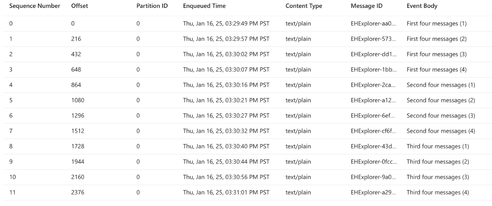

### TLDR

"At least once" delivery ensures messages are reliably delivered to their target system, even in the face of disruptions. This is critical for fault tolerance and data integrity in high-availability systems.

### The challenges

1. Session Persistence: Connections between clients and brokers must survive drops to avoid message loss.
2. Delivery to Kafka: Messages must reliably reach Kafka topics, even if connections break.

### The solutions

1. Persist Sessions: Use `MQTT5’s cleanStart` and `sessionExpiryInterval` to ensure sessions remain active during disconnects.
2. Manual ACKs: Enable manual acknowledgments in Paho `MQTT5` to confirm messages are fully processed before marking them as delivered.

### What is “at least once” delivery and why is it important?

At least once delivery is a messaging guarantee that does exactly what it says: ensures messages are delivered at least once to the target system. This is obviously important to ensure no data is lost when transferring messages from one system to another.

Let’s say we have two systems called Source and Destination. These two systems may agree beforehand that messages must be delivered exactly once, at least once, or with no guarantee. If Destination wants the messages “at least once”, it will send an ACK to Source every time it receives a message. This is feedback for Source to let it know the message has arrived to Destination successfully. If Source does not receive an ACK, it will retransmit the message until it’s received successfully.

Delivery guarantee is important for systems that require fault tolerance, data integrity, and high availability.

### So, isn’t this as easy as just setting the QoS param to 1?

In MQTT, a client can set the Quality of Service (QoS) level, to 2 (exactly once), 1 (at least once), or 0 (no guarantee). So, we should be able to set the QoS to level 1 and call it a day, right? Well, that would be the case if you could guarantee the connection from the subscriber to the MQTT broker or from the subscriber to the Kafka cluster. However, we want the delivery to be guaranteed to the subscriber, even when the connection is lost and re-established. In addition, we require the messages are guaranteed to be delivered at least once to the Kafka topic from the connector. The simplified diagram below illustrates all the components involved:



Essentially, we have two problems we need to solve:

1. Persist sessions when the connection between a client and the broker is lost.
2. Ensure at least QoS 1 for messages being delivered to a Kafka topic when connection between Kafka and the connector is lost.

### So, how do we fix it?

#### Persist sessions when the connection between a client and the broker is lost.

An apt MQTT user would immediately think about the `cleanStart` MQTT5 property (in MQTT3, this option is called `cleanSession`). The `cleanStart` property sets whether or not the connection should be forgotten when the client disconnects from the broker. When setting this property to false, the client session will persist across disconnects. In MQTT5 this property needs to be used in tandem with `sessionExpiryInterval`.

*NOTE: According to Paho’s documentation, this property will be populated to -1 by default, which should indicate the session does not expire. However, in my tests, the property required a positive value for it to take effect. *

### Ensure at least QoS 1 for messages being delivered to a Kafka topic

The Paho MQTT5 component sets the QoS level of the connector to level 2 by default. This ensures messages are received exactly once by the connector. However, if messages are received by the connector, but the connection between the connector and broker is lost, then the broker assumes the messages were delivered successfully. So, how do we ensure the broker waits for messages to be flushed to the Kafka topic before prematurely celebrating?

The solution is to enable manual acknowledgements in the Paho MQTT5 consumer.

```java
if (getEndpoint().getConfiguration().isManualAcksEnabled()) { 
    client.setManualAcks(true); 
} 
```

By default, acknowledgements are sent automatically on the successful completion of the `messageArrived `callback method. After setting `manualAcks` to true, the client (connector) must send the acknowledgements manually when the messages are successfully processed to Kafka, using the `messageArrivedComplete` method:

```java
if (getEndpoint().getConfiguration().isManualAcksEnabled()) { 
    exchange.getExchangeExtension().addOnCompletion(new Synchronization() { 
        @Override 
        public void onComplete(Exchange exchange) { 
            try { 
                    PahoMqtt5Consumer.this.client.messageArrivedComplete(mqttMessage.getId(), mqttMessage.getQos()); 
            } catch (MqttException e) { 
                LOG.warn("Failed to commit message with ID {} due to MqttException.", mqttMessage.getId()); 
            } 
} 
        @Override 
        public void onFailure(Exchange exchange) { 
            LOG.error("Rollback due to error processing Exchange ID: {}", exchange.getExchangeId(), exchange.getException()); 
       } 
    }); 
} 
```

To see the full solution, please see my PR in the Apache Camel repo [CAMEL-21589: Enable manual acks mqtt5.](https://github.com/apache/camel/pull/16702)

### How to prove our solution works?

The test we’re going to conduct involves setting up Kafka Connect in a Docker image. I’ll be using an Azure Event Hubs Namespace as my Kafka cluster and Mosquitto as my MQTT5 broker (and publisher). The scenario that we’re attempting to mimic is one where the connection from our source connector to our Mosquitto broker is temporarily lost, while messages are still being published.

In the test below, we reproduce the issue where messages that are sent while the connection is unstable are not guaranteed to be delivered to the Kafka topic (or in this case, the Azure Event Hub).

1. Publish “First four” messages while all connections are stable.
2. Update the connector to have a faulty connection to Azure Event Hubs
3. Publish “Second four” messages.
4. Update the connector to have a stable connection to Azure Event Hubs.
5. Publish “Third four” messages.

As expected, the messages sent to the connector while its connection with Azure Event Hubs is lost are not successfully delivered.



We want to run this same test after we implement our proposed solution to ensure we’ve actually fixed the problem. When creating our updated connector, we set the following properties:

1. `cleanStart`: false
2. `sessionExpiryInterval`: > 0
3. `manualAcksEnabled`: true

As expected, the messages sent while the connection was interrupted are still delivered even though the connection with both Azure and Mosquitto was temporarily lost.



### Conclusion

So, what did I learn from all this? Essentially, at least once, delivery is not always as simple as it sounds, even when there are only a few machines involved. Issues like dropped connections and mistimed acknowledgements can make message delivery guarantee complex. With MQTT5’s `cleanStart` and `sessionExpiryInterval `sessions stick around through disconnects. Additionally, there could be issues with the connector that must be fixed in the connector repo. Sometimes you’ll need to go directly to the (open) source and convince the community to throw it in their backlog. However, if the issue isn’t urgent, it usually won’t get fixed within your timeline. That’s why at Improving, we take the initiative to implement the solution ourselves, so the community has access to a fix as soon as possible.

[Reach out to us!](https://www.improving.com/contact)
