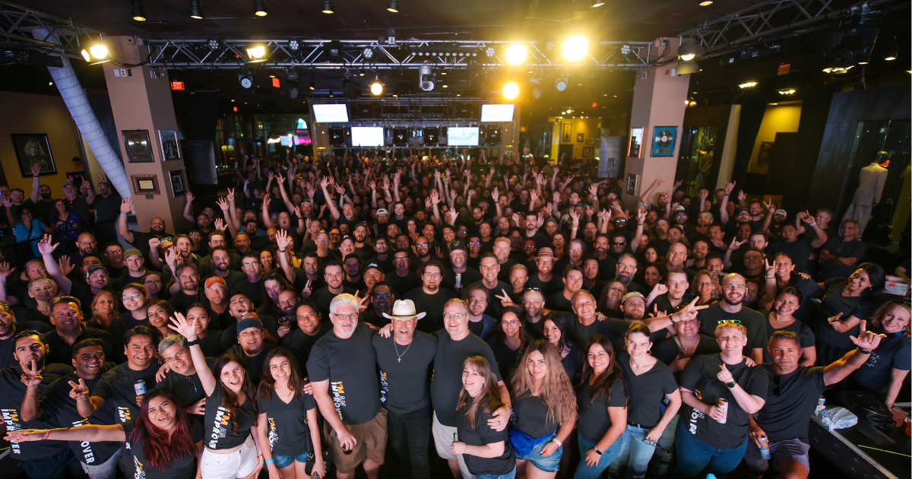

In today's interconnected world, effective collaboration is the cornerstone of success for any organization. At Improving, we not only help other organizations understand how to collaborate across global teams, but we also practice what we preach. With 19 offices worldwide, we’ve developed and implemented several initiatives to bring our people together and foster a culture of collaboration and innovation.

## **The Come Together Initiative**

At the core of our collaborative culture is the Come Together initiative—our intentional effort to bridge the distance between our 19 global offices and foster a deep sense of connection across the company. More than just a program, Come Together is a mindset that prioritizes belonging, inclusivity, and shared purpose.

Through thoughtfully designed virtual gatherings, cross-office projects, and team-building activities, we create opportunities for Improvers to connect, collaborate, and build relationships, regardless of time zones or geography. In 2023 alone, the initiative saw meaningful engagement, with 1,356 Improvers participating at least once—a clear reflection of its impact and reach.

Come Together has been instrumental in breaking down silos, strengthening interoffice communication, and nurturing a company-wide sense of community that drives both personal and professional growth. When employees feel connected, they care about what they do and who they work with. This gives a collaborative edge, driving innovation and growth throughout the company.

## **PATH**

The **PATH** program is another key component of our collaboration strategy. PATH stands for *Professional Advancement Through Helping*, and it embodies our commitment to mutual growth and support. This program encourages Improvers to mentor, be mentored, and learn from each other.

It’s a no-brainer why this effort works to benefit our company. Employees stay on track and grow professionally, ultimately providing better employees who feel valued and nurtured. By leveraging the diverse expertise throughout the organization, we can tackle complex challenges and drive positive outcomes.

## **ImprovingU **

Education is a powerful enabler of collaboration, and that’s exactly the purpose of our ImprovingU program. Through a wide range of virtual training sessions, workshops, and courses, Improvers can develop not only essential technical, but soft skills.

What makes ImprovingU especially impactful is how it harnesses the collaborative power of our 19 global offices. Learning isn’t limited to job roles or tech stacks—it’s enriched by the unique perspectives, cultural backgrounds, and individual passions of Improvers from around the world. By connecting across borders, we gain not only technical and cultural insights but also exposure to the unique strengths, talents, and even hobbies that make each Improver unique.

## **Annual Retreat in Las Vegas**

One of the most anticipated events of the year is our annual retreat in Las Vegas. This retreat is more than just a getaway; it's an opportunity for Improvers to meet, connect, and grow their relationships while having fun. The vibrant atmosphere of Las Vegas provides the perfect backdrop for team-building activities, workshops, and social events that foster a sense of camaraderie and unity. Whether it's through collaborative projects, casual conversations, or shared experiences, the retreat helps strengthen bonds and create lasting memories. By bringing together Improvers from different offices and backgrounds, we ensure that everyone feels included and valued, driving both personal and professional growth.

## **Building Bonds Globally**

By fostering a culture of unity, growth, and continuous improvement, we not only help our organization achieve its collaboration goals but also set a standard for what effective collaboration looks like in the modern world. While these collaborative efforts build a solid culture, they also build bonds that will help your organization thrive in more tangible ways. When employees care about each other, it leads to better outcomes within teams and drives results.

Would you like to learn more about any of these initiatives or how we can help your organization improve its collaboration efforts? [Feel free to reach out to us! ](https://improving.com/contact)
