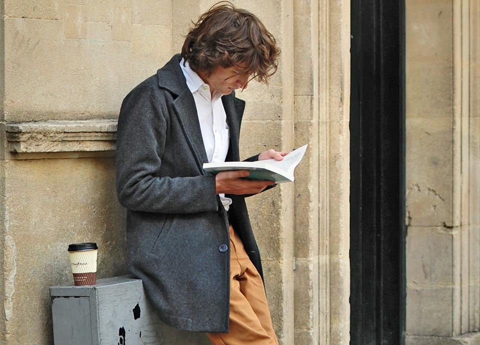

One of Improving's core Pillars is Excellence. We define excellence as a consistent habit, not an occasional act. Practically, that means we do not call it excellence to deliver at a high rate in the short-term and then fall off when the pressure isn't there anymore. Instead, we want to continually ratchet up our delivery at a sustainable pace over time.

Truly, this is harder to achieve, but the results speak for themselves. Any large machine needs maintenance to keep producing excellently. Only, the 'machine' that needs tuning and maintenance isn't some car or mammoth excavator. It’s you!

When the pandemic shifted the nature of our work, most of us lost the normal boundaries around our time. A so-called work-life balance was thrown out of whack. With a five-minute commute to your desk, it can become hard to mentally separate from work. Moreover, that fear and stress probably led many of us to overwork and try to keep things going during hard times.

But if we clench and push and sprint, then never take a moment to breathe or to slacken our pace, what do we get? The popular phrase for it lately is burnout. And, it has come in droves. When so much of our value in society is attached to what we do, our labor can consume all that we are.

If we were training for a marathon, we wouldn't be pushing for speed. We'd be aiming for distance. We'd cultivate the ability to listen to our muscles, to adjust the pace so we can win the race. Critically, you don't win the race by stopping. You win a marathon by making it to the end, at an uncommon pace!

You cannot afford to burn out early in the race because you bolted off the start line. Neither can you just stop and take a nap, like the proverbial hare. Instead, our answer lies somewhere in the middle, in some action we can take which builds back our reserve to keep going.

One of the common misconceptions of rest is that it’s defined societally as the lack of action. Many believe we can only rest if we get to a point where we drop everything or wait for life to stand still. And frankly, this basically never happens.

Adult life always has some kind of commitment we need to attend to. Out of this kind of misconception, we can fall into the idea that sitting around binging on Netflix is rest because it involves doing nothing.

While intentionally watching a show you've been eager to see might count as rest, mindlessly zoning out is not. *The key to real rest is the restoration of your reserves. *It’s that feeling of life returning back to you.

Rest does not naturally happen on its own as sleep does. Instead, some intentional selections and protections are necessary to build the space for rest. Natural questions at this point might be: How do I do that? How do you protect time for yourself? How do you find and cultivate the activities which rebuild your reserves? I would propose we start simply.

### Do You Have Permission to Rest?

One of the critical components for rest is the permission for ourselves to accept it. Our culture is often deeply focused on work. A lot of our identity gets wrapped up in what we do. To find and accept real restoration, we will need permission from ourselves to take it. We can think of rest as an investment or maintenance paid to keep our performance high.

With that concept in place, finding actions that are restorative becomes an exercise in introspection. We often call those repeated restorative actions hobbies. But it's not just that. We are human. Our needs range beyond achievement and autonomy.

We desire connection, purpose, and appreciation. So, in addition to habits that we can practice alone, we should also look to cultivate friendships and other close relationships. Cultivating meaningful connections takes time, just like practicing a hobby.

Touching on time, we can begin to answer the “How do I do that” question. The shortest answer is to get good at honoring appointments with yourself. If you know what actions might be restorative, book some time on your calendar this Saturday or even one of the evenings this week to do it!

Then when the time comes, don't make excuses or allow other lesser matters to take its place. You might be tired but try to do it anyway. You might not succeed the first time or two. But keep trying. Keep that commitment to yourself. You may find by pushing through, your strength begins to return despite initial trepidations.

Take some time each week, as you look ahead at what you must do and book some time with yourself to take restorative action. Plan it. Review it. Improve it. Self-care is a necessary investment for producing your highest service!

A craftsman knows when and how to care for his tools. He does this regularly because maintaining his tools allows him to maintain his ability to service with quality and distinction. We have no reason to treat ourselves, our minds, as any less than our tools. We only have one set of hands, one mind to use. We must care for them as such.

That doesn't mean we need to cultivate vast blocks of do-nothing time though. Instead, we must be intentional in choosing actions that restore us. These restorative actions will be different for each of us, but vital for all.

So, as you take on this week, take some time to think about which actions you can intentionally plan that will restore you and will enable you to continue delivering with excellence! To learn more about Improving and our culture, [click here](https://improving.com/company/about).
