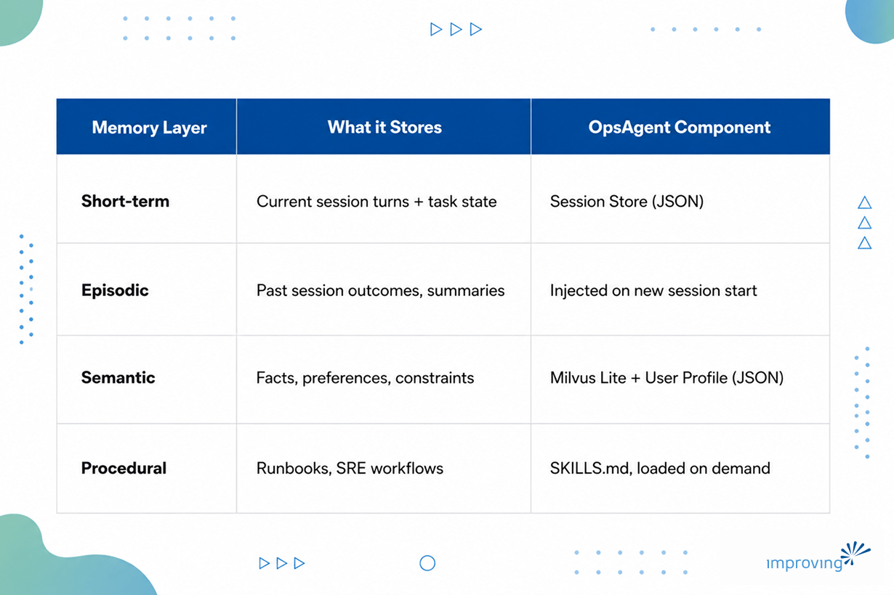
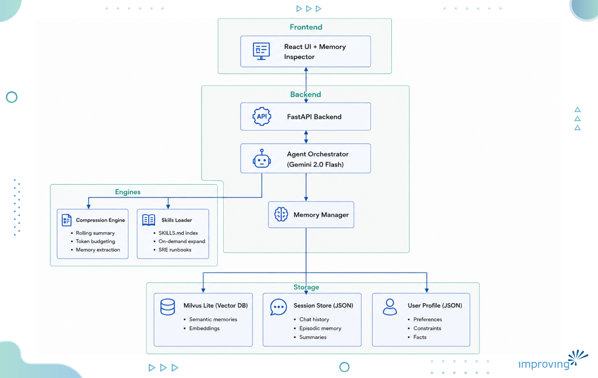
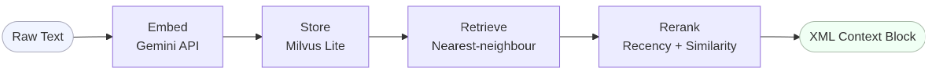
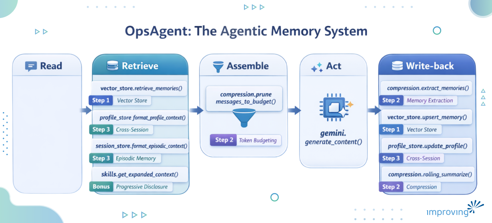
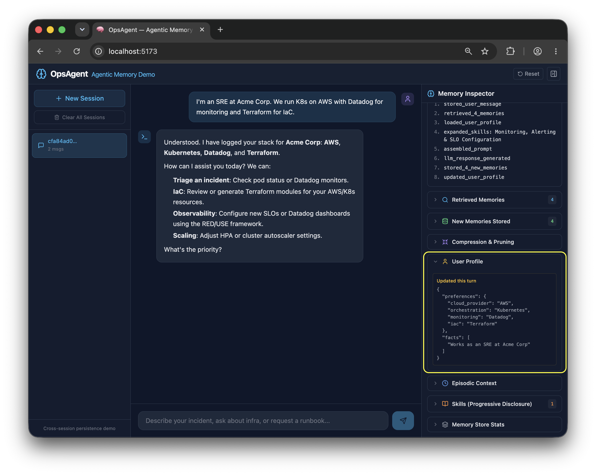
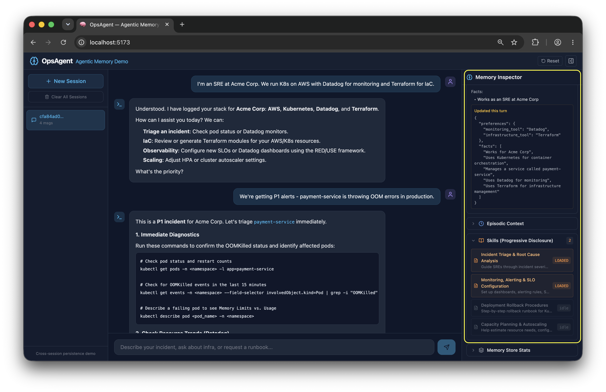
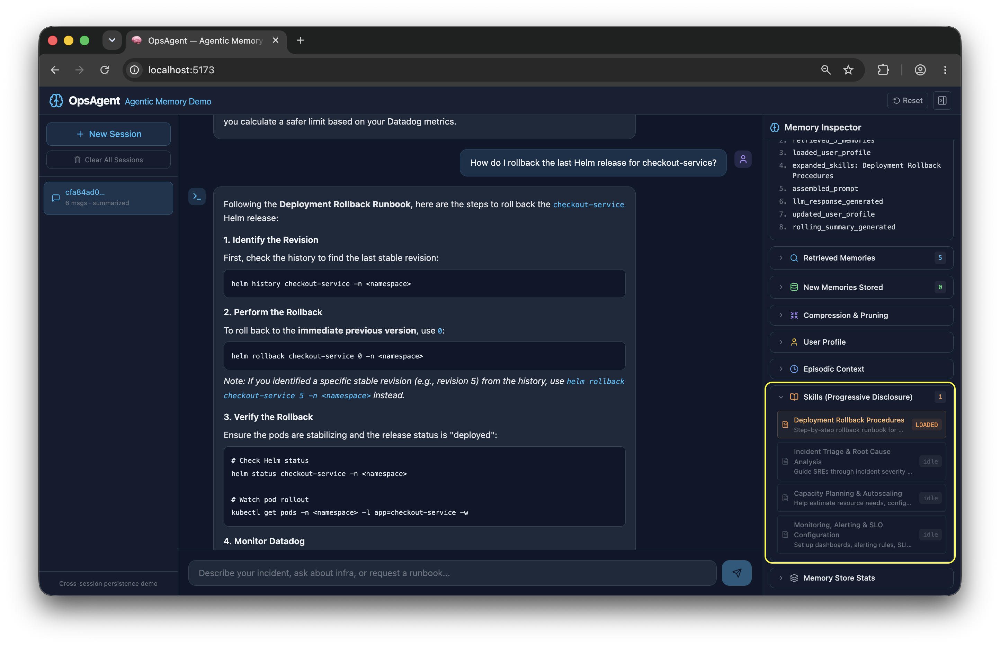
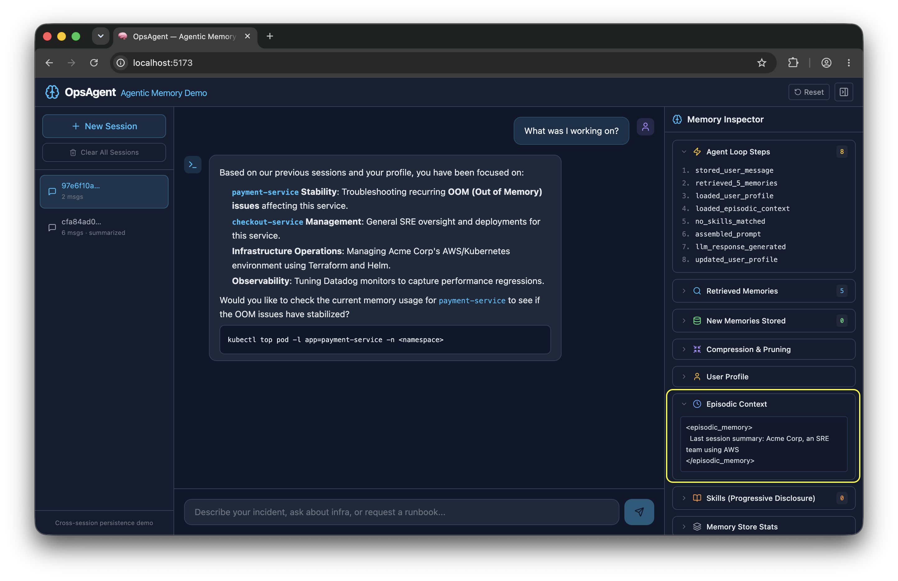
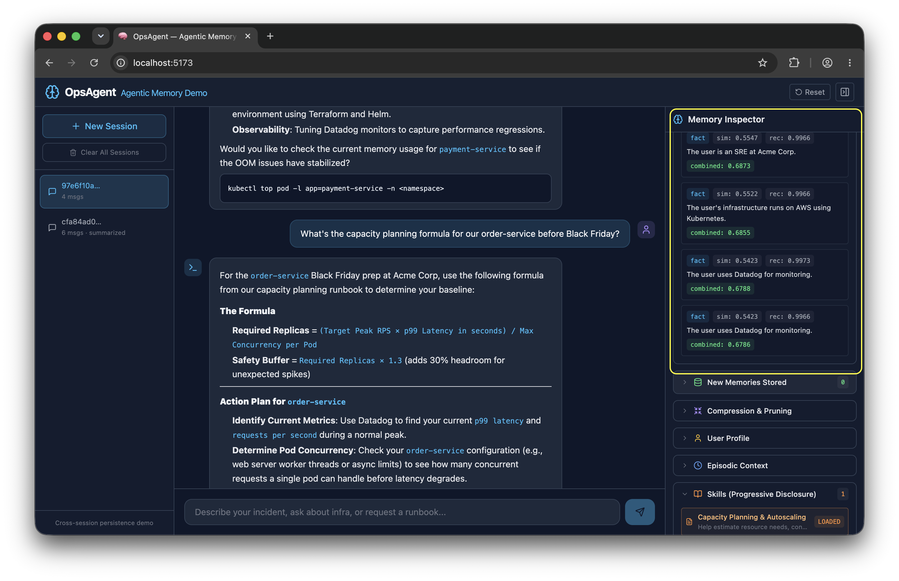
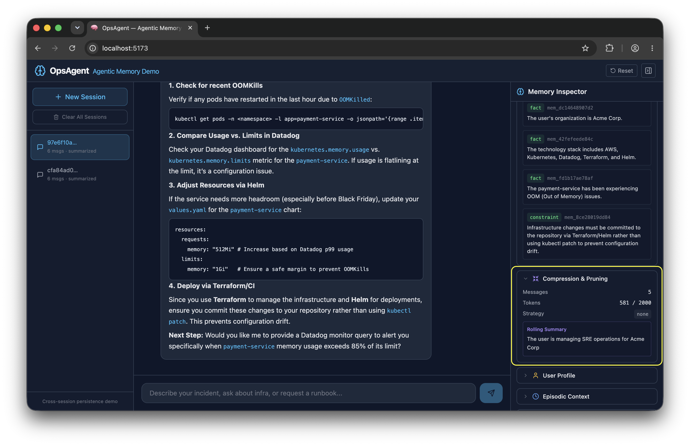

One of the biggest frustrations with the available AI/LLM Models is having to repeat the same instructions every time you start a new conversation. Instead, you can save your preferences, such as choosing Argo CD over Flux CD, so the AI remembers your decisions and applies them automatically in future discussions. Eliminating the need to rebuild context from scratch makes conversations more efficient and allows AI agents to become useful immediately instead of spending time relearning your preferences.

This is exactly what I discussed in the first part of the blog series [*Agent Memory Systems: Building Long-Term Context for AI*](https://www.improving.com/thoughts/building-agent-memory-systems/). Here's the quick recap with reference to what is going to map to the actual system we'll build in this blog post:

*The agent loop (Read -> Retrieve -> Assemble -> Act -> Write-back) runs through all of it. *

I recommend reading the previous post if you haven't read it, previous post helps you understand all these memory layers and why we need them. Let’s now build something to understand how all these components of a memory system of AI integrate and work.

## Laying the Groundwork to build an Agentic Memory System

Our focus for this post will be on building an **OpsAgent**, an AI SRE assistant for triaging incidents, rolling back deployments, and capacity planning. OpsAgent will employ all the components that we discussed in the previous blog post: the vector store, context pruning, cross-session persistence, and just-in-time skill loading.



On a high level, this is how the flow will be, when the user asks OpsAgent to triage an incident. OpsAgent will:

- Pull the user's stored profile (their stack, past preferences, known constraints)
- Search the vector store for semantically relevant memories from past sessions, and load only the runbooks that match the query
- Assembles all of that into a token-budgeted prompt, generates a response, and then writes back: extracting new facts into the vector store, updating the user's profile, and rolling the conversation into a summary.

The next time that user opens a session, the agent already knows their infrastructure, their past incidents, and where they left off.

You can [clone the OpsAgent GitHub repository](https://github.com/improving/agentic-memory) and have the OpsAgent running in a few minutes by following the README file. By the end of this walkthrough, you'll know exactly what each piece is doing and why.

### Architecture of OpsAgent

This OpsAgent role is to [help platform engineers](https://mcas-proxyweb.mcas.ms/certificate-checker?login=false&originalUrl=https%3A%2F%2Fwww.improving.com.mcas.ms%2Fexpertise%2Fplatform-engineering%2F%3FMcasTsid%3D15600&McasCSRF=578e34c876e0f547fcc587305c4f692d7c6a2ddc5f9f48aaf780002140a9c2f1) triage incidents, roll back deployments, and plan capacity. Here's how the pieces from the first blog (vector store, agent memory, cross-session persistence, progressive disclosure) look when assembled into a real system.

Here's the architecture:



### Prerequisites

You'll need:

- Python 3.11+, Node.js 18+
- [Gemini API key](https://aistudio.google.com/apikey) (the free tier works fine)
- Vector store: We're using Milvus Lite, which is simple & requires zero infrastructure, but for production you can use full Milvus by hosting it on a separate server.

In this OpsAgent demo, we implement each layer from scratch, so you can see exactly what's happening. In production, you'd likely use libraries like:

- LangChain (conversation memory, pruning),
- mem0 (managed memory layer), or
- LangGraph (stateful agent workflows): They implement these same patterns to provide you with much better controls than building from scratch.

## Steps to Build an Agentic Memory System

### Step 1: Vector Store Integration

Semantic memory is the agent's ability to recall facts, decisions, and corrections across an unbounded timeline. To make an agent remember, we need to implement a memory pipeline like the one below:



#### *Embed & Store*

We're using [Milvus Lite](https://milvus.io/docs/milvus_lite.md) for the vector DB and Gemini's embedding API (gemini-embedding-001, 3072 dims). The collection uses auto-schema, so we can attach any metadata such as user, session, type, timestamp etc. without defining a rigid schema upfront:

```python
# memory/vector_store.py 
self.client = MilvusClient(db_path)            # single-file embedded DB 

self.client.create_collection( 
    collection_name="agent_memories", 
    dimension=3072,                            # gemini-embedding-001 
) 
```

After every conversation turn, the compression engine (Step 2) extracts memorable facts. Each one gets embedded via the Gemini API and stored as a row with metadata:

```pug
# memory/vector_store.py - upsert_memory() 
vector = self.embed_fn(text)                   # embed via Gemini 
row = { 
    "vector": vector, 
    "text": text, 
    "user_id": user_id, 
    "memory_type": memory_type,                # "fact", "preference", "decision", ... 
    "timestamp": time.time(), 
} 
self.client.insert(collection_name=COLLECTION, data=[row]) 
```

#### *Retrieve & Rerank*

A plain nearest neighbor search isn't enough on its own. Vector similarity tells you *what* is topically relevant, but it says nothing about *when* it happened. In a long-running agent, the vector store accumulates memories across many sessions. Older memories that are semantically close to the query can easily outrank newer, more actionable ones.

This is the recency bias problem. In SRE especially, the incident from 2 hours ago almost always matters more than a similar one from last month, even if both are equally "similar" in embedding space. A rollback that worked for payment-service yesterday is far more useful than one from six months ago when the stack was different.

The fix is to over-fetch candidates from the vector DB, then rerank them by blending cosine similarity with an exponential time-decay score, so fresher memories get a boost:

```python
# memory/vector_store.py - retrieve_memories() 
results = self.client.search( 
    data=[query_vec], 
    limit=top_k * 2,                           # over-fetch for reranking 
    filter=f'user_id == "{user_id}"', 
) 
 
for hit in results[0]: 
    age_hours = (now - hit["entity"]["timestamp"]) / 3600 
    recency_score = 2 ** (-age_hours / 48)     # halves every 48h 
    combined = (1 - recency_weight) * similarity + recency_weight * recency_score 
```

#### *Format*

The top results are then packed into a structured XML block the LLM can parse easily:

```markup
<retrieved_memories> 
  [1] (type=fact, relevance=0.87) 
      User runs K8s on AWS EKS with Datadog for monitoring 
  [2] (type=decision, relevance=0.72) 
      Team decided to use Helm 3 for all deployments 
</retrieved_memories> 
```

That's the full vector store pipeline (from raw text to ranked, formatted context ready for the prompt).

### Step 2: Context Pruning and Compression

Every LLM has a [fixed context window](https://www.improving.com/thoughts/vibes-arent-a-strategy-engineering-context-in-the-age-of-ai/). The naive approach is to keep appending everything into it: the full conversation history, all retrieved memories, every loaded runbook. This is context stuffing, and it has a predictable failure mode. As the window fills up, the model's ability to attend to what actually matters degrades - older turns get ignored, critical constraints get buried, and you start paying for tokens that aren't helping. In a long-running SRE session, this happens faster than you'd expect.

A bigger context window would not be helpful here. You must be deliberate about what goes in. Three mechanisms work together here: **rolling summaries**, **token-budget pruning**, and **structured memory extraction**.

Every 6 messages, the engine compresses the conversation into a concise paragraph. The key detail is it's rolling. Each new summary builds on the previous one, so we never lose earlier context:

```python
# memory/compression.py 
SUMMARY_TRIGGER_MESSAGES = 6 
def rolling_summarize(self, messages, existing_summary=None): 
    prompt = SUMMARIZE_PROMPT.format( 
        conversation="\n".join(f"{m['role']}: {m['content']}" for m in messages), 
        existing_summary=existing_summary or "(none)", 
    ) 
    return self._generate(prompt) 
```

This produces summaries like:

```markup
<conversation_summary> 
  SRE at Acme Corp triaging a P1 OOM in payment-service. 
  Identified memory leak in connection pool. Decided to rollback to v2.3.1. 
  Next step: set up memory alerts in Datadog. 
</conversation_summary> 
```

When history exceeds our token budget, we keep the summary plus the most recent messages that fit, following the sliding window + summary pattern:

```python
# memory/compression.py 
MAX_CONTEXT_TOKENS = 2000 
for m in reversed(messages): 
    if used + self.count_tokens(m["content"]) > budget: 
        break 
    kept.insert(0, m) 
```

The important part here is memory extraction where short-term conversation becomes long-term memory. After each turn, we ask Gemini (using JSON response mode for guaranteed valid output) to extract anything worth remembering, i.e. what should become memory? Question (preferences, constraints, decisions, corrections). Decision making can be customized and can become more granular and specific depending on the use case.

```python
# memory/compression.py 
def extract_memories(self, user_message, assistant_response): 
    raw = self._generate_json(prompt)          # response_mime_type="application/json" 
    return json.loads(raw) 
    # → [{"text": "User runs K8s on EKS", "type": "fact"}, 
    #    {"text": "Team uses Datadog", "type": "preference"}] 
```

Each extracted memory feeds right back into the vector store from Step-1, closing the read → write-back loop.

### Step 3: Cross-Session Persistence

When you open a new session, the agent has memory of previous conversations and saved user profile. This is what makes the agent feel like it actually knows you. Generally, there are two scopes; user-level memory (facts that persist forever) and thread-level memory (session history). We've implemented both here.

The profile store stable facts from every conversation such as your name, your stack, and your constraints. Facts are accumulated over time and are not deduplicated.

Sometime language could be different, or sentences can be formed in different ways, but a fact will be a fact, always true. For example, Gemini might extract *runs K8s on EKS* in one turn and *runs Kubernetes on EKS* in another, so we might end up with both. To handle this, we do fuzzy substring matching to keep things clean:

```python
# memory/user_profile.py - _dedup_list() 
if norm_new in norm_old: 
    is_dup = True; break                       # new is subset → keep existing 
if norm_old in norm_new: 
    result[i] = new; is_dup = True; break      # new is more detailed → replace
```

The profile is injected at the top of every prompt:

```markup
<user_profile> 
  Name: Rahul 
  Preferences: 
    - monitoring: Datadog 
    - iac: Terraform 
  Known facts: 
    - SRE at Acme Corp 
    - Runs Kubernetes on AWS EKS 
</user_profile>
```

Then there's a cold-start problem. When you open a new session, the LLM has zero history. So, we have implemented Silent Summarization technique which grabs the rolling summary from the most recent previous session and injects it:

```python
# memory/session_store.py 
def get_previous_session_summary(self, user_id, current_session_id): 
    for s in reversed(self.list_sessions(user_id)): 
        if s["session_id"] != current_session_id: 
            prev = self.get_session(user_id, s["session_id"]) 
            if prev and prev.get("summary"): 
                return prev["summary"] 
    return None 
```

Now, when you open a new session and ask What was I working on? The agent doesn't give you a blank stare. It has something to say.

```markup
<episodic_memory> 
  Last session summary: Triaged P1 OOM in payment-service. 
  Rolled back to v2.3.1. Next step: set up Datadog memory alerts. 
</episodic_memory>
```

### Progressive Disclosure

Instead of loading every runbook into the prompt, the agent keeps a lightweight index and expands only what's relevant. This is the SKILLS.md pattern we discussed earlier in the sections, just-in-time context retrieval.

The [Agent Skills](https://www.improving.com/campaign/ai-deep-learning-program/) format was originally developed by Anthropic, released as an [open standard](https://agentskills.io/home), and has been adopted by a growing number of agent products. We will be using this format to load skills into the prompt.

The index is always loaded to ensure we don't load all the skills into the prompt. Each skill has a one-line summary and keywords:

```python
## incident_triage - Incident Triage & Root Cause Analysis 
Summary: Guide SREs through severity classification, diagnostics, and RCA. 
Keywords: incident, outage, alert, p1, triage, root cause 
 
## rollback - Deployment Rollback Procedures 
Summary: Step-by-step rollback for K8s deployments, Helm releases, feature flags. 
Keywords: rollback, deploy, revert, helm, release, canary 
```

On each query, only matched skills get expanded. Everything else stays as a one-liner:

```python
# memory/skills.py - get_expanded_context() 
matched = self.match_skills(query)             # keyword match against index 
for skill in matched[:3]:                      # cap at 3 
    content = self.expand_skill(skill.id)      # load full .md file on-demand
```

When I asked about, "We can't scale horizontally right now because of a database connection pool limit of 100 connections. That's a hard constraint." It loaded Incident Triage and Capacity planning and monitoring configurations skills.

When you ask about a rollback -> only rollback.md loads and when you ask about monitoring -> only monitoring_setup.md. That's the difference between context stuffing and context management.

### Agent Loop

Each of the three steps and the bonus we just walked through don't run in isolation. They're all called inside a single request handler in agent.py that fires on every chat message. This is the agent loop: the sequence of operations the agent runs every time a user sends a message.

Here's how each component maps to a stage in that loop:



Every time a user sends a message, the agent reads it, pulls in everything relevant from memory, assembles a token-budgeted prompt, calls Gemini, and then writes back - storing new facts, updating the profile, and rolling the conversation into a summary.

The result: the agent remembers your stack, your preferences, and your past incidents, and gets sharper with every conversation. Not because it has a bigger context window, but because it has a memory system.

## Seeing It in Action

Now that you know what's running under the hood, here's how to exercise every memory feature from the UI. Send these prompts in order and watch the Memory Inspector panel on the right respond to each one.

1. **Profile creation**: Send the prompt -> *"I'm an SRE at Acme Corp. We run K8s on AWS with Datadog for monitoring and Terraform for IaC."* The **User Profile** panel populates with preferences and facts. The compression engine extracts these from your message and writes them into the profile store - they'll persist across every future session.
   
2. **Incident triage** (skills loading): Now, send the prompt -> *"We're getting P1 alerts - payment-service is throwing OOM errors in production."* The **Skills** panel loads the incident_triage runbook. The skills loader matched keywords like p1, alert, and oom against the index and expanded only that file. Check **Retrieved Memories** - your infra context from the previous message should already be surfacing.
   
3. **Rollback help**: *"How do I rollback the last Helm release for checkout-service?"*
   The rollback skill expands in the **Skills** panel while incident_triage stays collapsed. This is progressive disclosure working: only what's relevant to this query gets loaded.
   
4. **Start a new session** (cross-session persistence): Click **New Session**, then send: *"What was I working on?"*
   The **Episodic Context** panel injects the previous session's rolling summary. The agent has no conversation history here - it's purely the cold-start injection from session_store.get_previous_session_summary() that gives it something to say.
   
   It injected the episodic memory which you can also see in the right sidebar.
5. **Capacity planning**: *"What's the capacity planning formula for our order-service before Black Friday?" *
   The capacity_planning skill will load. Your K8s/AWS stack from session one should appear in **Retrieved Memories** - pulled across the session boundary from the vector store.
   
6. **Long conversation** (compression): Keep chatting. After 6+ messages, the **Compression** panel will show a rolling summary being generated. The pruning stats will show how many messages were dropped and which strategy (keep_recent_with_summary) was used once history exceeds the token budget.
   

## Wrapping Up

You can find the complete working demo on GitHub, clone it, modify it, and extend it. What we built here is a reference implementation of everything from [Part 1: semantic memory](https://www.improving.com/thoughts/building-agent-memory-systems/) over a vector store, context pruning with rolling summaries, cross-session persistence via user profiles and episodic injection, and progressive skill disclosure. Each piece is replaceable. Swap Milvus Lite for Pinecone, swap Gemini for any embedding API, swap the JSON profile store for a proper database. The patterns stay the same.

We regularly explore various AI systems through webinars and hands-on work with teams building intelligent applications. If you're looking to add memory, reasoning, or agentic capabilities to your AI workflows, our [AI cloud experts](https://www.infracloud.io/build-ai-cloud/) can help you get there. Do share your thoughts on this article and any interesting agent memory use cases you've encountered with me on [LinkedIn](https://www.linkedin.com/in/sudhanshu212).
