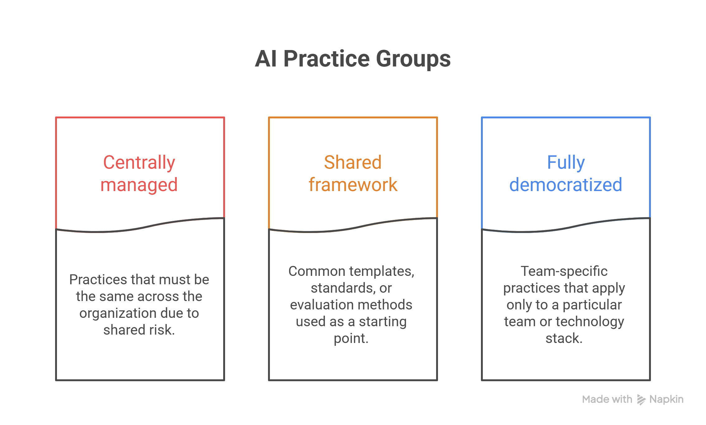

Every AI Center of Excellence (AI CoE) I've been asked to help stand up starts with the same questions:

- Who should sit on it?
- Which director owns it?
- Whether it reports through IT or the business?
- How many people it needs?

Those are real questions but they aren't the right ones. They're downstream of one nobody asks first:

- Which parts of your AI practice have to be uniform across the whole organization?
- Which parts should be a strong default teams can deviate from?
- Which parts should each team just decide for itself?

A center of excellence with the wrong governance split becomes either a bottleneck that reviews everything and ships nothing, or a name plate on a policy nobody follows. I've watched both failure modes happen inside organizations with genuinely talented people running the effort.

Underneath a lot of these failures sits the same people problem I've written about in AI change management. An AI CoE can have the org chart right and still stall if nobody worked the trust and identity questions first.

## **Understanding an AI Center of Excellence**

An AI Center of Excellence is the internal team that decides how AI gets built and governed across an organization, rather than letting every team invent its own rules. It sets the boundary between what must be centrally controlled, what should be a shared default, and what stays local to each team.

A global industrial automation and technology company had developed an AI Center of Excellence in one of its regional hubs to handle generative workflows like document generation and RFP response. We found that the team had built the whole thing from scratch on a custom architecture, with no distinction between what needed central governance and what could have started from a shared template. Nine or ten months in, the CoE was still stuck on that single workflow.

The reason was a real skills gap in cloud AI services combined with a habit of reinventing infrastructure that already existed as a platform service elsewhere in the company. They needed an honest skills and architecture assessment, followed by a deliberate move toward the knowledge-graph and semantic-chaining patterns the team had been rebuilding badly from scratch, echoing the pattern we cover in GraphRAG systems.

## **Why an AI Center of Excellence Matters**

Without a center of excellence, there are two things that can happen:

- Fragmented AI practice, where five teams build five versions of the same compliance check.
- Governance binder nobody reads because it was never enforced anywhere.

Both cost more than standing up the CoE properly in the first place. [Why AI pilots fail to scale](https://www.improving.com/thoughts/why-ai-pilots-fail-to-scale/) usually traces back to exactly this: no one decided, in writing, what had to be uniform before the first pilot team touched a workflow.

### Advantages to develop an AI CoE:

1. **Make better use of AI investments:** A central team can review AI initiatives, identify overlapping projects, and help leaders focus resources on use cases that offer meaningful business value.
2. **Build AI capabilities across the organization:** An AI CoE can create training programs, share practical guidance, and connect teams working on similar challenges. This helps employees in technology and business functions develop the skills to work effectively with AI.
3. **Reduce duplication and control costs:** Teams do not need to build everything from scratch. Shared platforms, reusable components, common tools, and negotiated vendor agreements can reduce unnecessary spending and effort.
4. **Move from experiments to production faster:** Common architectures, templates, workflows, and implementation patterns give teams a starting point for new projects. This can shorten the path from an initial idea to a production-ready solution.
5. **Improve AI quality:** A CoE can establish common standards for testing and evaluating AI systems. Teams can use shared test cases, monitoring, and red-team exercises to identify weaknesses and improve reliability before systems reach users.
6. **Create consistent security and governance:** AI projects can follow organization-wide requirements for data privacy, security, compliance, and responsible AI. This creates a more consistent approach to managing risk across different teams and use cases.
7. **Enable safer AI agents:** As AI agents gain the ability to access systems and take actions, organizations need stronger controls around identity and permissions. An AI CoE can help ensure agents use appropriate access controls, authentication, logging, and audit processes.
8. **Share lessons across AI initiatives:** What one team learns from an AI project can benefit others. A central CoE can capture successful approaches, common challenges, and lessons learned so teams can build on existing knowledge instead of repeating the same mistakes.

## Divide AI Practices Into Groups

The most important design decision for an AI Center of Excellence is how to divide AI practices into three groups: what must be centrally controlled, what should be a shared starting point, and what should be left to individual teams.

**Always true, centrally managed:** These are AI practices that must be the same across the organization because the risk is shared. For example, a compliance agent that checks code touching payment data for PCI exposure should not be customized separately by each team. If three teams build three different versions of that check, one version may miss a critical risk.

**Shared definition framework:** These are common templates, standards, or evaluation methods that teams should use as a starting point. Examples include a product-definition framework, acceptance-criteria templates, or a rubric for grading AI-agent output. Teams can adjust them, but they should have a clear reason for doing so.

**Only true for one team, fully democratized:** These are team-specific practices that should stay local because they only apply to a particular team or technology stack. For example, a Java team’s coding-standard agent should not be required for a team running SAP.

A center of excellence’s first job is to sort the organization’s AI practices into these three buckets and be clear about why each item belongs there.

Many conflicts between an AI CoE and the business come from putting something in the wrong bucket, like making a local team decision mandatory for everyone, or leaving a high-risk rule to each team when it should be centrally controlled. Getting this split right before debating the org chart is often the first major step in our [AI adoption and transformation](https://www.improving.com/expertise/ai/adoption-transformation/) engagements.

**Counterintuitively:** This three-tier split matters more than the org chart. Two AI CoEs can have the same number of people and the same roles, but get very different results depending on whether they clearly define what is mandatory, what is a recommended default, and what is local to each team.

## **AI CoE Roles That Make This Work**

A center of excellence needs fewer full-time roles than most proposals suggest, and the roles it needs differ from what a traditional PMO staffs.

**Engagement or program lead** owns sequencing: They cover which teams onboard in what order, what their current tooling and process maturity actually looks like before the effort starts, and where the landmines are that would blow up a rollout if nobody mapped them first. This role starts before the first team does, not alongside it. Skipping that lead time is the single most common reason a rollout stumbles in its first two weeks.

A team gets assigned to a wave even though it has a critical release that month. Another team is assumed to have a working CI pipeline, but it turns out it does not. The program then spends time fixing issues that a few weeks of planning could have prevented.

**Data steward or compliance owner** owns the rules that must be the same across the organization, such as security, privacy, compliance, and other mandatory AI standards. This role should not approve every team-level template, tool choice, or local workflow. If it does, the CoE becomes a bottleneck. Keep this role focused on the mandatory tier: the rules that truly need central control.

**Embedded technical role** needs to pair directly with working teams on real backlog rather than run training in the abstract. Behavior change on contrived exercises evaporates the moment people go back to their actual work. Behavior change on the real backlog compounds, because the habit and the job are the same activity.

**Change or enablement lead** is the role most CoEs understaff, and it carries the hardest part of the job. More on why below.

## **Where the Failure Actually Lives**

Ask people what they do for a living and they rarely describe a task. They describe an identity. I'm a QA engineer. I'm a business analyst. I'm an accountant. Those are statements about who someone is, not just what competency they hold.

An AI Center of Excellence that moves work between roles, however sensibly, reaches identity whether or not anyone intends it to. Reassigning a task reassigns a piece of how that person describes their own value.

This is the actual mechanism behind AI pilots that never made it past the pilot stage, a pattern [why most AI training fails](https://www.improving.com/thoughts/why-most-ai-training-fails/) traces from a different angle. The technical work was frequently fine. The rollout was derailed because a workflow was redesigned before the people involved had a chance to understand how their roles were changing. They needed to shift from thinking about their work as completing specific tasks to owning specific outcomes.

- A tester whose identity is "I run these test scripts" experiences an AI-assisted test-generation agent as a threat.
- A tester whose identity is "I own the quality of what ships" experiences the same agent as leverage.

The task moved in both cases. Only one of those people experienced it as growth, and what separated them had nothing to do with technology. It came down to whether anyone did the identity work before the task work landed.

This is also where the "top of license" framing earns its keep, borrowed from clinical operations. You don't want your most credentialed people doing work anyone could do. Nobody wants a PhD data scientist to check date formats in an import file.

Making that argument explicitly, framing the change as freeing people to work at the top of their license rather than framing it as headcount efficiency, is the difference between a rollout people lean into and one they quietly slow-walk. The identity conversation has to happen before the workflow changes, not after.

## **SOP Versus Active Participant**

The other failure mode I see constantly is a CoE that defines governance as a binder: Here are the standards, here's the SOP, and we'll audit compliance quarterly.

The SOP model works fine for low-stakes and low-volume activity. It fails completely once agent-driven work reaches real velocity, because by the time a quarterly audit catches a problem, the flawed output has already propagated through however many downstream steps depended on it.

Take a document-generation agent producing 200 outputs a week. A quarterly audit checks roughly 13 weeks of output at once, meaning around 2,600 documents accumulate before anyone reviews a sample. If the agent drifts in week two, that drift compounds through every downstream document built on the flawed ones for the following 12 weeks before the audit even starts. A quality gate that checks output against explicit criteria the moment it's produced catches that same drift in week two, not week fourteen. Audits scale with your review cycle, quality gates scale with your output.

The functional governance model shifts from auditing after the fact to participating during the work itself. This is a genuinely different posture for a compliance function to hold, and it's the reason I tell AI CoE sponsors to expect their governance role to look more like an embedded reviewer than a policy author.

The AI center of excellence that writes the best binder and the center of excellence that catches the most problems before they compound are frequently not the same organization. If you can only build one well in your first ninety days, build the second one. [Ignoring ethics and compliance](https://www.improving.com/thoughts/top-reasons-ai-projects-fail-10-ignoring-ethics-and-compliance/) is exactly this failure mode from the compliance side.

## **First Ninety Days**

The instinct is to spend the first ninety days writing the governance framework and the roles document. I'd spend them differently:

- Two to three weeks mapping actual team readiness before anyone touches a workflow.
- An explicit, documented decision about which practices sit in which of the three governance tiers, before a single team goes through onboarding.
- One pilot cohort working real backlog, not a training sandbox.
- A change lead running the identity conversation with that cohort's leadership before the workflow changes land on their desks.

Everything else, the full governance binder, the org-wide rollout plan, the steady-state operating rhythm, can be built from what that first cohort teaches you.

The AI center of excellence that survives its first year is the one that got the three-tier split right, staffed the identity conversation as seriously as the technical rollout, and built its governance to catch problems in flight rather than audit them after the fact. An AI CoE is also only one layer of the larger question.

## Final Words

If you're in the middle of standing one up, take an afternoon and actually write down which of your organization's AI practices sit in which of the three tiers: mandatory, recommended default, or fully local, before you spend more time on the org chart.

Ask whoever's leading your rollout whether they've mapped team readiness yet, or whether the first pilot cohort is already working real backlog instead of a training sandbox. Where would your own CoE land if you graded it on that split today?

If you’re still figuring out what your AI operating model should look like, let’s talk. Reach out through our [AI adoption and transformation](https://www.improving.com/expertise/ai/adoption-transformation/) page and let's find time to talk.

## **FAQ**

**Do we need a dedicated AI CoE, or can we fold this into our existing Cloud or Platform CoE?**

If you already run a Cloud CoE, extend it rather than standing up a parallel structure. Only build a standalone AI CoE if your current team genuinely can't absorb the governance and skills gap, not by default.

**How many people does a CoE actually need to start?**

4 people are needed to start an AI CoE. A program lead, a compliance owner scoped to the mandatory tier, an embedded technical role, and a change lead covers the first pilot cohort. Headcount grows as the number of cohorts grows, not before.

**What if we can't get executive sponsorship right away?**

You can start the readiness mapping and the three-tier split without it, but don't run a pilot cohort without a named sponsor who can resolve cross-team conflicts. Without that, the first disagreement between two teams stalls the whole effort.

**How do we know if the CoE is working after the first ninety days?**

Look for a completed three-tier split in writing, one pilot cohort that shipped real work rather than a demo, and a governance model built on quality gates rather than a quarterly audit calendar. If any of those three are missing, the CoE isn't done setting its foundation yet.
