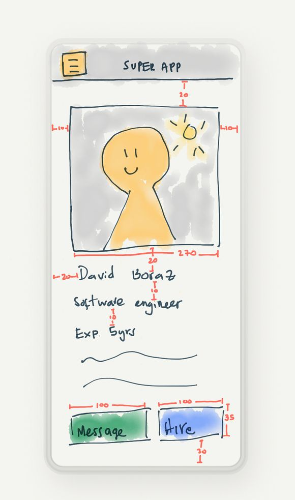
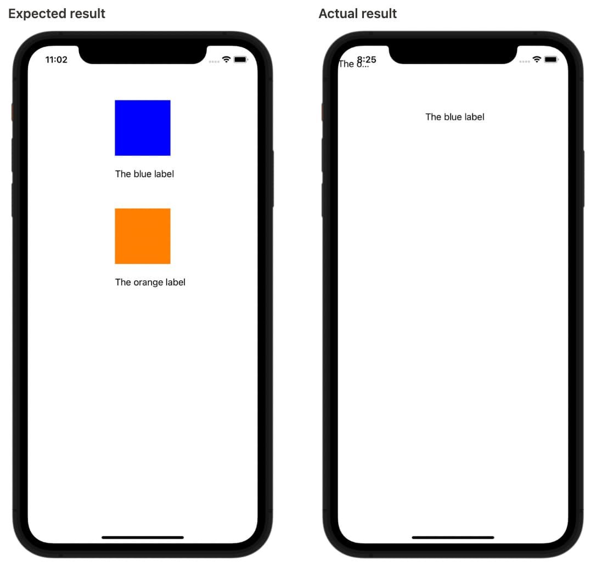
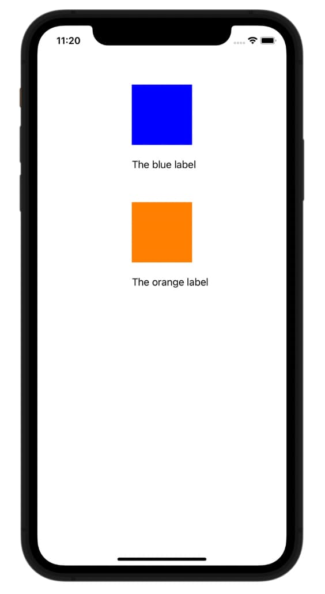
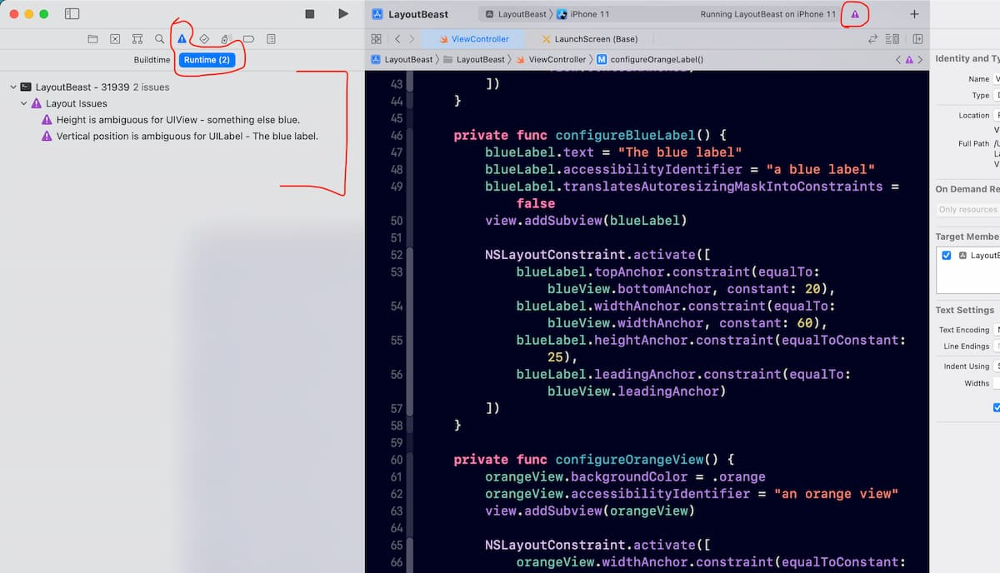

When writing iOS apps, few things are more frustrating (and more common) than AutoLayout conflicts. You take the time to visualize your beautiful layout, create a mental image of the view hierarchy, and maybe even sketch a pretty drawing…

But once you compile & run your app, BOOM! it blows up in your face and things just do not look as expected. You’re now scratching your head, and all you’re left with are some cryptic layout logs that can be intimidating and scary to read. Sound familiar? Worry not, I’m here to help.

I can promise you that after investing a few minutes going through this article, you’re going to see things are not so bad after all: You will survive, life will go on, and you will be able to debug layout conflicts like a pro in no time. Ok, now that we got that out of the way, let’s get into it!

## Types of Layout Errors

### Unsatisfiable

There is conflicting/confusing information in your layout logic.

- *Ex: One constraint says “make width 400”, but another constraint says, “well, actually make width 325”.*

### Ambiguous

There isn’t enough layout information to resolve constraints.

- *Ex: Your logic says “make width 200, x coord 0, y coord 25” but you forgot to specify height.*

### Logical

There’s a bug in your layout.

- *Ex: make the view 35 points larger than the parent view, but you forgot to specify what the parent view is.*

## Sanity Checks

Mentally check these boxes before you start debugging:

1. Did all layout logic execute correctly?

- A view’s layout may depend on a specific dimension being computed, or a view already existing to be configured properly.
- Some layouts may need to be specified in a certain order. If so, make sure you are aware of it, and make sure the order of events is correct. Adding subviews to a stackView is a good example of this.

2. Did you set `translatesAutoresizingMaskIntoConstraints` to false when adding constraints programmatically?

- Interface builder will automatically set this to no if you add constraints on the canvas, but that won’t happen when you’re adding constraints programmatically.
- TIP: You will see `NSAutoresizingMaskLayoutConstraint `in one of your conflicting constraints in the logs.

3. Is your view hierarchy complete?

- Make sure you instantiated the parent views, and that the children views are added to the parent as subviews appropriately.

4. Are you adding constraints both programmatically and in Storyboards?

- I try to avoid this as much as I can. As storyboards tend to do magical things I am sometimes not aware of, while programmatically you are responsible for each step. This makes things a little harder to debug.

## Reading Constraint Conflict Logs

**AutoLayout to plain dummy English Translator**

Constraints are applied to a view and *may* be relative to another view (make the height of a view equal to another), or may set a dimension with a fixed number (make height 162).

**What information are you looking for in each constraint?**

- The main view it’s applied to
- The dimension (height, width, leading, trailing, top, bottom)
- The orientation (vertical or horizontal)
- A secondary view of the constraint is related to (optional)
- The constraint is constant. The actual number to apply to the constraint. This one can be negative too.

**Examples:**

`<NSLayoutConstraint:0x60000041c0f0 UIImageView:0x7fb5af855ea0.height == 164 (active)>`

- *Set the height of UIImageView to 164 points.*

`*<NSLayoutConstraint:0x60000041c910 V:|-(9)-[UIStackView:0x7fb5af855810] (active, names: '|':UIView:0x7fb5af854ec0 )>*`

- *Apply vertical space of 9 points between stackView and view.*

`*<NSLayoutConstraint:0x60000041caa0 MyApp.FeaturedCollectionViewCell:0x7fb5af855bf0.top == UIView:0x7fb5af854ec0.top (active)>*`

- *Make the top of *`*FeaturedCollectionViewCell *`*(custom cell class) equal to the view’s top.*

`*<NSLayoutConstraint:0x6000004b2350 'UIView-bottomMargin-guide-constraint' V:[UILayoutGuide:0x600001ec7aa0'UIViewLayoutMarginsGuide']-(10)-| (active, names: '|':UIStackView:0x7fb59fd07360 )>*`

- S*tackView’s bottom edge should be equal to the view’s bottom layout guide plus 10 points.*

## A Real World Example

*(let’s walk the walk)*

Now that we have some preparation, how can we fix some real constraint problems in the real world? I created a simple project that you download here to debug 2 different offending constraints.

Welcome to LayoutBeast ([download it here](https://github.com/improving-minnesota/layout-beast-ios)), a simple Xcode app with 1 view controller and 4 subviews: `blueView`, `blueLabel` , `orangeView`, `orangeLabel`.

However, If you run the app, you’ll find that we have some issues. Let’s take a look:

#### Example #1

`2022-10-04 10:42:27.022723-0400 LayoutBeast[98234:4811764] [LayoutConstraints] Unable to simultaneously satisfy constraints. `

Probably at least one of the constraints in the following list is one you don't want.

Try this:

1. Look at each constraint and try to figure out which you don't expect;
2. Find the code that added the unwanted constraint or constraints and fix it.

(NOTE: If you're seeing `NSAutoresizingMaskLayoutConstraints `that you don't understand, refer to the documentation for UIView property `translatesAutoresizingMaskIntoConstraints`)

#### Example #2

`( "<NSAutoresizingMaskLayoutConstraint:0x60000236d4a0 h=--& v=--& an orange view.width == 0 (active, names: an orange view:0x7f796ff0bf90 )>", "<NSLayoutConstraint:0x6000023647d0 an orange view.width == 100 (active, names: an orange view:0x7f796ff0bf90 )>" )`

This one is not so bad! We can see that we’ve got some `NSAutoresizingMaskLayoutConstraints` being added to one of our views. If we have a look at the note in the logs, we can see a good clue there… We also talked about this in our sanity check section, point 2.

The problem seems to be that we did not set `translatesAutoresizingMaskIntoConstraints` to `false` in one of our views. So the fix will be to add this line to our `configureOrangeView()` method:

`orangeView.translatesAutoresizingMaskIntoConstraints = false`

Ahh, all good now! Things just feel a lot better now. And they look better too:

## Causality vs Correlation

You may have noticed purple icon warnings showing up in a couple of places in Xcode. These are runtime warnings indicating layout issues. This is yet another place where you can gather useful information about where violations are happening. However, at times they can be a bit misleading. In this specific scenario, for example, these warnings are **NOT** telling you who is responsible (causality), but rather what other views are being affected (correlation).

Additionally, if you ran the project you may have noticed other constraint issues in our logs; right below the one we cited above. Those too were indicating affected views and constraints, but they **WERE NOT** pointing you to the root cause.

This is to make an important distinction not only applicable to constraints but for engineering in general:

Your job is *always* to find the root cause. The core of the problem. Attempting to solve anything above that will not resolve your original, deeper problem.

**TIP:** Taking a closer look at the error logs above, you will see “an orange view” in the offending constraints. Strange… Upon closer inspection, you will *also* see that we’re setting the `accessibilityIdentifier` for the `orangeView` to that text. This means, that you can set the accessibility identifier for a view to having it printed when you get constraint conflicts. This has been SUPER SUPER helpful for me!

Have a question about this blog post? Email the author at julian.builes@improving.com or contact Improving [here](https://improving.com/contact)! If you are a developer looking for career opportunities, take a look at our [careers page](https://improving.com/careers).
