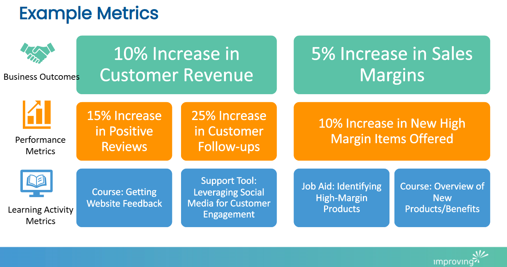

[In my last blog post](https://www.improving.com/thoughts/implementing-an-effective-learning-strategy-for-your-company/), I discussed how to create a learning strategy for an organization. Now, how will we know if it is effective? Measuring the success of a learning strategy is crucial for understanding its impact on both individual development and overall business outcomes. To effectively evaluate the success of a learning strategy, organizations should employ a variety of metrics that align with their business objectives and provide insights into the effectiveness of their training initiatives.

Using this graphic, we will start at the bottom with the Learning Activity Metrics and move our way up through Performance Metrics to Business Outcomes.

**Learning Activity Metrics:** One metric is the training completion rate, which tracks the percentage of individuals who complete training programs on time. This metric ensures that learning is being carried out as planned and is vital for assessing the success of new hire training and ongoing professional development. Another important metric is knowledge retention, which can be measured through assessments and quizzes to determine how well learners retain the information presented during training sessions. High retention rates indicate that the training content is effectively absorbed and remembered by the learners. We would not want to stop our metrics with completion rates and assessments; let’s go further.

**Performance Metrics: **Behavioral changes are also a critical indicator of the success of a learning strategy. Observing tangible changes in how employees perform their tasks and interact with others can provide valuable insights into the effectiveness of the training. Metrics such as employee performance and productivity can be tracked to see if there is an improvement following the training. Additionally, employee engagement and satisfaction surveys can help gauge the impact of the learning strategy on workforce morale and retention.

**Business outcomes: **These should be the ultimate goal when measuring the success of a learning strategy. Metrics such as return on investment (ROI), client satisfaction, and project success rates can provide a clear picture of how the training initiatives contribute to the organization's goals. For example, tracking the percentage of completed deliverables, adherence to project timelines, and client feedback can help measure the effectiveness of training in driving business results.

Furthermore, continuous improvement metrics, such as the frequency of feedback and the implementation of improvement ideas, can help ensure that the learning strategy remains relevant and effective. Regularly reviewing and updating the training content based on feedback and performance data can lead to sustained success and growth.

In conclusion, measuring the success of a learning strategy involves a combination of metrics that assess individual learning outcomes, behavioral changes, and business results. By employing a comprehensive set of metrics, organizations can effectively evaluate the impact of their training initiatives and make data-driven decisions to enhance their learning strategy. To learn more about how our training initiatives can drive your business success, [reach out to us](https://www.improving.com/contact)!
