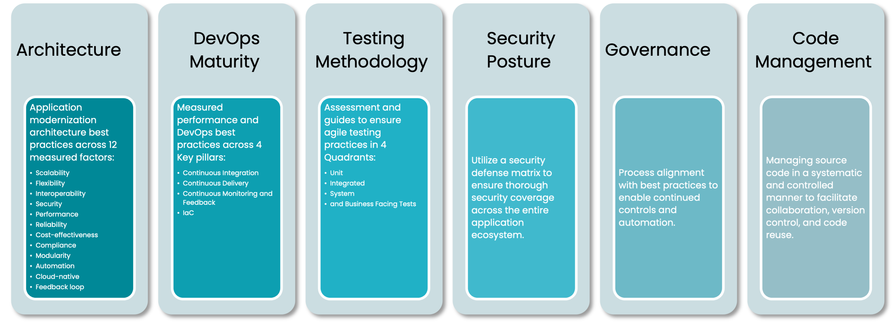
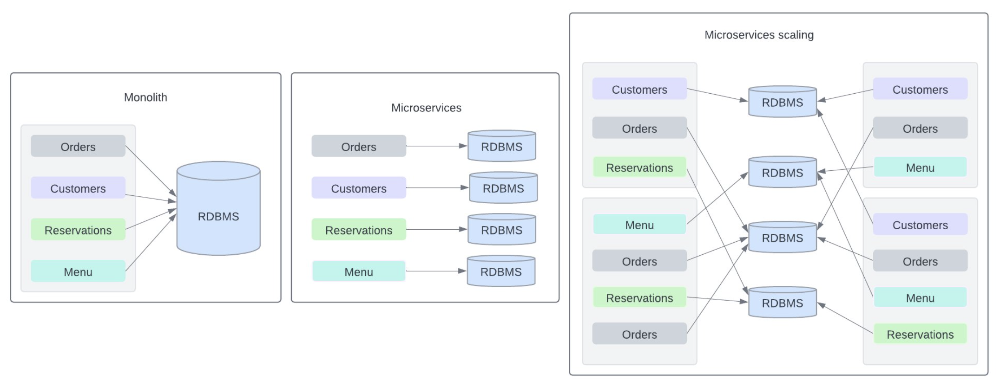
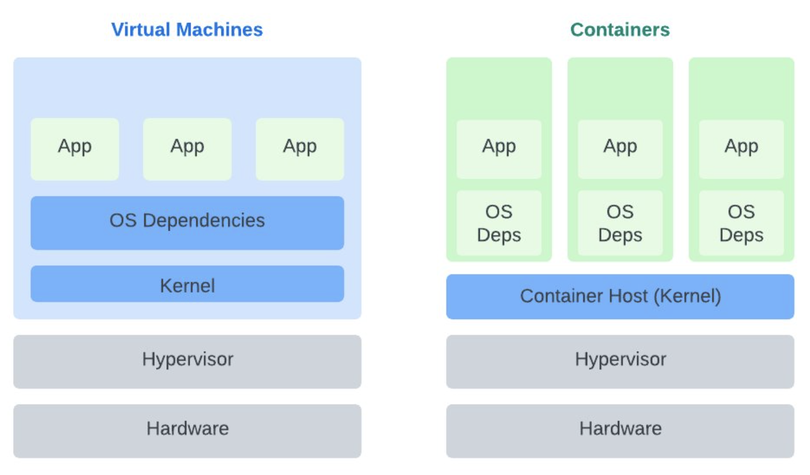
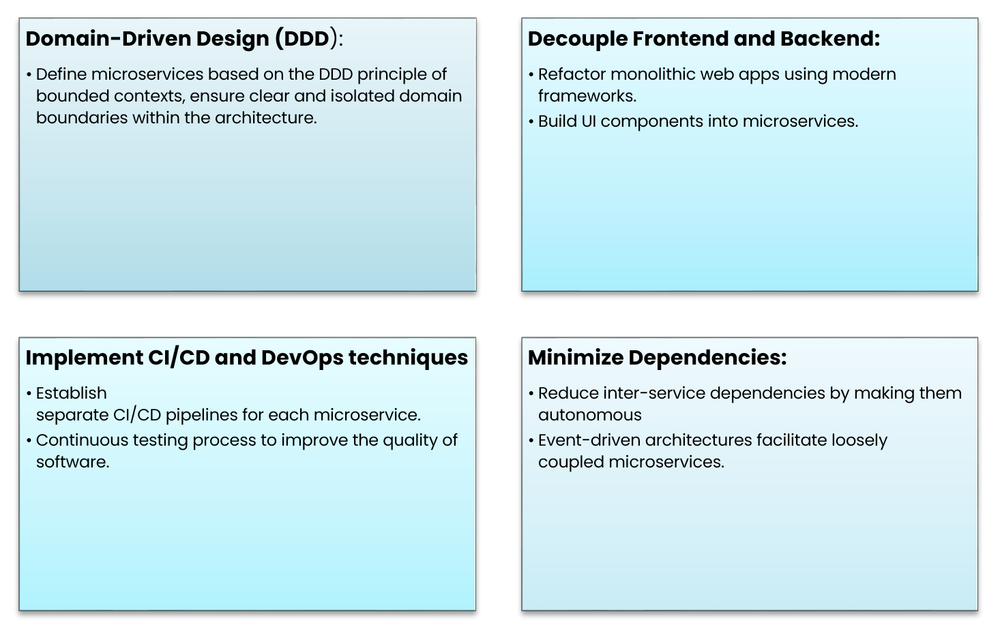

## Application Modernization Framework

The journey of application modernization can vary depending on your business goals, organizational challenges, and the state of your legacy system.

Application modernization architecture best practices encompass 12 crucial factors for the successful migration and transformation of legacy systems. By ensuring that an architecture can handle increasing workloads, enabling seamless communication with other systems, implementing robust security measures, and leveraging automation tools, organizations can optimize system performance, minimize costs, and adapt to evolving business needs in the modern digital landscape.

DevOps maturity is also crucial in ensuring the success of your application modernization process. It involves measuring performance and adherence to DevOps best practices across four key pillars. DevOps facilitates faster delivery of modernized applications with higher quality and better alignment with business objectives. By embracing Continuous Integration / Continuous Deployment (CI/CD), organizations can automate manual processes, enhance collaboration, and implement monitoring and feedback loops for continuous improvement.

Security integration, known as DevSecOps, is essential for bolstering the security posture of modernized applications. Utilizing Key Performance Indicators (KPIs) identified by DORA helps organizations track progress and measure the effectiveness of their DevOps initiatives. Additionally, adopting agile testing practices across **Unit**, **Integrated**, **System**, and **Business Facing Tests** ensures comprehensive test coverage.

Assessing security vulnerabilities and implementing remediation strategies using a security defense matrix is critical for addressing weaknesses and ensuring thorough security coverage. Governance processes aligned with best practices are also integral to the application modernization process because they enable continued controls and automation.

Furthermore, effective code management through version control, code reviews, and branching strategies ensures high code quality and facilitates efficient software deployment. Overall, leveraging DevOps principles and practices is essential for successfully navigating the complexities of application modernization while maintaining robust security measures and efficient development workflows.

## Monolith vs Microservices

Forward-thinking organizations are moving towards application modernization with a focus on refactoring their business-critical monolithic applications into microservices, supported by a cloud-native architecture. This transformation is not merely desirable; it's essential in today's rapidly evolving digital landscape. Companies are increasingly transitioning towards application modernization by refactoring business-critical monolithic applications into microservices within a cloud-native architecture, a pivotal move in today's fast-paced digital landscape. At Improving, we utilize a process that involves several key steps. Initially, we decompose the monolith into smaller, more manageable components, followed by identifying services that encapsulate specific functionalities or domains, such as menu, customer, and order processing in an e-commerce application.

Communication is key in a microservices architecture, and we must establish robust communication methods between services in a modernized application. To successfully complete a dependency analysis of each module, we look at the following:

1. The type of dependency: dependencies from data or other modules.

2. The scale of the dependency: how a change in the identified module might impact other modules.

Typically, monolithic applications have their own monolithic databases. One of the principles of a microservices architecture is to have one database for each microservice. Therefore, when we help you modernize your monolithic application into microservices, we must split the monolithic database based on the service boundaries that you have identified by analyzing database mappings. As part of the service extraction analysis, we will gather some insights on the microservices that you need to create. We can use the same approach to analyze database usage and to map tables or other database objects to the new microservices.

Incremental refactoring is recommended to gradually build microservices alongside the monolith, with the monolith eventually diminishing as functionality migrates to microservices. To achieve this, clear service boundaries must be defined to ensure proper isolation and modularity, alongside effective data management to maintain consistency and integrity.

Operationally, transitioning to microservices requires adjusting team structures to small, cross-functional "two-pizza teams," promoting accountability, communication, and agility. Microservices architecture facilitates independent scaling of components, enhances maintainability, and mitigates system failures by isolating issues, ultimately enabling rapid software delivery.

## Benefits of containerization

Containerization serves as a foundational element. At the heart of containerization lies the concept of microservice architecture, which plays a pivotal role in modernization efforts. Containerization technologies enable the encapsulation of legacy applications, providing operational benefits such as portability, security, and scalability, simplified and enhanced testing processes. By leveraging containers, applications can be deployed across various environments without the need for extensive rewrites or changes to the runtime environment. Once in a container environment, applications can run on major cloud platforms and modern on-premises servers.

Unlike virtual machines, containers are lightweight, isolated environments running on the host operating system. They leverage the host kernel and contain only essential components, ensuring efficient resource management and minimizing security risks. Container images package all necessary libraries and dependencies, enabling seamless deployment across various platforms. Because containers are so small, there are usually hundreds of them loosely coupled together—which is why container orchestration platforms such as Kubernetes are used to provision and manage them. Containers can be quickly scaled up or down to meet changing workload demands, making them ideal for microservice architectures and cloud-native applications.

## Separate microservices build

First and foremost, let's emphasize the importance of defining microservices based on the Domain Driven Design principle of bounded contexts. This principle ensures clear and isolated domain boundaries within our architecture, laying the foundation for a scalable and maintainable system. By adhering to bounded contexts, we can effectively manage complexity and promote autonomy within our microservices.

A crucial aspect of application modernization is the decoupling of frontends and backends. By refactoring monolithic web applications using modern frameworks, we can break down the UI components into microservices. This separation allows us to build more modular and flexible systems, enabling independent development and deployment of frontend and backend components.

In our pursuit of microservices, it's imperative to minimize dependencies between services. Event-driven architecture offers a solution by facilitating loosely coupled microservices. By leveraging events as a means of communication between services, we can reduce direct dependencies and promote scalability and resilience.

As we start this modernization journey, the implementation of CI/CD and DevOps techniques becomes paramount. Establishing separate CI/CD pipelines for each microservice enables rapid and continuous delivery of software updates, ensuring agility and responsiveness to changing business requirements. Additionally, a continuous automated testing process is essential to maintain the quality and reliability of our software, enabling us to detect and address issues early in the development lifecycle.

If you’re unsure where the opportunities to enhance your systems exist, Improving can help you find the most optimal path forward to modernize your application or systems. Check out the [part 1](https://www.improving.com/thoughts/what-is-application-modernization-and-why-does-your-business-need-it) and [part 2](https://www.improving.com/thoughts/key-steps-to-making-application-modernization-successful) of this blog in the series for more insights and a deeper dive into the topic! [Reach out to us today](https://www.improving.com/contact/) and we will walk you through the many aspects of application modernization and how it can help you stay growth-oriented, competitive and innovative.
