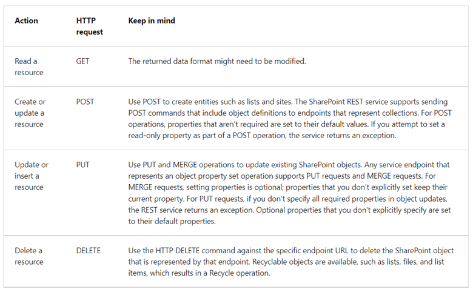
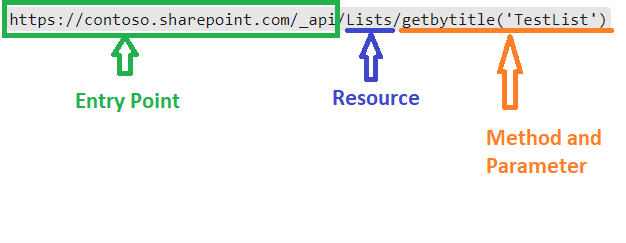
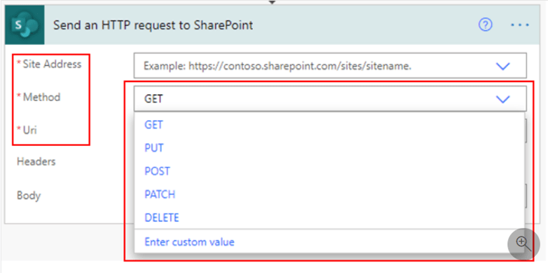
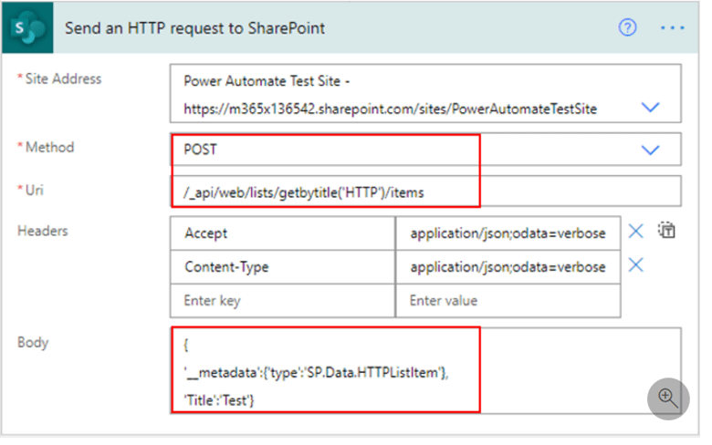
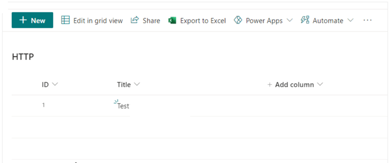

Hi everyone! In this post, I would like to chat a little about using Power Automate to evoke the very useful and powerful SharePoint REST APIs. Let’s get started!

### What is Power Automate?

Power Automate is the online workflow service included in the Power Platform suite of services that allows users to automate actions across over 500 apps and services in the cloud, via the Representational State Transfer (REST) service, or on-premise, via an on-premises gateway. SharePoint Online is an example of a service that uses REST. For more information about Power Automate, [click here](https://docs.microsoft.com/en-us/learn/powerplatform/power-automate).

### The SharePoint REST API service

SharePoint Online uses REST Application Programming Interfaces (REST APIs) to allow professional and citizen developers to perform Create, Read, Update, and Delete (CRUD) operations on SharePoint data. Power Automate uses HTTP requests to leverage the SharePoint REST API.

The following table provides an overview of some of the HTTP REST requests.

An HTTP REST request also includes a REST URL comprising an appropriate entry point, specific resources, and parameters for endpoints that correspond to methods in the client object model.

In the following example, the entry point is the SharePoint site URL with the ‘_api’ postfix that identifies the communication channel. The resource in this example is a list and the method is ‘getbytitle’ which as the name implies gets the list with the name parameter enclosed in the parentheses, ‘TestList’, in this example.

For more details on the SharePoint REST service, you can [check this out](https://docs.microsoft.com/en-us/sharepoint/dev/sp-add-ins/get-to-know-the-sharepoint-rest-service?tabs=csom)

How to perform CRUD operations in SharePoint using REST APIs from Power Automate

Firstly, Power Automate has a ‘Send an HTTP request to SharePoint’ action, supporting various HTTP request types as shown below. In this blog however, we will focus on using it to add an item to a List using the ‘POST’ method.

Let’s take a closer look at this action. In the screenshot below, the ‘Site Address’ is a mandatory field that contains the address of the SharePoint site which contains the resource you would like to edit. In this case, the site is called ‘Power Automate Test Site’

The POST ‘Method’ communicates to the SP site it would like to create a resource, a list in this instance.

The Uniform Resource Locator or ‘Uri’ specifies the list that needs to be updated. In this example, it is the SP list called ‘HTTP’.

The ‘Body’ contains the metadata that will be added to the List, in this example, it will be the value ‘Test’ in the Title column.

The result will look like the screenshot below.

There you have it!! That’s all you need to add an item to a SharePoint List using the REST API. The approach would be similar to the other request types. However, if you would like to learn more about using the SharePoint REST APIs with Power Automate, you can [click here!](https://docs.microsoft.com/en-us/learn/modules/integration-http-connector/)

If you enjoyed this post, be sure to check out our recent successful projects in [Microsoft Business Productivity Services](https://imaginet.com/project-summaries-microsoft-365/).
