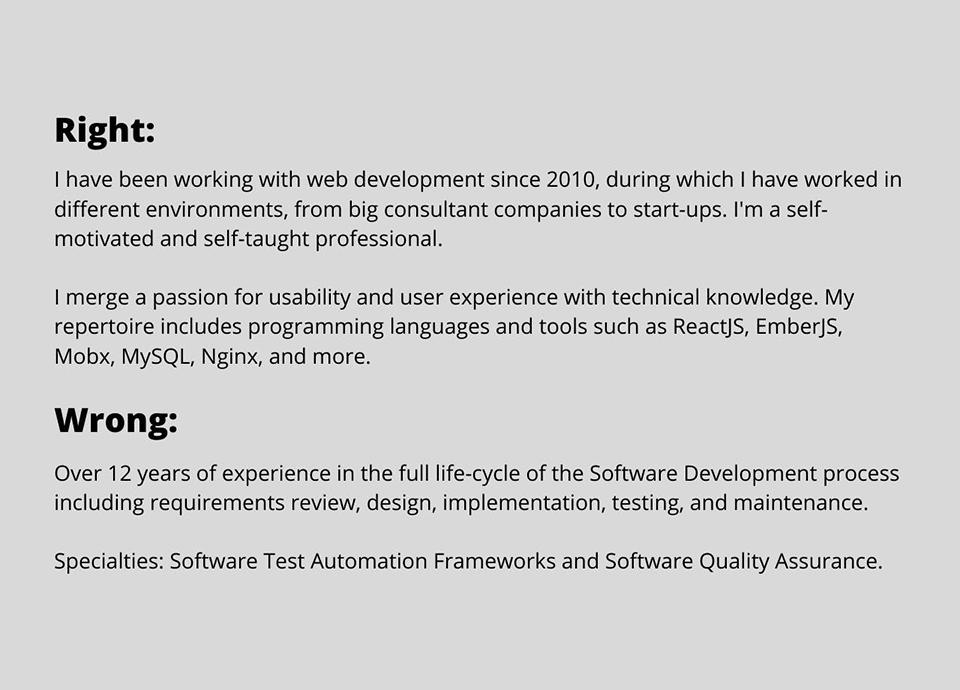
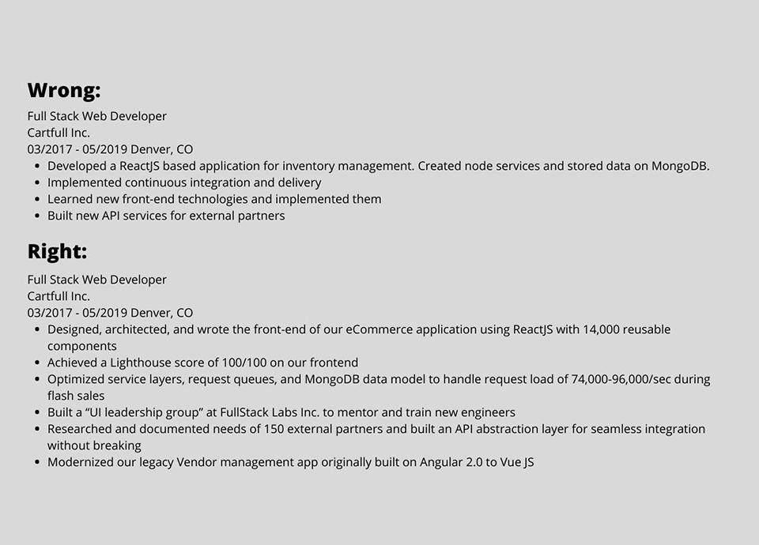

Are you looking to create an outstanding resume and find better jobs as a developer?

No matter if you’re an experienced engineer or just starting out, you will get a complete and effective guide to write and improve your resume through these tips. I am the talent acquisition manager at Improving Nearshore with ten years of experience working as a recruiter in the IT industry. So, I know what people hiring are looking for and the important things they evaluate.

## What to Include in a Developer Resume?

This can be broken down into seven basic parts of a nicely done resume:

1. Summary
2. Experience
3. Certification and awards
4. Education
5. Technical Skills
6. Contact Information
7. Additional information like LinkedIn, GitHub, Hackerrank, and portfolio.

Today, we will mostly go over the most important and time-consuming parts of this process, which are numbers one and two.

## Writing the Best Developer Resume

Writing a developer resume is like walking on thin ice. If you try too hard, you fail. If you don't try hard enough, you look lazy.

### Length

The perfect length for a resume is up to two pages. Take into consideration that recruiters see many resumes per day, so they won’t read more than three pages for every candidate. If they want to know more about your work experience, they will simply call you.

### Format

The key rule is to keep things simple when it comes to format and ensure that your resume is highly readable. Format it as a pdf. Never use a word document to avoid text from moving around. Use black tact and the same font to keep it clean and consistent. *Check for typos *and use bullet points. Make sure to put your phone number, email, and city at the top so people can contact you. You’d be surprised how many resumes I have seen that did not include this.

## How to Write a Killer Summary

The summary is not where your goals should be written, it’s the *summary *of your work experience. Your summary can be the single reason a recruiter calls or has your resume thrown in the shredder. Recruiters give an average resume only a six-second glance, and the first thing they see is your summary. Think of this section as a first impression where you boil down your passions, dreams, and experiences into one short (5-6 lines) paragraph.

Your resume summary should answer three simple questions:

1. What is your experience?
2. What do you care about?
3. What do you want to achieve?

What’s wrong with this summary? At first sight, it can look like a good summary, but they do not go further after listing technical skills.

## The Experience Section

### Follow the X by the Y by the Z

“Accomplished [X], as measured by [Y], by doing [Z].”

This formula is used by Amazon and Google’s employees to create resumes and get promotions. In short, this means that you want to focus on your accomplishments, results, and the impact that you had as a result.

For example, imagine an applicant wants to make it clear that they are a member of a prestigious group. Here’s the OK way, the better way, and the best way to describe this on a resume:

- OK: “Member of Leadership for Tomorrow Society”
- Better: “Selected as one of 275 people for this 12-months professional development program for high-achieving diverse talent”.
- Best: “Selected as one of 275 participants nationwide for this 12-month professional development program for high-achieving diverse talent based on leadership potential and academic success.”

***Recruiter’s tip: ****Tailor your resume to the position you’re applying for. That doesn’t mean you will make up your resume or pretend you have experience in areas that you barely know.*

### Examples of the Experience Section on Your Resume

Notice the difference? There are a couple of problems that you can see on the first one.

First, to a hiring manager, it would feel as if the candidate hasn’t put any effort into listing what they did.

Second, if you’re an experienced developer, this resume experience will get you rejected when it is placed between hundreds of resumes. Writing a ReactJS-based application with nodeJS and MongoDB could mean a lot of things when you put it without context.

A hiring manager will usually try to get the following context from your experience section:

1. What was the quality of the front-end that you built?
2. What aspects of the work were you truly passionate about? (front-end, back-end services, databases, etc)
3. What did you learn and implement there?

But as you can see, a hiring manager is unable to get any of that from what the first example says.

***Recruiter’s Tip:***** ***If you have mentored or trained anyone, include it on your resume. For companies and recruiters, it’s valuable to find people who are interested in sharing their knowledge and helping the team to grow and succeed. *

## Follow This Template to Write your Resume Experience:

- Position + Dates
- Location
- Company name

As for responsibilities and achievements, the average number you want to hit is six. It’s optimal enough to describe your experiences with a company properly while leaving room for your other experiences.

### Write Your Experience Summary Step-by-Step

1. Add experience. You need to write about your achievements at each previous company, what you did to improve it, or how you helped the project or company with your work.
2. Then, add accomplishments. This refers to your activities, what you did, and how you did it. Be specific and write all your sentences in the past tense.
3. You can add or specify all the projects you have worked on in each company, though it’s not necessary.

Now that you know the basics of developer resume writing, you can feel confident about the job application process. To see what U.S. jobs are available at Improving, [click here](https://improving.com/careers) or reach out to us at careers@improving.com.
