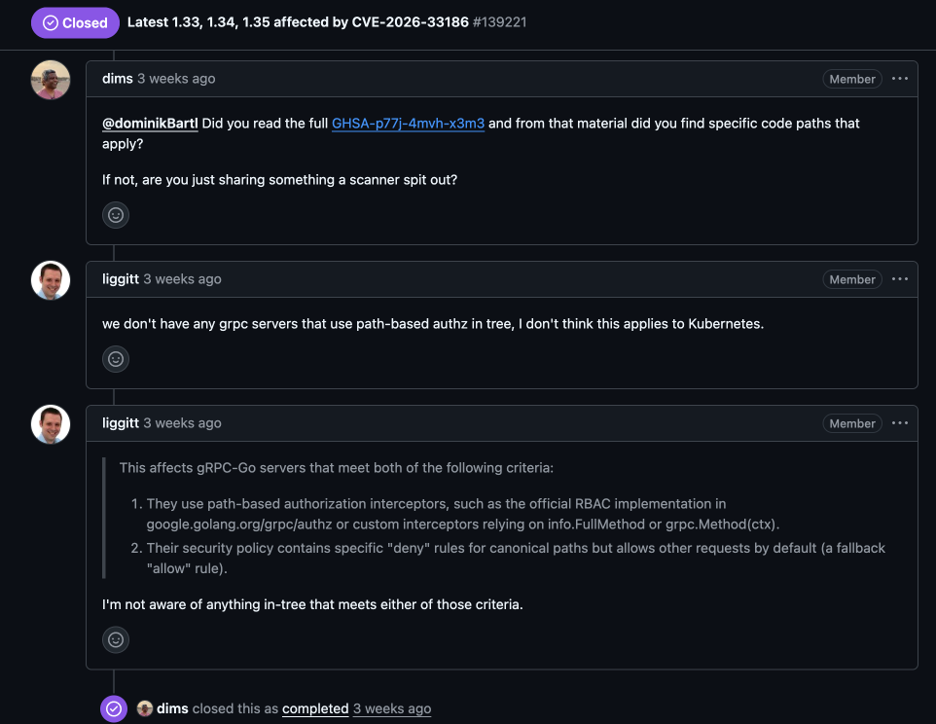
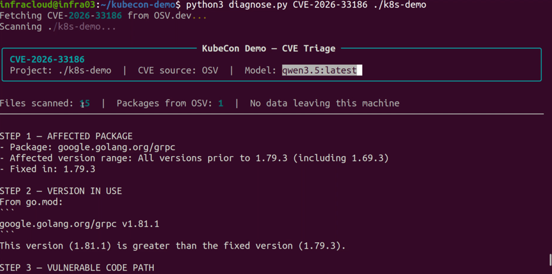
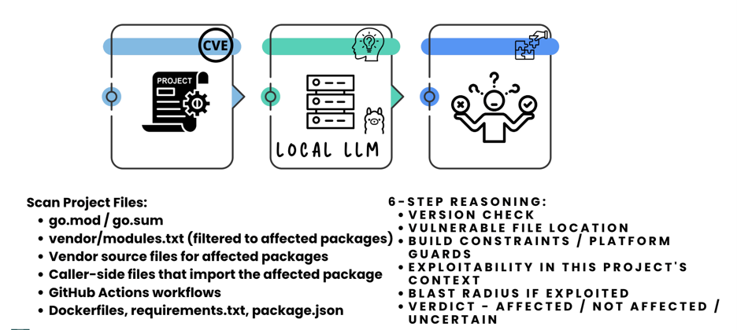
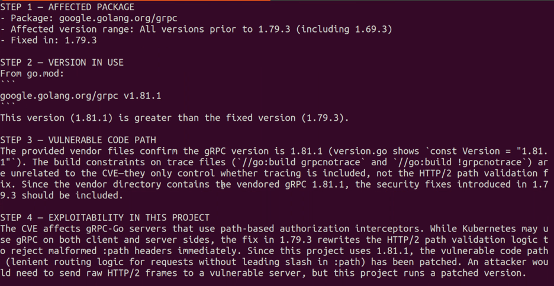
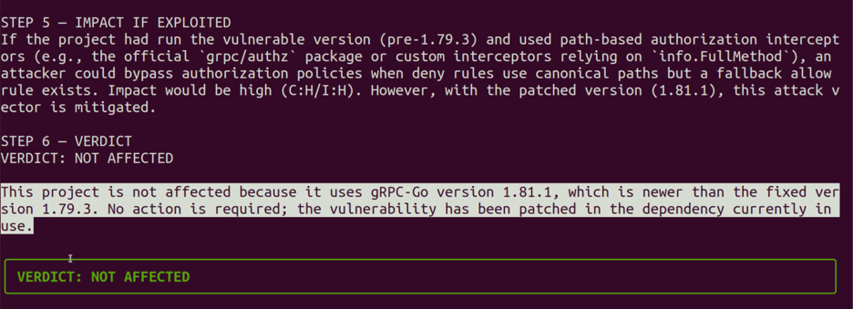

AI-enabled adversaries increased attacks by 89% year-over-year and software supply chain security is one of the areas taking the hardest hit. [AI accelerated phishing](https://go.crowdstrike.com/rs/281-OBQ-266/images/CrowdStrike-2026-Global-Threat-Report.pdf) and automated reconnaissance are shortening the time from initial access to impact. Recently, [TeamPCP obtained credentials](https://labs.cloudsecurityalliance.org/research/csa-research-note-teampcp-supply-chain-cascade-20260402-csa/) for a service account used to maintain Trivy’s official repositories.

These attacks have been surfacing for a long time now, but who has been dealing with them?

The Humans!

Every issue that lands in a queue, a compliance flag in Jira, or an infrastructure alert in your monitoring tool, eventually reaches a person. That person has to read it, understand it, decide whether it's real, and act on it. It could be part of their job. Or if they are OSS maintainers, it might have to be handled in the narrow window they have between their job and life.

In this blog post, we will walk you through the type of vulnerabilities engineers have had to patch, and the kind of issues they've faced since the arrival of AI. You'll also see a demo of how to turn that same AI around, using a local LLM to reason through an issue and give humans the right set of information to act on.

*(Sonali’s keynote at KubeCon + CloudNativeCon India 2026 on The Human Cost of Security in the AI Era)*

## Gap of Knowing and Doing: Low Effort Issue

Knowing something might be wrong is the first step. Confirming it, understanding it, and deciding what to do about it is comparatively hard. That gap between the two is where the real human cost sits.

When someone raises an issue with the bare minimum effort, they've only done the "knowing" half. The "doing" half lands entirely on whoever picks it up next. That person now has to rebuild everything the reporter could have already checked: does this hold up, what's the real context, what evidence would settle it. Raising an issue this way, knowing full well the other person has finite hours, widens that gap because:

- **Time meant for building goes into validating instead: **Every under-specified issue is a fresh investigation someone else has to start from zero.
- **Same ground gets covered twice: **With no detail in the original report, the same claim can resurface later and cost someone else those same hours again.
- **Trust wears down on both sides: **Short reports read as low effort; short responses read as dismissive. Neither side set out to cause that.
- **Head start gets thrown away: **The reporter is usually closest to the problem when they find it. A hunch about the cause, or what they already tried, gives the assignee somewhere to start instead of a blank page.

## A Real World Example of Project Maintainers

Authorized organizations, researchers, and vendors identify the publicly disclosed vulnerabilities and assign them official tracking IDs, termed as Common Vulnerability and Exposures (CVEs). The severity level of these CVEs is identified by a score assigned using ways like the Common Vulnerability Scoring System (CVSS), which ranges from 0.0 to 10.0, where the higher numbers represent a higher degree of severity.

When an issue is reported claiming a vulnerability in a project, the maintainers of that project become responsible for vulnerability triage. They have to understand attack vectors they did not create, write a patch for vulnerability they did not introduce, and create reports that will be scrutinized by 100s of people where many of whom will not be empathetic.



Above is a screenshot of an [example](https://github.com/kubernetes/kubernetes/issues/139221) of a low-effort issue raised in the Kubernetes project. Maintainers here had to spend time just responding that this vulnerability does not impact Kubernetes. The maintainer's response makes clear they didn't appreciate the bug finder's effort and called this a “scanner spit out”.

That exchange takes about four minutes to read. It almost certainly took the maintainers considerably longer to investigate, confirm, and write up the response. Multiply that by however many issues get filed against a project the size of Kubernetes in a given month, and the hours start to add up fast.

This isn't unique to maintainers. A security engineer closing a Jira ticket, an SRE chasing an alert with no baseline attached, same problem, different title, carries this same cost well beyond open source. Maintainers just happen to be where this shows up most visibly, because their work and responses are public. The cost itself belongs to anyone whose job includes a queue.

## Why the Human Cost is Growing

The human cost of maintaining security was already real before AI entered the picture. It's compounding now for specific reasons:

- **Volume explosion**: Due to AI, there are more attacks, which means more scanners running more often, flooding queues with findings humans have to triage to separate signal from noise.
- **Speed mismatch**: AI-accelerated attacks move faster than humans can respond. Time from breach to impact is shrinking, giving maintainers less window to investigate and act.
- **Harder containment**: Supply chain attacks now spread through dependencies maintainers can't manually map. Even "contained" breaches resurface later. The Trivy team thought they had it handled, then 76 version tags were force-pushed 19 days after the initial response.

## Trivy Supply Chain Attack

In March 2026, a threat actor tracked as TeamPCP compromised Aqua Security's [Trivy](https://github.com/aquasecurity/trivy), one of the most widely used vulnerability scanners in the cloud native ecosystem, by stealing [CI/CD](https://www.improving.com/expertise/applications/platform-engineering/) credentials and pushing malicious binaries through Trivy's own GitHub Actions.

The attack ([CVE-2026-33634](https://nvd.nist.gov/vuln/detail/CVE-2026-33634), CVSS 9.4 CRITICAL) followed a pattern that's become familiar in supply chain compromises: the initial breach wasn't the end of it.

The Trivy team rotated credentials, published an advisory, and communicated with users. They believed they had contained it. They had not.

Nineteen days later, 76 version tags were force-pushed to the repository, re-exposing every pipeline still referencing a mutable tag instead of a pinned SHA. The same stolen access was later used against Checkmarx's KICS scanner and against LiteLLM, an unrelated project reachable only because it shared infrastructure with the first two.

Later analysis put the [potential exposure at more than 2,500 organizations worldwide](https://www.cxtoday.com/security-privacy-compliance/supply-chain-attack-exposes-2500-companies-in-largest-ai-infrastructure-breach-of-2026-so-far/), including names like AWS, Samsung, and Cisco, none of whom made a mistake, they were simply reachable through a shared dependency.

This is the environment maintainers and engineers are triaging in now: more tools generating more findings, a wider and less mapped attack surface, and the same limited hours to sort signal from noise. Every under-specified report that lands in that environment adds directly to the pile, at exactly the moment the pile can least afford to grow.

## Turning the Same AI Around

If AI is behind both halves of this problem, the volume of attacks on one side and the volume of low-effort scanner output on the other, the obvious question is whether it can be pointed at the half that actually helps.

[Local LLMs](https://www.improving.com/thoughts/key-fundamentals-of-ai-development/) are well suited to exactly this kind of triage. They can reason through whether a claim holds up in a specific context, the way a human would if they had the time.

This is a narrow, practical slice of agentic AI cybersecurity: not a general-purpose assistant, but a scoped agent that works through one CVE at a time and hands back a verdict.

The mechanism doesn't change with the domain. Give it:

- Report and access to the relevant context
- An alert and a monitoring config
- A dependency bump and a changelog
- A CVE and a codebase

It works through the question. What changes is what it reads and what question it's answering.

Reasons we are using local models for CVE triage:

- **Data sovereignty & compliance**: Your dependency tree and source code stay within your boundaries, required for GDPR, HIPAA, SOC 2, and internal security policies. You maintain direct control over what's analyzed and where.
- **Offline resilience**: Local models work without internet access. Essential during incident response when the network itself may be compromised or unavailable.
- **No shared risk**: Cloud systems don’t fail in isolation. Prompt injection attacks have tricked services into exposing other customers' data. Running analysis locally eliminates that cross-customer exposure risk entirely.
- **Fewer credentials to defend**: You eliminate the need to manage API keys for cloud services. Security researchers have found thousands of exposed API keys in public databases; fewer third-party credentials means fewer attack vectors.
- **Predictable economics**: High-volume CVE triage becomes cheaper with local hosting than per-token cloud pricing. You trade fixed infrastructure cost for unlimited analysis runs.

## Setting Up a Local Model to Audit CVEs

We built a Python tool for CVE triage that reasons through vulnerabilities using everything needed to answer the question: the public CVE record, your project's dependency manifests, and the source code.

The workflow itself doesn't change from what a maintainer would do by hand. The only difference is where that reasoning happens on your machine instead of an external API or from memory.

### Prerequisites

Before running the tool, make sure the following are in place:

- Python 3.8 or above
- [Ollama](https://ollama.ai/) installed and running locally
- Access to [tool GitHub repository](https://github.com/cerebro1/vulnerability-check-kubecon2026.git)

**1. Deploy a local model runtime using Ollama**

- Pull a model. We used qwen3.5:latest for this walkthrough.
- Start Ollama and confirm it's serving on the default port:

```bash
ollama list  

curl http://localhost:11434/api/tags 
```

If you see your model listed and a response from the API, Ollama is ready. It runs as a background service, so this endpoint stays available across sessions without restarting it manually.

**2. Set up the tool and project to check against**

Clone the tool and install its dependencies:

```bash
git clone https://github.com/cerebro1/vulnerability-check-kubecon2026.git 
cd vulnerability-check-kubecon2026 
pip3 install requests rich 
```

For this demo, we ran it against a sparse clone of Kubernetes repository pulling only the files needed to evaluate the CVE rather than the full repository:

```bash
git clone --filter=blob:none --no-checkout --depth=1 \ 
  https://github.com/kubernetes/kubernetes.git k8s-demo 
cd k8s-demo 
git sparse-checkout init --no-cone 
git sparse-checkout set \ 
  vendor/go.opentelemetry.io/otel/sdk/resource \ 
  vendor/modules.txt \ 
  go.mod \ 
  .go-version 
git checkout HEAD 
```

**3. Run the check against the local model**

Invoke the tool with a CVE ID and the path to the project:

```bash
python3 diagnose.py CVE-2026-33186 ./k8s-demo 
```

The tool auto-detects the first available Ollama model, so no additional configuration is needed unless you want to target a specific one.



Underneath, two files drive what the model does with that request.

- system_prompt.txt sets it up as a security analyst who understands Go build constraints and is explicitly told to say **NOT AFFECTED** if the evidence supports it, even when an automated scanner has already filed a report.
- reasoning_instruction.txt gives it a six-step scaffold, identify the package, find the version in use, locate the vulnerable code, assess exploitability given the project's runtime, determine blast radius, and state a verdict, written to generalize across any CVE and any language ecosystem.



The tool streams that reasoning to the terminal.



Once it's done, a color-coded verdict banner shows the result.



You can get reliable results from a local model with a few adjustments:

- Keep the reasoning scaffold structured and specific to the task, not open-ended
- Limit what gets fed in per step (relevant files only, not the entire repository)
- Lean on it for classification and pattern matching (does this apply, yes or no, with evidence) rather than open-ended exploratory analysis

## Final Words

Before you raise an issue on any project, spend the thirty seconds it takes to ask:

- Whether your findings hold up in that work’s context
- Whether the information you provide will help the resolver

The issue resolver's time matters exactly as much as yours, so do not give them the work to do that you already did. The supply chain we keep trying to secure is made of tokens, tags, and build pipelines, but it runs through people.

We need to make sure we do not let our maintainers pay a human cost for powering the cloud native ecosystem. That's the same principle behind the tool we walked through above, and it's the same lens [our AI consulting team](https://www.improving.com/expertise/ai/) brings to every engagement: point the automation at the part of the job that's actually eating your team's hours, not the part that just adds a dashboard.
