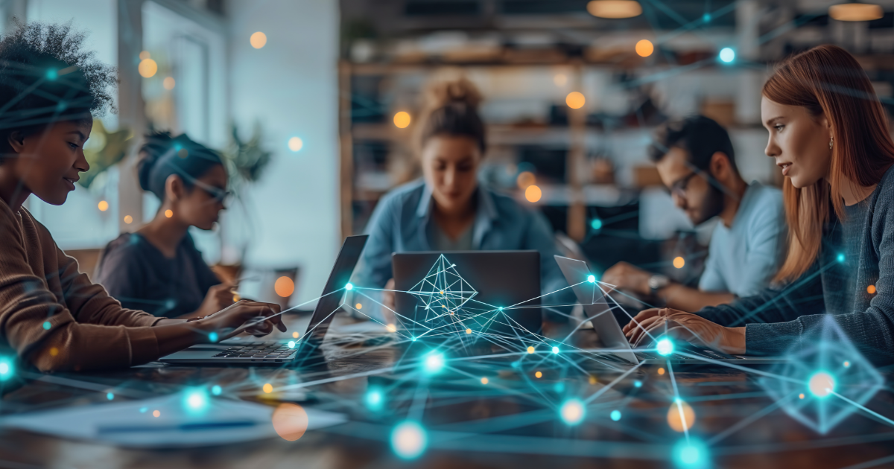

Artificial intelligence is no longer a distant concept relegated to futuristic conversations; it's reshaping our present reality. [As we recently explored in our Improving Talk series](https://youtu.be/uEuE2lljbq8?si=kFbb55jnjkrBCgG2), the interaction between humans, AI agents, and tools is quickly becoming pivotal in determining how we think, decide, and create. Let's delve deeper into how this symbiotic relationship between humans and AI is poised to revolutionize the workplace.

### **A Historical Perspective**

Understanding the evolution of technology is crucial to appreciating today's AI-driven revolution. Katherine Johnson, famously known as a "human computer," exemplifies the transformative power of technology. She performed complex calculations by hand for NASA's space missions in the 1960s, but her role evolved with the advent of computerized systems, shifting her responsibilities toward shaping the very software that replaced manual computation.

Each technological wave, from mainframes in the 1960s, personal computers in the 1980s, the internet boom of the 1990s, to the cloud explosion in the 2010s, has abstracted complexity, allowing humans to focus more on creativity, innovation, and strategic tasks.

### **Entering the Agent Era**

Today, we are standing at the threshold of a new technological abstraction—agentic AI. Unlike perception AI, which focuses on singular human-like capabilities such as image or speech recognition, agentic AI employs Large Language Models (LLMs) to autonomously perform specific tasks, harnessing reasoning and decision-making capabilities.

Agents are not a futuristic notion; they are active participants in current workflows. They have clear, repeatable goals and use tools effectively to perform their tasks. With advances in LLMs, these agents can now perform not just routine tasks but engage in basic reasoning, effectively becoming your "junior coworkers." They can operate individually or in coordinated teams, managed by higher-level reasoning agents.

### **Practical Implications of AI Agents**

At Improving, we witnessed firsthand the transformative impact of agentic solutions through a recent client engagement. The client’s business development team traditionally spent significant time manually searching and analyzing financial information online. We introduced agent-based solutions equipped with tools such as search engines and LLM-driven analytics. These agents consistently and accurately identified relevant articles, streamlining a previously cumbersome process.

The outcome was staggering: our solution increased lead identification from a billion dollars in potential leads to over $14 billion within months. Importantly, human team members were not displaced; instead, they transitioned into supervisory roles, strategically managing agent-driven outputs. This exemplifies a critical point: AI agents automate tasks—not entire jobs—freeing human resources for strategic, high-value contributions.

### **Navigating the New Tools Landscape**

To effectively leverage this agentic shift, companies need awareness of the AI tools landscape:

- **Enterprise tools** like Microsoft Copilot, Google Gemini, OpenAI, and Anthropic Claude offer broad capabilities suited for business needs.
- **Developer-focused tools** such as Cursor, GitHub Copilot, and Windsurf significantly enhance coding productivity.
- **Agentic frameworks** including LangGraph, crewAI, and Pydantic AI facilitate the structured development and deployment of AI agents.

Understanding these tools empowers organizations to strategically integrate AI, enhancing productivity and operational effectiveness.

### **Crafting Your AI Strategy: The Consulting Playbook**

To harness the benefits of agentic AI effectively, consider this structured approach:

1. **Identify Toil Tasks**: Pinpoint manual, repetitive tasks that can benefit from automation.
2. **Prototype Narrowly**: Create focused, manageable prototypes that demonstrate clear value.
3. **Upskill Your Team**: Equip employees to manage and supervise AI agents, ensuring alignment and efficacy.
4. **Integrate and Iterate**: Seamlessly integrate agent-driven processes into existing workflows, continuously refining through feedback.
5. **Scale Responsibly**: Implement robust governance frameworks to maintain trust, transparency, and human oversight.

### **A Human-centric AI Future**

Contrary to common fears, AI agents are unlikely to render humans obsolete. Instead, they redefine the nature of our work, emphasizing skills like critical thinking, systems thinking, and narrative synthesis. The essence of human intelligence, strategic foresight, creativity, and ethical reasoning, remains irreplaceable.

At Improving, we embrace this agentic revolution as an opportunity to augment human potential rather than diminish it. The future of work lies in a collaborative model where humans strategically direct and supervise intelligent agents, continuously shaping and redefining the boundaries of productivity and innovation.

Are you ready to discover how AI agents can revolutionize your organization’s workflow? Start small, measure impact consistently, and, above all, keep people at the heart of your AI journey. Our team is here to support you every step of the way, [so reach out to us](https://improving.com/contact)!
