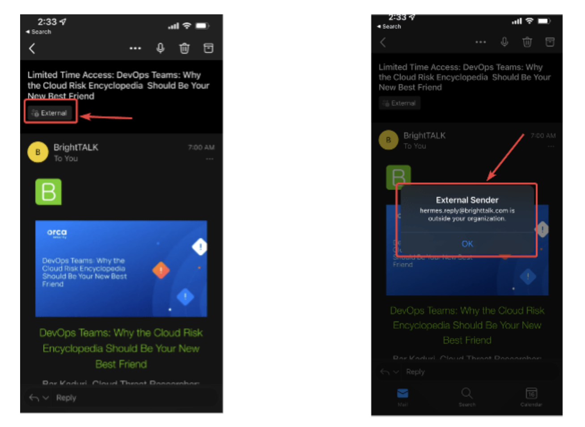
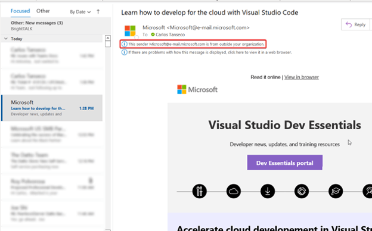

External email warning tag helps to alert users from clicking malicious links and phishing emails sent by external senders. It plays a vital role in protecting against spam and phishing threats. For these years, admins use a transport rule to prepend in the subject line.

In this blog, let’s discuss implementing an ‘external’ tag identifier on your business email. This feature implements an “External” tag identifier on Outlook for email messages received from outside your organization. Microsoft created this feature in hopes that the external tag will help users easily identify spam and phishing threats from external senders. When someone outside your organization receives an email, an “External” title will be present in Outlook on the web, Outlook for Mac, Outlook for iOS, and Android. After clicking the external tag, the email address for the sender will be shown.

In [Outlook clients for Windows](https://support.microsoft.com/en-us/office/getting-started-with-the-new-outlook-for-windows), a mail tip will be present at the top of the reading pane.

If you click the mail tip, it will give you the option to Add a Sender to the Blocked Senders List.

### How to turn on the external email tagging feature

Since external tagging is disabled by default, you will need to manually turn this feature on.

1. **Load the exchange online module on PowerShell.**
   Import-Module ExchangeOnlineManagement
2. **Connect to Exchange Online PowerShell using an admin account. For example:** Connect-ExchangeOnline -UserPrincipalName name@imaginet.com This will prompt a log-on screen for you to enter your password.
3. **Turn on external tagging.**
   The following command will enable external tagging for the whole organization. Set-ExternalInOutlook -Enabled $true

- You could also omit senders and domains from the external tagging feature. For example, to omit admin@fourthcoffee.com
- I would enter the following:
    - Set-ExternalInOutlook -AllowList admin@fourthcoffee.com
  To omit a whole domain, use the following example:
    - Set-ExternalInOutlook -AllowList “quest.com”, “google.com” – Enabled $True
  Adding one domain at a time may throw an exception. A quick workaround would be to add two domains at a time.
- You could also use the get command below to verify that you have enabled the External tagging feature.
- Get-ExternalInOutlook

**To omit a whole domain, use the following example:** Set-ExternalInOutlook -AllowList “quest.com”, “google.com” – Enabled $True Adding one domain at a time may throw an exception. A quick workaround would be to add two domains at a time.

You could also use the get command below to verify that you have enabled the External tagging feature. Get-ExternalInOutlook

Please note that once this feature has been enabled, it may take 24-48 for you to start seeing the External sender tag in email messages received.

Hope this quick tutorial helps you implement the external email identifies tag in your organization and secure your organization from malicious external emails.

Thank you for reading this post! If you enjoyed it, I encourage you to r[each out to Improving ](https://improving.com/contact)to learn more.
