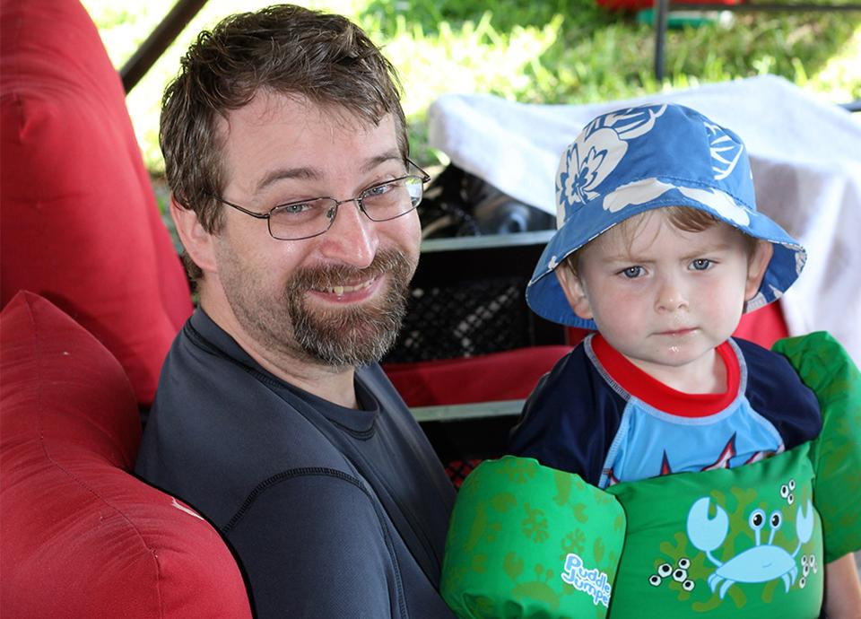

Meet Eric Huckabay, Technical Director from [Improving - Houston](https://improving.com/locations/houston). His history with Improving goes way back to the early years of 2007. Eric helped build the [College Station](https://improving.com/locations/college-station) office where we offer mentorships for students and graduates of Texas A&M.

Eric is one of those developers who has done almost every type of position within software development.

“Usually the role I play on the team is the switch hitter,” Eric shares. “What I tend to do is coordinate and load balance between whatever needs to get done on a project. If we have more work on the UI in this sprint, I work on the User Interface. If we have more work on the backend, I do database work. I’ve done everything from business rules engines, framework development, and highly complex systems.”

In 2012, Eric moved to Houston to work with another company, just two months before the Improving - Houston office opened. Fast forward five years and Eric rejoins the Improving family at the Houston office.

“I came back mostly to work with the people and the environment,” Eric shares. “I really like working with the caliber of people here and the attitude of the people here; the learning orientation, the interest in technology and doing things right - doing things in a way that makes the most difference and is the best for the customers without being overly idealistic.“

That’s a significant part about what makes Improving different - the ability to see what’s going to make things better without having the ‘everything must be the absolute latest and greatest’ mindset. I think to a large extent, Improving understands that what is exciting to a technologist is valuable and we need to stay ahead of that curve so that we can figure out what things actually make a difference to people. Then be able to offer those as people follow that adoption curve and become interested in those technologies. There’s a real balance there.”

I really like working with the caliber of people here and the attitude of the people here; the learning orientation, the interest in technology and doing things right...

Eric Huckabay, Technical Director, Improving

When Eric isn’t at work, he enjoys playing video games and writing fiction. However, in the past three years, how Eric spends his “free time” has significantly changed.

“I have a three-year-old, who is pretty awesome. So that substantially affected my free time,” Eric shares. “Evan charms everybody he meets. He’s cute and he knows it. He taught all of the kids in his preschool ‘All My Exes Live in Texas’ because he’s definitely a performer… He and his friends all do concerts for the teachers at school.”
