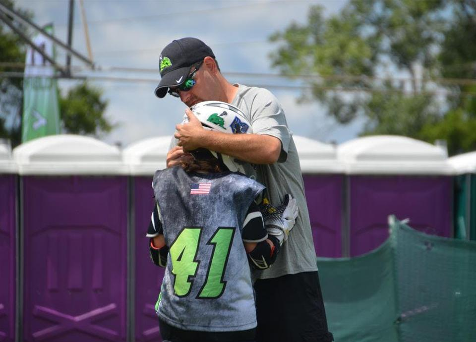

**MEET KEN LEDYARD, THE MICROSOFT PARTNER ALLIANCE MANAGER FOR IMPROVING!**

Ken started working for Improving just over a year ago in our Ohio Enterprise and has now transitioned to Improving Corporate as part of the newly formed Microsoft Services Team.

“I'm excited to collaborate with every Improving Enterprise on the Microsoft Partnership,” he says. “This is an opportunity to ensure we are maximizing the value of our Microsoft Partnership while ensuring our clients are realizing the full potential of the investments they make in Microsoft Technologies.”

Ken’s role will strengthen alignment between Enterprises and drive better communication. This allows Improving to better align technical skills with the needs of our customers. He will work to build deep relationships with Microsoft to ensure Improving is well-aligned as a trusted partner in the Microsoft Partner Ecosystem.

“I will be supporting the company through varied strategic initiatives as they relate to the new Microsoft Cloud Partner Program to ensure Improving and our clients are taking advantage of all the benefits associated with the program.”

Ken has spent a great deal of his professional career around the Microsoft Partner Channel, including 12 years working directly for Microsoft as part of the field sales team and an additional four years with a large Microsoft VAR.

Ken loves to volunteer his time as a boys and girls youth lacrosse coach in his local community. This is from his pregame hug and pep talk routine with his daughter the goalie.

“Since joining Improving I continue to be impressed with the people and the company overall," Ken says. "The technical expertise in Improving is fantastic. In my opinion, there are not a lot of Microsoft Partners with the skill set to execute on the large portfolio of Microsoft Technologies offered, and even fewer who look to accomplish it with trust at the foundation of everything they do. I think that is what really sets Improving apart in the market.”

Improving feels fortunate to have Ken in this position, as his experience in working in both sales and marketing for Microsoft and for a Microsoft Partner provides a unique blend of experience. With 24 years in the technology space, Ken is an asset with a wealth of knowledge for our Enterprises and clients.

During his time off, you can find Ken on a lacrosse field coaching or watching his daughter in high school. You can also find him at THE Ohio State University campus with his son Jase, currently a sophomore pre-med major, cheering on the Buckeyes. Ken currently resides in Perrysburg, Ohio with his wife Carla, daughter Shaye, and their two-family cats Scarlet and Gray.
