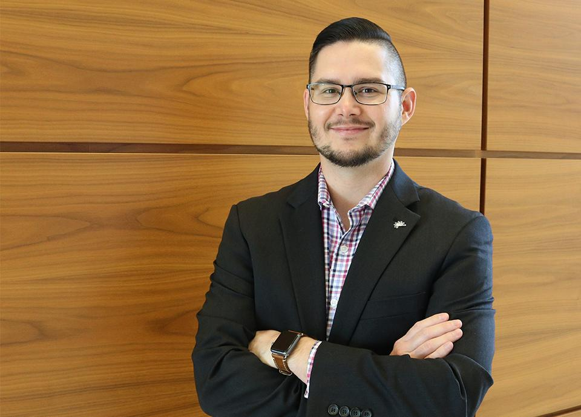
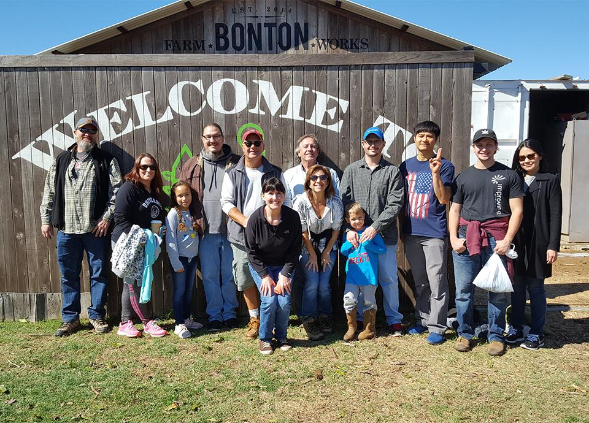

Meet Kevin Baker, Vice President of Consulting and User Experience from our Dallas office. For the last seven years as an Improver, he’s been making great technology feel simple.

“User-Centered Design is learning what the user needs, what the business needs, and then being able to meet in the middle” Kevin explains. “ I’ve made it a habit to keep asking why.”

“When I was first started at Improving, I quickly realized that I was amongst some of the smartest people, I knew I was in the right place to learn and grow.”

Kevin has also been a major mover behind the company-wide adoption of Conscious Capitalism. “I love the concept that business is there to do something more than just make money and that the people that are in the company are important. It’s not just about the people that are in the company. It’s about everybody and everything the business touches.” He looks forward to the yearly international conferences and has attended almost every Dallas chapter meeting since 2016.

Looking beyond the obvious has become a large part of Kevin’s work ethic. “Purpose has been on my mind a lot lately. We can do work or other things that look like progress, but at the end of the day if we’re not doing it for something greater, we don’t have a purpose in what we’re doing.”

Of the many ways that Kevin supports the office, the most loved tradition is his daughter’s Girl Scout cookie deliveries each winter. “With a five and an eight-year-old, it’s all about the kids right now, but I really do love the outdoors. That could mean anything, fishing, going kayaking, or just hanging out in nature by a campfire.”
