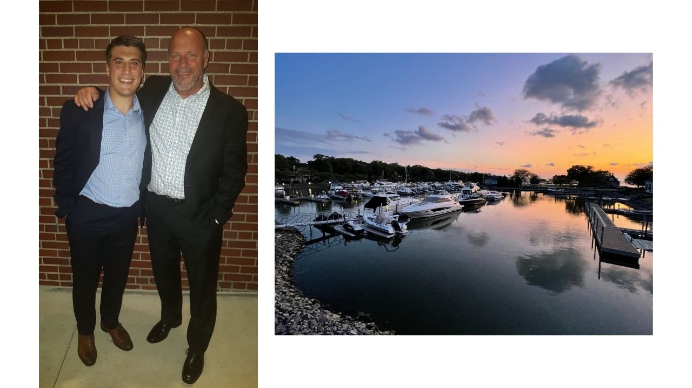

Meet Lowell Messner, SVP of the Microsoft Services Team for Improving. Lowell has been with Prosource (pre-Improving) since 2006. Improving acquired ProSource in 2017 and Lowell continued as president. Earlier this year the Cleveland and Columbus Ohio locations combined under the leadership of Josh Harrison, allowing Lowell to extend his passion for working with Microsoft to all the Improving Enterprises.

"As a Microsoft Managed Partner, we have created strong relationships with Microsoft Executives and several Microsoft Sellers and Specialists in the field. Improving has the resources to provide services and support on all three of the Microsoft Clouds (M365, Azure, and D365) in a variety of Microsoft account segments and industries. I’m thrilled to have the opportunity to continue the existing relationships while cultivating new relationships at Microsoft for Improving."

Lowell’s role will strengthen alignment between all Improving Enterprises and Microsoft to allow each Enterprise and our clients to fully leverage the benefits of our Microsoft Partnership.

Lowell has spent his professional career in the technology industry. Prior to Improving he held key leadership positions with National City Bank (now PNC), Fabri-Centers of America (now Joann), CCAi, and University Hospitals of Cleveland.

“Since day one of joining ProSource with Improving I have been impressed with the culture of the organization and the passion they display for the people," Lowell said. "Today I feel Improving is one of the few Partners in the Microsoft Ecosystem that has the expertise to support the large portfolio of Microsoft Technologies offers. Our ability to cover all three Microsoft Clouds with multiple offices in the US and our resources in our Canadian and Mexico offices provides us a competitive advantage few other Microsoft Partners can offer.”

The two things in life that bring joy to Lowell are his son Anthony and waking up to the view from his Ohio home on Lake Erie.

Lowell’s experience and passion for Microsoft and its Partner Program make him an ideal leader for Improving’s newly formed Microsoft Services Team.

During his time off, you can find Lowell on his boat entertaining colleagues and friends or spending quality time with his son Anthony. Lowell also enjoys traveling and sampling fine wines. Lowell currently resides in Catawba, Ohio.
