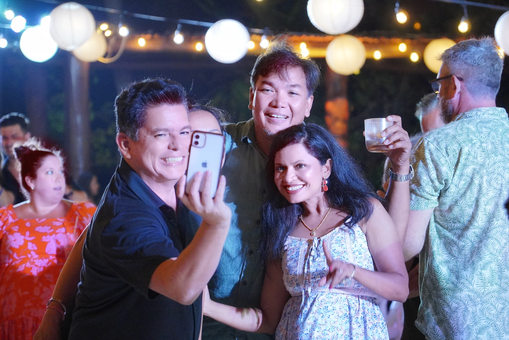
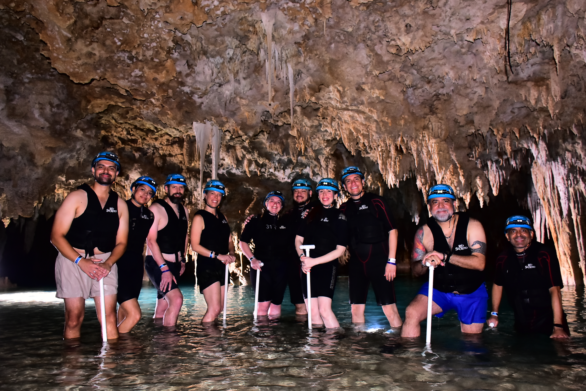
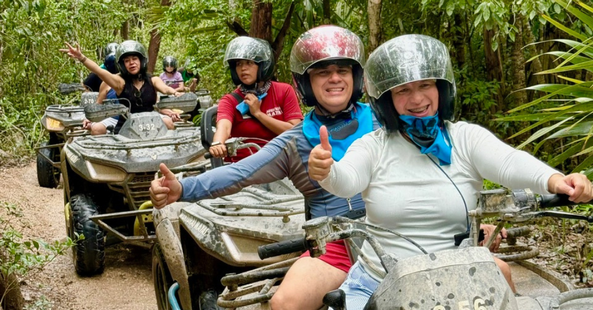
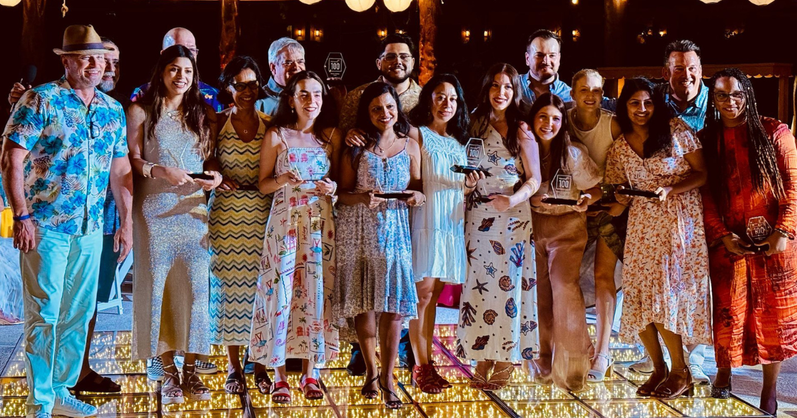

Just seven months ago, [Leniolabs](https://www.improving.com/thoughts/improving-expands-footprint-with-leniolabs-acquisition/) became part of the Improving family as Improving South America. Like any major change, it came with excitement… and a little bit of uncertainty. What would this new chapter bring? How would we fit into a company that, until recently, felt so far away? That uncertainty was quickly replaced by something else: warmth, connection, and a sense of belonging, all thanks to the people who welcomed us so genuinely.

It was a couple of months into the integration when I first heard about *Improving 100*, a recognition program that honors those who consistently go the extra mile. A program designed to celebrate Improvers across the company who embody our values through their dedication, impact, and spirit. Little did I know that months later, not only would I get to nominate some amazing colleagues, but I would also receive the honor of being selected as one of the 2024 *Improving 100* recipients myself.

Honestly, it’s hard to put into words how it felt. It was an experience filled with humility, joy, and deep gratitude. Not just for the recognition, but because it meant that my teammates, people I admire and respect, took the time to nominate me. That kind of trust and support stays with you.

And just like that, my journey began.

Each of us Improving 100 winners (plus our chosen guests) were invited to an all-expenses-paid weekend getaway to Maroma Beach Resort in Cancún, from June 27th to 29th. A tropical, all-inclusive celebration with fellow Improvers from around the world. How surreal is that?

From the moment the confirmation email hit my inbox in April, I could feel the anticipation growing. I remember reading it over and over, trying to process what was happening. Soon after, we were choosing our excursions, making travel plans, and, of course, counting the days until we could finally meet in person the faces we’ve come to know only through a screen.

### **From Winter to Warmth**

Coming from South America meant a long journey: nearly 10 hours of travel for us, a few hours for others. But from the moment we landed, we were welcomed by the heat, humidity, and joy that only the tropics can offer. It felt like the weather itself was embracing us, whispering, “This weekend will be unforgettable.”

When we arrived at the resort, everything had been carefully prepared to make us feel special. A private check-in for Improvers awaited us, complete with champagne, beer, snacks, and the friendliest welcome (Mexicans truly know how to host!). We were handed a beautifully curated welcome bag: thermal tumbler, sunscreen, cap, Improving bracelets, itinerary, snacks, lip balm, and electrolytes (which we’d definitely need in the days to come).

Right away, familiar faces began to appear. I got to meet people I had only known through Teams calls or messages. The joy of finally putting voices into real-life smiles was overwhelming. We were no longer just avatars or profile pictures. We were people, together in the same place, ready to celebrate.

That evening, we gathered at the World Café for our official welcome toast. Despite a sudden tropical rainstorm (Cancún had surprises for us!), spirits were high. As we raised our “Improving blue” cocktails, the leadership team** **shared heartfelt words that reminded us why we were there, not just for our individual achievements, but because we are part of something greater. The energy in that room was electric, and we all knew this was the start of something magical.

### **Memories in the Making**

Over the next few days, we dove headfirst into connection and celebration. The resort offered world-class cuisine: Mexican, Italian, French, Asian, seafood, and steak. I’m still adjusting to post-resort meals! Each night came with a new activity: karaoke on the first night, and a silent disco on the second (which turned into the loudest fun once a few of us figured out how to dance with headphones *and* still talk to each other) We laughed until our stomachs hurt, danced with a glowing robot, and created inside jokes that will last far beyond the weekend.

Friday was excursion day. I chose the ATV + cenote adventure, something I had never done before. I was nervous, but the guides and other Improvers were so encouraging that I felt completely safe. We raced through muddy trails, soaked in jungle rain and laughter, before plunging into the crystal-clear waters of a cenote. A traditional Mexican lunch followed, and a quick stop in Morelos for shopping and tequila tastings completed the perfect day.

Back at the resort, the rain returned, but instead of retreating, we embraced it. That afternoon, part of the Improving South American team and I decided to take a walk, coffee in hand, and explore the hotel grounds despite the weather. Eventually, we ended up by the pool, completely empty under the gray sky. It felt like a hidden treasure, so we dipped our feet in and, minutes later, we were fully in.

Soon enough, Improving’s CEO, Curtis Hite, and CCO, Devlin Liles, joined us, and just like that (without any plan or schedule), we were having a full-blown improvised pool party. More people started trickling in, margaritas in hand, and within no time, it turned into a joyful, spontaneous moment of connection and fun. Stories, jokes, even a couple of impromptu cheers. It was a perfect reminder that sometimes the best moments are the ones that aren’t planned.

### **A Night to Remember**

Saturday came quickly. After a short visit to Playa del Carmen, we returned to a lively afternoon at the resort. Volleyball on the beach, lounging in the pool, sharing stories under umbrellas: it was all about enjoying our last full day in paradise.

That night, we had our VIP Dinner, a new addition to this year’s experience that brought an even more personal touch to the weekend. Small groups enjoyed a more intimate setting hosted by leadership. I chose the Asian restaurant and was joined by a** **wonderful group of fellow Improvers. Over delicious food and lighthearted conversation, we deepened the kind of connections that don’t happen in team messages.

And then came the grand finale: the Improving 100 Celebration at Oceana Terrace. Everyone looked stunning dressed up, glowing from the joy of the last few days. The North American Managing Director, Scott McMichael, and Curtis shared words that moved me to tears. It wasn’t just about trophies or recognition. It was about community, feeling seen, appreciated, and empowered. As the awards were handed out, hugs exchanged, and photos snapped, I felt truly lucky to be there.

When the music started, the dance floor came alive. We laughed, we celebrated, we played limbo, and we said our goodbyes (some tearful, some hopeful) with the promise to carry this magic forward.

### **The Takeaway**

This wasn’t just a weekend in Cancún. It was a celebration of who we are as individuals, as teammates, as Improvers. It reminded me why we give our all. It showed me what community looks like across borders, cultures, and languages.

If you’re reading this and wondering if you could be part of the next Improving 100. YES, you absolutely can. Keep showing up. Keep caring. Keep giving your best. **Magic happens when people see the light in you, and even more when you see it in others.** Want to become part of the Improving family? [Reach out to us](https://www.improving.com/contact/) and [explore our career page](https://www.improving.com/careers/).
