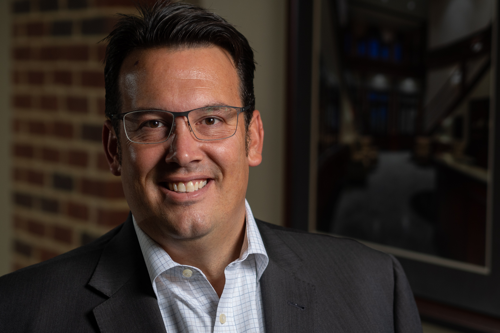

Improving has acquired [Innovative Architects](https://www.innovativearchitects.com/), headquartered in Atlanta, Georgia with satellite offices in Washington D.C. and Florida. The transaction is expected to increase Improving's annualized revenue by more than 30% in 2019, making Improving’s collective revenue close to $100 million.

This transaction successfully continues Improving’s “Enterprise Strategy,” an innovative business model that focuses on merging technology service companies that share a commitment to building trust, delivering excellence, and cultivating culture. This model combines localized incentives and ownership behavior with geographically leveraged service offerings. Innovative Architects’ leadership team will continue operating and growing the business, while contributing to Improving’s sustained success across North America. Innovative Architects joins Improving as its seventh enterprise location and will expand its geographic reach to the Southeastern United States.

The mutual benefits of joining forces with businesses that share similar company values is that it allows us to advance our ambition of building a company that has a lasting impact in the technology community.

Curtis Hite, CEO, Improving

"The mutual benefit of joining forces with businesses that share similar company values is that it allows us to advance our ambition of building a company that has a lasting impact in the technology community,” states Curtis Hite, CEO of Improving. “Our goal is to further the success of IT organizations across the region by combining the proven performance of local teams with an increased focus on establishing stakeholder trust. Innovative Architects’ strong culture and expertise in Microsoft technologies and cloud computing will strategically accelerate our ability to accomplish these goals.”

Innovative Architects’ service offerings focus on delivering customized cloud computing business technology as well as enterprise integration and data driven IT solutions. The merger will significantly strengthen the breadth and depth of the technical consulting services and training offerings that can now be utilized across all of Improving’s markets. Innovative Architects is a Microsoft Gold-Certified Partner that provides premier, process-based business solutions.

“We are thrilled to be a part of Improving’s growth strategy,” states Scott McMichael, President of Innovative Architects. “Improving shares our values of trusted advisor-ship and a commitment to client success. We have remarkable synergies as a culture-rich organization that rewards innovation and involvement. We are looking forward to anchoring the Southeast in the national footprint of Improving to better serve our clients from both a business and technology perspective."

To read more, please visit [PRnewswire](https://www.prnewswire.com/news-releases/improving-acquires-georgia-based-innovative-architects-300774090.html?tc=eml_cleartime).
