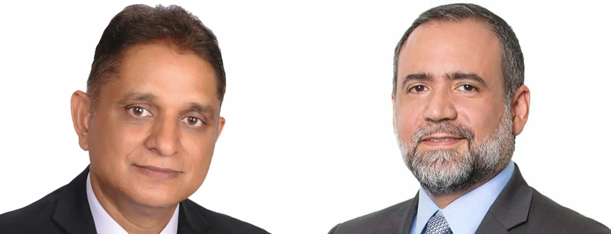

Improving has merged with [iTexico](https://www.itexico.com/), headquartered in Austin, Texas with nearshore offices in Guadalajara and Aguascalientes, Mexico and sales offices in Dallas, Chicago, Northern California and Southern California. The merger is expected to increase Improving's workforce by more than 300 professionals with a combined annualized revenue in excess of $115 million.

This transaction successfully continues Improving’s “Enterprise Strategy,” an innovative business model that focuses on merging technology service companies that share a common commitment to delivering excellence, cultivating culture, and building trust within the industry and community. The iTexico merger is particularly strategic as it expands Improving into the nearshore market with teams in Mexico, while also providing a local presence in one of the United States’ fastest growing cities, Austin, Texas. iTexico’s leadership team will continue operating and growing the business, while contributing to Improving’s sustained innovation and industry leadership across North America.

...our companies’ values and cultures seem unusually aligned. iTexico has a noticeable commitment to an inclusive culture with an equal expectation of delivery excellence. This merger is truly exciting.

Curtis Hite, CEO, Improving

“The mutual benefits of joining forces with a business like iTexico are significant. We are now able to serve both new and existing customers in ways that neither company alone could prior to our merger. It will immediately provide noticeable value to our existing partners by giving them access to new and critical services” states Curtis Hite, CEO of Improving. “Equally as important, our companies’ values and cultures seem unusually aligned. iTexico has a noticeable commitment to an inclusive culture with an equal expectation of delivery excellence. This merger is truly exciting.”

iTexico’s service offerings focus on delivering end-to-end software development and digital services, including Agile Product Engineering, UI/UX & Design, Mobile, Cloud and AI, all with a nearshore delivery model in nearby Mexico. The merger will significantly strengthen the breadth and depth of the technical consulting, digital services and training offerings that can now be utilized across all of Improving’s markets. iTexico has been growing very rapidly and has been on the Inc. 5000 list five times in the last six years.

We look forward to working with Curtis and his leadership team to offer additional innovative and transformative digital solutions to our clients and grow our teams in the U.S. and Mexico.

Anurag Kumar, CEO & Co-Founder, iTexico

“We are thrilled to be a part of Improving’s growth strategy,” states Anurag Kumar, CEO of iTexico. “Improving shares our values of trusted advisor-ship and a commitment to client success. We have remarkable synergies as a culture-rich organization that rewards innovation and involvement. We look forward to working with Curtis and his leadership team to offer additional innovative and transformative digital solutions to our clients and grow our teams in the U.S. and Mexico.”

To read more, please visit [PRNewswire](https://www.prnewswire.com/news-releases/improving-acquires-nearshore-model-company-itexico-301079030.html?tc=eml_cleartime)

