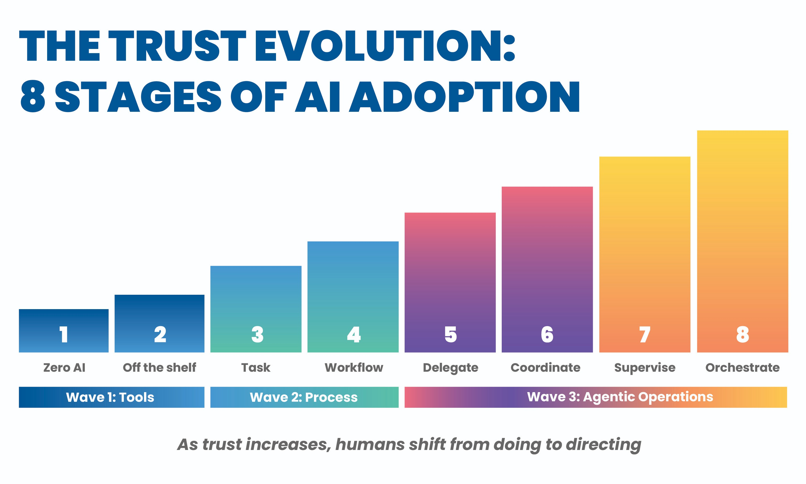

> ***Editor's Note: ***

> *Windsurf is now Devin Desktop. Devin Desktop brings the full engineering cycle in one place, from planning, to delegating, reviewing, and merging. The future of software engineering is managing teams of agents working alongside you. Devin Desktop is the command center for that.*

> [*Learn more about Devin Enterprise.*](https://devin.ai/enterprise)

##### **Enterprise-grade AI adoption built on Improving’s AI Maturity Model — from first steps to autonomous agent orchestration **

**Dallas, TX — February 18, 2026**

[Improving](https://improving.com/), a leading digital services and software consulting company, announced a strategic partnership with [Cognition](https://cognition.ai/), signaling a shared commitment to the future of autonomous AI‑driven software development. This collaboration brings together Cognition’s breakthrough autonomous AI technology with Improving’s deep consulting expertise and its proven **AI Maturity Model:** a structured 8-stage framework that guides organizations from initial AI experimentation through full autonomous agent orchestration.

Through this partnership, Improving will deploy two of Cognition’s flagship products: [**Devin**](https://devin.ai/), the autonomous AI software engineer, and [Windsurf](https://windsurf.com/), the AI‑enabled development environment. Both serve as accelerators, helping engineering teams progress through the maturity model and reach true autonomous operation.

## **The Trust Evolution: Improving’s 8 Stages of AI Adoption**

Improving’s AI Maturity Model defines the progression organizations must navigate as they adopt AI, not only in technology, but also in trust, governance, and the fundamental way teams work. The model spans three waves and eight stages:

**Wave 1 — Tools **(Stages 1–2): from zero AI usage to off-the-shelf AI assistance, where humans approve every action.

**Wave 2 — Process** (Stages 3–4): AI moves beyond individual tasks to full workflows, with governance infrastructure becoming essential.

**Wave 3 — Agentic Operations** (Stages 5–8): agents run autonomously outside the IDE, operate in parallel, coordinate other agents, and span multiple products. This is where organizations achieve transformational development capacity.

As trust increases, human roles shift from* doing *to *directing.* The maturity model recognizes that scaling AI’s real challenges are trust, governance, and organizational readiness. Each stage builds the muscle memory and infrastructure required to advance to the next stage.

## **Accelerating Teams Along the Maturity Curve **

### **Windsurf: Easy Adoption at Stages 1–3**

Windsurf is Cognition’s AI‑enabled development environment that embeds advanced AI capabilities directly into the developer’s workflow. For organizations at the earliest stages of AI adoption, Windsurf significantly lowers the barrier to entry. It meets developers exactly where they are inside their IDE and introduces AI assistance in a way that feels natural, not disruptive.

- **Stage 1 → Stage 2 (Zero AI → Off-The-Shelf): **Windsurf introduces AI-assisted code generation, review, and explanation within the familiar IDE experience. Developers learn to work alongside AI with full visibility and approval over every suggestion, building foundational trust that’s required for later stages.
- **Stage 2 → Stage 3 (Off-The-Shelf → Task): **As teams gain confidence, Windsurf enables the shift from ad‑hoc prompting to defined task-level agents. Developers move from reviewing individual suggestions to delegating entire task steps, like generating test suites from specifications or scaffolding boilerplate from conventions, with documented constraints that make autonomous task execution safe and predictable.

Because Windsurf integrates into existing workflows with minimal disruption, it serves as the ideal on-ramp for organizations that need to build AI fluency across their entire engineering team.

### **Devin: Enterprise-Grade Autonomy at Stages 4–6+**

At the center of the partnership is Devin, Cognition’s autonomous AI software engineer. Devin independently plans, writes, debugs, and deploys code, operating as a true contributor within a software development organization. Devin represents the leap into Wave 3: Agentic Operations.

- **Stage 4 — (Workflow): **Devin operates as a workflow-level agent, coordinating across planning, implementation, testing, and deployment. Improving wraps Devin’s deployment in enterprise-grade governance infrastructure and allows the team to add to the process without having to build the plumbing.
- **Stage 5 — (Delegate): **Devin runs in a sandboxed environment outside the IDE, which is the defining characteristic of Stage 5. Teams stop watching agents’ code in real time and instead review status dashboards and output artifacts. This shift frees developer attention from observation to direction, unlocking the capacity to manage multiple workstreams simultaneously. Devin produces pull requests, test results, and deployment configurations that humans review as deliverables, not as a live stream.
- **Stage 6+ — (Coordinate, Supervise, Orchestrate): **Multiple Devin instances can run in parallel on isolated workstreams — one implementing a feature, another writing tests, a third generating documentation — each on its own branch with no cross-contamination. Improving’s multi-agent infrastructure provides the status aggregation, merge strategy, and context-sharing protocols required to operate at this scale. At Stages 7–8, meta-agents orchestrate Devin instances, with humans setting goals and reviewing milestones while the agent system handles execution planning.

*“Enterprise AI adoption doesn’t happen with tools alone. It happens when organizations have the right partners to guide how those tools reshape the way teams work. Improving brings deep expertise in enterprise transformation and governance, which is exactly what companies need as they move from AI experimentation to autonomous software development. Together, we’re helping engineering organizations build the trust, operational models, and infrastructure required to unlock the full potential of Devin and Windsurf.” *

- **Gardner Johnson**, Global VP of Partnerships, Cognition

## **Enterprise-Grade Opinions and Mature Governance **

Improving’s approach to AI adoption is built on a core conviction: ***autonomy without governance fails.*** Research shows autonomous AI projects achieve only 20% success rates without governance infrastructure, compared to 45% with it. The human-plus-AI combination at Stages 5–6 achieves 94% quality, which is higher than either fully manual (85%) or fully autonomous (73%) approaches.

As an implementation partner, Improving brings enterprise-grade opinions to every deployment. These are battle-tested standards shaped by decades of software consulting across industries, not generic best practices. This includes:

- **Governance Engine: **Breaking governance from bookend compliance (policy documents upfront, audits after the fact) into participatory infrastructure. Governance agents actively check the work of execution agents, conducting back-and-forth review cycles before escalating to humans.
- **Multi-Agent Infrastructure: **Purpose-built orchestration for running multiple Devin instances in parallel with proper isolation, monitoring, and merge strategies. It’s the plumbing that makes Stages 5–8 operationally viable.
- **Change Management and Training: **Guiding teams through the psychological shift from *doing* to *directing*. Improving’s maturity model recognizes that scaling AI is as much an identity and culture challenge as a technology one.
- **Domain-Specific Compliance: **Automated governance agents that activate based on context like HIPAA compliance for healthcare engagements, PCI for payment processing, SOC 2 for SaaS, ensuring regulatory requirements are met at every stage of autonomous operation.

## **Proven in Practice**

Improving has already seen the promise of this future firsthand. As part of an internal pilot, the company deployed Devin within **Engage**, Improving’s custom-built employee platform that supports learning management, skills tracking, recognition, and internal collaboration. Engage represents a large, long‑standing codebase, similar to those used by many enterprises today. Devin successfully added features and supported ongoing maintenance, demonstrating how autonomous AI delivers meaningful impact in real‑world, enterprise environments and validating the progression from Stage 4 through Stage 5 in practice.

*“Our partnership with Cognition represents a shared vision for where software development is headed. We’re not just handing teams a new tool. We’re guiding them through a maturity progression that builds trust, governance, and operational readiness at every stage. Windsurf gets teams fluent in AI‑assisted development. Devin takes them into true autonomous operation. And Improving’s role is to make sure they’re ready for each step.”*

**— Devlin Liles, **Chief Customer Officer, Improving

## **Ready for Stage 5 and Beyond**

The partnership positions Improving and Cognition to help organizations reach the stages where AI delivers transformational, not incremental, value. Windsurf provides an easy on-ramp that builds AI fluency across every developer. Devin provides the autonomous capacity that lets teams expand output without expanding headcount. Improving provides enterprise-grade governance, multi-agent infrastructure, and change management expertise that make the journey safe, structured, and sustainable.

Together, Improving and Cognition are helping organizations move beyond AI experimentation into **AI‑native software development,** where autonomous agents operate at scale, governance becomes infrastructure rather than overhead, and humans direct outcomes instead of performing tasks.

## **About Improving**

Improving is a modern digital services firm specializing in artificial intelligence, data, and application development. Since 2019, it has partnered with private equity firm Trinity Hunt Partners to accelerate its growth, driven by a strong commitment to trust, diversity, and innovation. The company operates internationally, with 21 offices across the Americas and India. To learn more about Improving, visit [improving.com](https://improving.com/)

## **About Cognition**

Cognition is an applied AI lab building autonomous agents for software development. Its flagship product, Devin, is the first autonomous AI software engineer capable of planning, writing, debugging, and deploying code across complex real-world environments. Cognition also develops Windsurf, an AI-enabled development environment that brings powerful AI capabilities directly into the developer workflow. Together, Devin and Windsurf enable engineering teams to move beyond traditional coding assistants toward autonomous, agent-driven software development. Cognition works with leading enterprises around the world to help teams increase development velocity, expand engineering capacity, and safely deploy AI-native software systems at scale. To learn more, visit [cognition.ai](https://cognition.ai/).

For additional information, please reach out to:

**Kristin Johnson, VP of Marketing at Improving**

+1 (214) 613-4444

[kristin.johnson@improving.com](mailto:kristin.johnson@improving.com)
