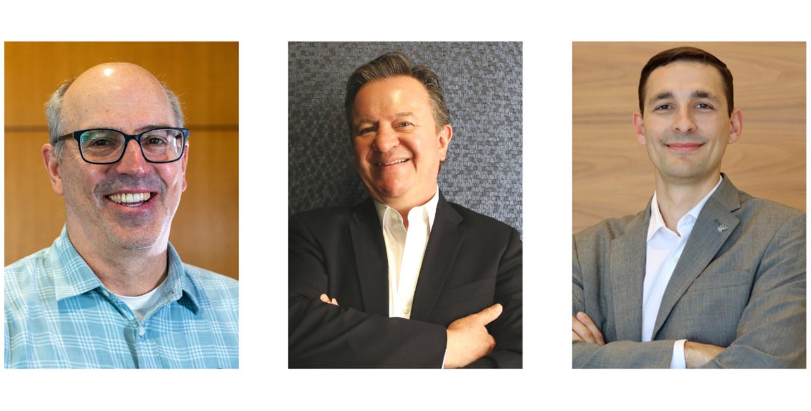

Improving is delighted to share that we have several new positions and promotions within our company! As we continue to grow, it’s important that our leadership team does too. We know that each of these people will work vigorously to ensure success and sustainability throughout all our enterprises while maintaining their commitment to making Improving a great place to work.

Chris Spurgat, our former President of the Minnesota enterprise, has transitioned into our Chief Information Officer. His primary focus will be on maturing our processes and technologies that help support the goals and overall vision for Improving.

New to Improving is Jorge Pliego who has been hired as our Chief Financial Officer. Jorge brings over 30 years of experience in large FMCGs and is responsible for the development and execution of the organization’s financial strategies. His steadfast leadership will guide Improving in our organic and strategic growth initiatives.

Devlin Liles will be taking on a dual role of continuing as the President of Improving’s Houston enterprise as well as becoming our new Chief Consulting Officer. His role as CCO will be providing opportunities for our consultants to excel through growth and career planning programs, as well as rolling out tools, templates, and processes to increase value to our clients.

## More Changes to Our Executive Team

Mark Kovacevich will be moving into the new role of EVP of Integrations, assisting Ric DeAnda, Improving’s Chief Acquisition Officer, with the integration of newly acquired companies into the Improving brand. Working alongside the core team of individuals in the acquired company to adopt the tools and processes that Improving uses, Mark will oversee the transition and progress of everything from business development to technology tools to employee engagement.

Additionally, Scott McMichael will be assuming Mark’s role of Managing Director of Improving’s Northern region and handling all oversight as the Managing Director of North America. Scott will be providing opportunities to lead amazing and creative executives as Improving continues to grow, positioning the team for greater impact across North America to positively change the perception of the IT Professional.

To further align the efforts of our sales and business development teams, Improving has also appointed Matt Russell from our Minneapolis office to be our Senior Vice President of Sales. He will lead a collaborative sales team across all of Improving to ensure consistent planning, execution and follow-through with our sales teams to ensure client satisfaction.

On a similar note, Clara Sponitz will be assuming the role of Vice President of Centralized Recruiting. She will be focused on creating communication channels between recruiters in all the Improving offices, along with overseeing a central sourcing team. Her efforts and leadership in facilitating consistent tools, processes, and messaging will allow for Improving to recruit as a whole, rather than on an individual basis.

With the recent shifts in positions, we are delighted to announce that Jay Bailey, a Vice President in the Atlanta enterprise, has moved into the role of President. Similarly, Ehren Seim, who was General Manager of the Minneapolis enterprise is now appointed as President. Both executives will focus on the areas of Sales, Culture, Recruiting, and Delivery of their respective enterprises.

We are so excited for this new chapter for Improving and cannot wait to see how these leaders flourish within their positions.
