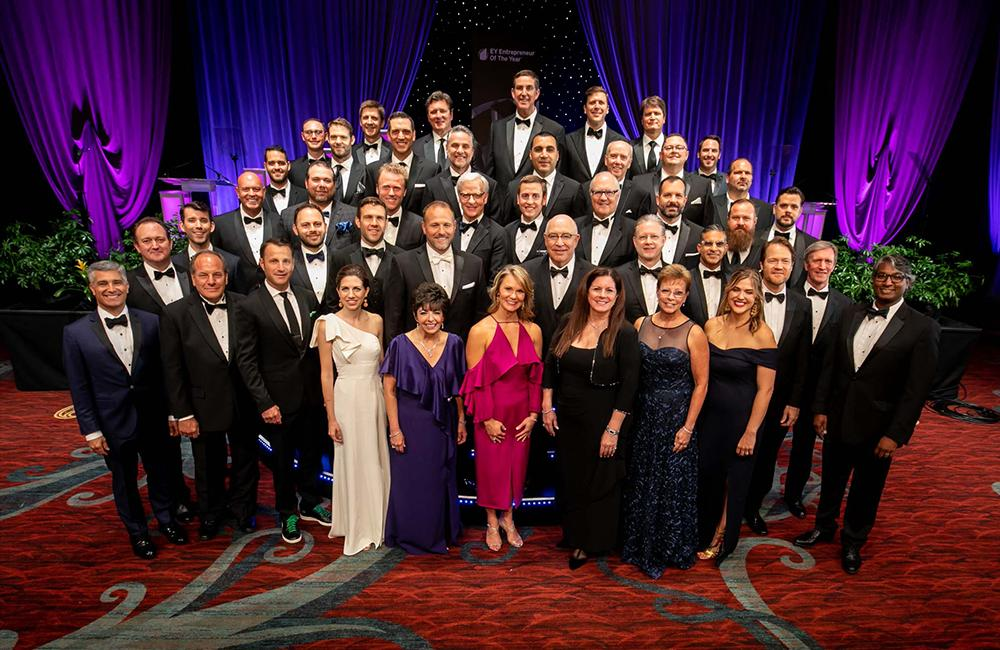

Improving CEO, Curtis Hite, was honored as a finalist for the Entrepreneur Of The Year® 2018 Award in the Southwest region. The Entrepreneur Of The Year award recognizes business leaders from more than 60 countries and is in its 32nd year. Hite was selected out of 900 nominees for the North Texas, Arkansas, Oklahoma and Kansas-Wichita area.

Finalists are chosen based on their achievements in categories such as "innovation, financial performance and personal commitment to their businesses and communities."

Curtis is passionate about creating a great place to work. We attract talented individuals to work at Improving because we are a purpose-driven company that thinks beyond profit. The key is having creative ways for team members to engage with our culture.

Ric DeAnda, VP of Operations

Finalists celebrated at the Hilton Anatole in Dallas on Saturday, June 23 where the winners were announced. For the past 11 years, D CEO has profiled all of the finalists for the Southwest region. To find out more about the finalists for this year, visit [here](https://www.dmagazine.com/publications/d-ceo/2018/july/entrepreneur-of-the-year/).

Transcription:

"Improving is a professional services company that focuses on delivering software application development. I think the proudest achievement is our commitment to culture and creating a great place to work for so many of the employees at our company.

I want to finish what we started so next for the company is taking our promise of trust, taking that with more impact to the entire community, our customers, our suppliers and all of our stakeholders.

I’m most inspired by my father, he was a great man and probably the best person I know."
