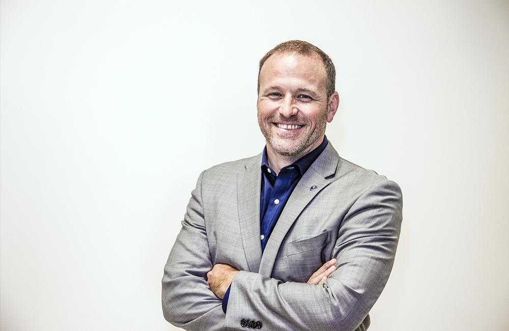

On February 7, 2018, [Conscious Capitalism International](https://www.consciouscapitalism.org/board) announced the new executive leaders that have joined the Board of Directors. Improving co-founder and CEO, Curtis Hite, is among eight newly appointed members.

Hite has joined many notable names and companies on the Board, including John Mackey, co-founder and CEO of Whole Foods Market, and Kip Tindell, co-founder, and chairman of The Container Store.

Members of the Board of Directors are leaders in the Conscious Capitalism movement and are charged with setting the strategic direction for the organization.

“We are honored and grateful that these exemplary leaders of conscious businesses have chosen to lend their experience and insights to what may very well be the defining social movement of the 21st century,” said Alexander McCobin, chief executive officer of Conscious Capitalism International. “With their additional guidance, we are even more so encouraged that the day when a more conscious practice of capitalism becomes the norm rather than the exception is well within our reach.”

Improving has been a longtime leader and sponsor for the Conscious Capitalism movement. [Conscious Capitalism](https://www.improving.com/conscious-capitalism) is the foundation and philosophy of Improving.

Read the full press release on [PRWeb](https://www.prweb.com/releases/2018/02/prweb15180392.htm).
