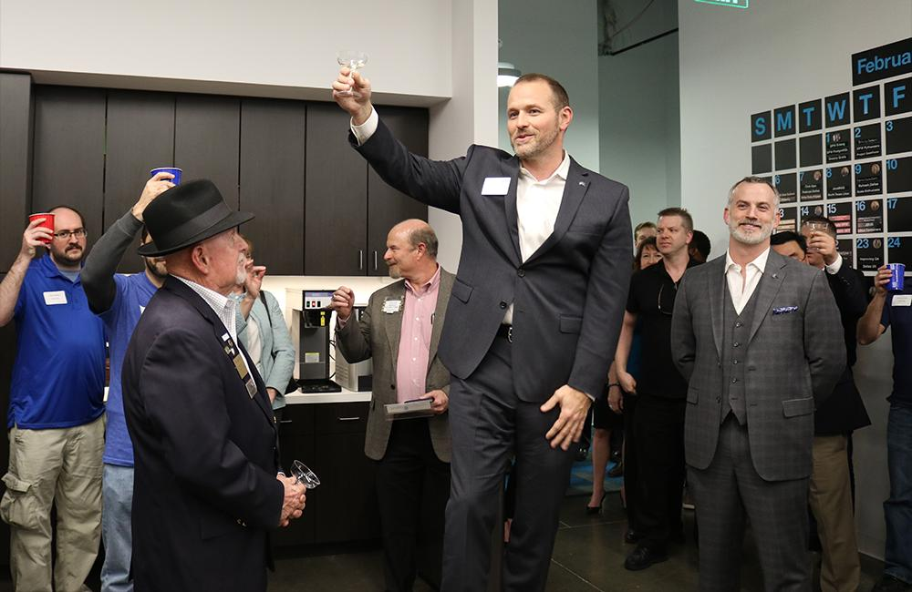
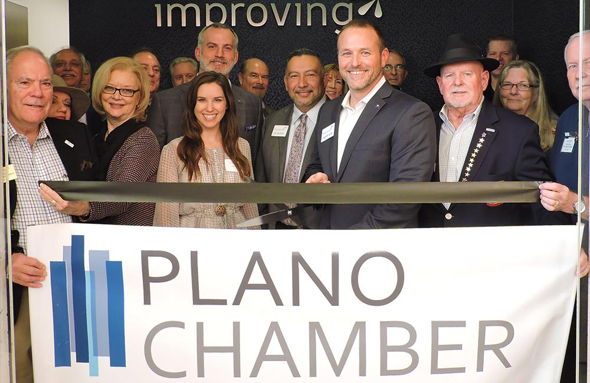
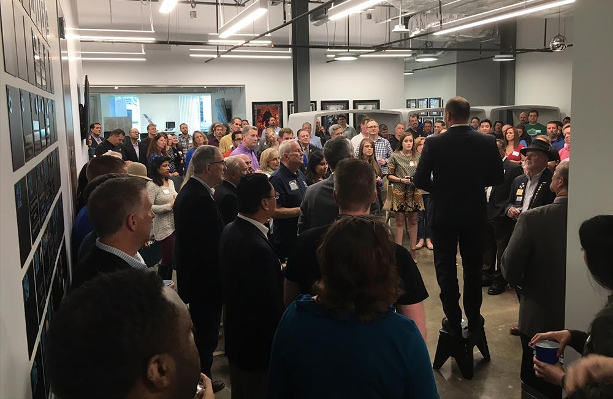
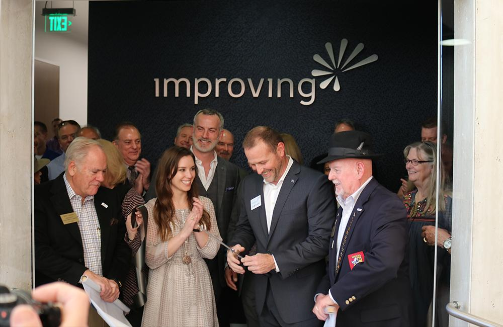

In ten years’ time, Improving has grown to five enterprise locations with six offices in total spanning across the United States and Canada. Our Dallas location has moved offices yet again to accommodate that growth for its consultants and customers.

Relocating from Addison to Plano, Texas, we celebrated the new location with friends, family, clients, and the community by hosting a grand opening and ribbon-cutting ceremony on January 31st. To welcome us to the city, members of the [Plano Chamber of Commerce](https://www.planochamber.org/) attended the event. Passed hors d’oeuvres were served as well as a champagne toast.

Our new space was built with an "open" concept environment ideal for team collaboration and creative problem-solving. It offers three classrooms dedicated to both software and process training classes. It also offers a large project area for the numerous onsite development teams that meet in the space.

We are looking forward to our continued involvement in the local technology community, as well as to sharing our commitment of building trust with our clients, suppliers, and community.

Curtis Hite, CEO, Improving

“We are very excited to be a part of the growing North Texas area, in particular the City of Plano. We are looking forward to our continued involvement in the local technology community, as well as to sharing our commitment to building trust with our clients, suppliers, and community,” shares Curtis Hite, CEO of Improving.

With close to 175 guests in total in attendance, we had the great pleasure of showcasing our culture and values to the community. Excited for the future, we look forward to continuing to grow within the dynamic North Texas area.

