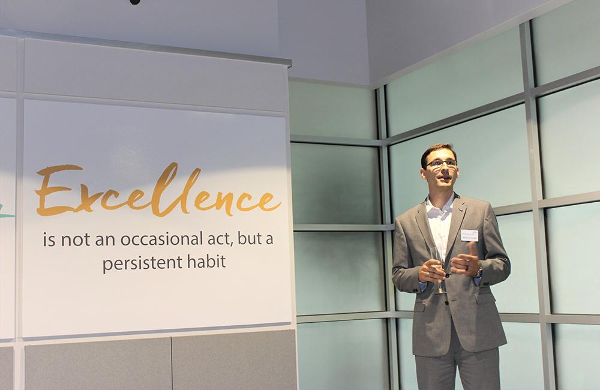
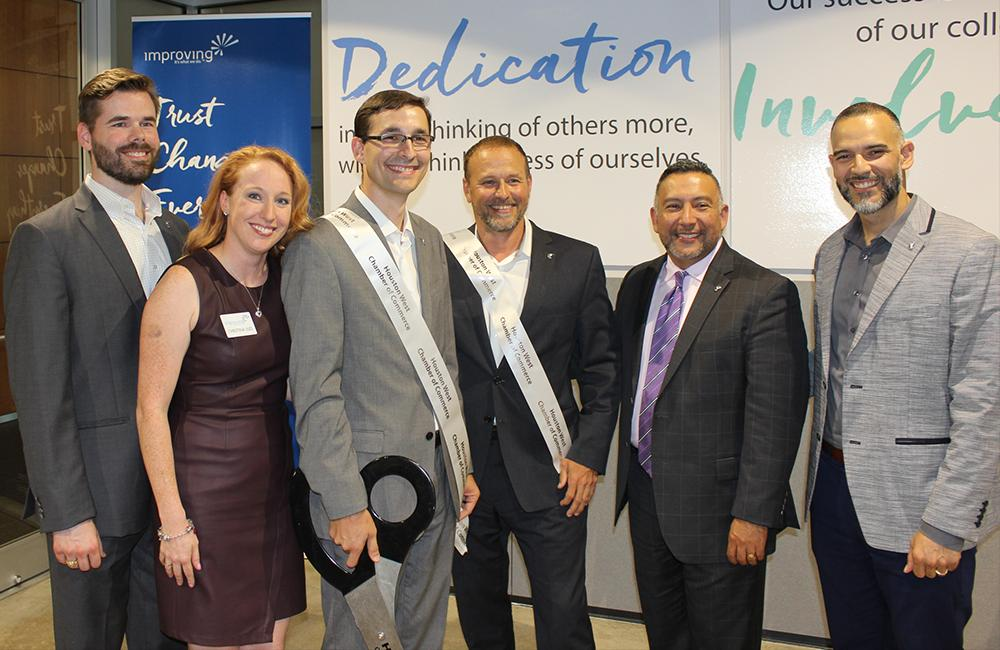

Our Houston Office is growing and to accommodate that growth, we have recently moved from our Bellaire location to a newly designed office space in the heart of the Energy Corridor in Houston. We celebrated with a Ribbon Cutting ceremony on June 15th with family, friends, and clients. We were welcomed to the area by members of the Houston West Chamber of Commerce. Passed hors d'oeuvres were served as well as a champagne toast.

Our new space was built with an open-concept environment ideal for team collaboration and creative problem-solving. It offers two classrooms dedicated to both software and process training classes. It also offers a large project area for the numerous onsite development teams that meet in the space. With the large classrooms, we now host several community user groups in the Houston area and are continuing to add more.

I am very excited about the growth that we have seen in Houston, and building our new long-term office has given us a great foundation to continue growing. The dedication and excellence of Improvers has continually exceeded even our greatest expectations.

Devlin Liles, Houston President, Improving

With over 140 guests in attendance, we had a wonderful time sharing our culture and values with the community. We are excited about the future here in Houston and look forward to continuing to grow within the Houston Metro.
