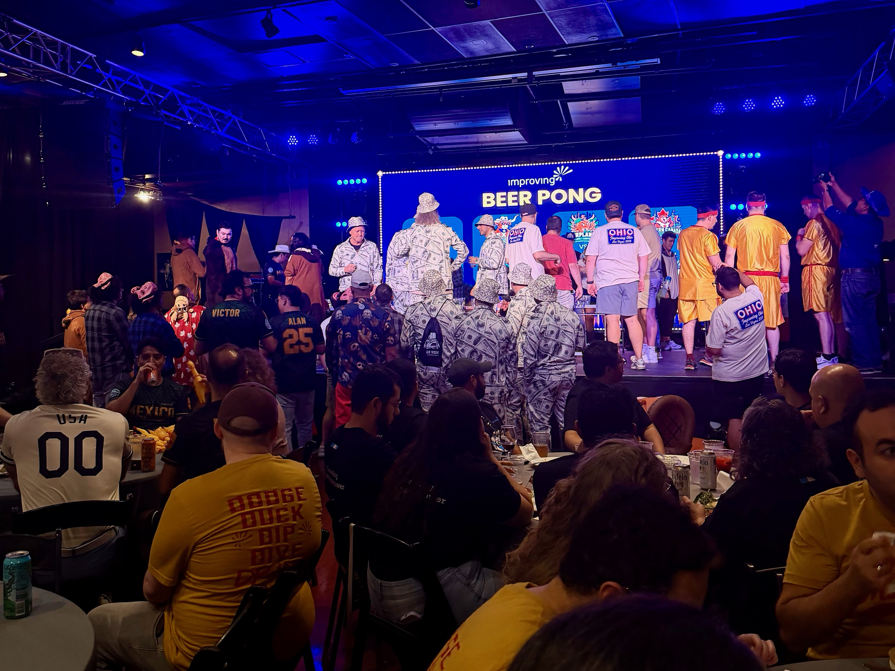
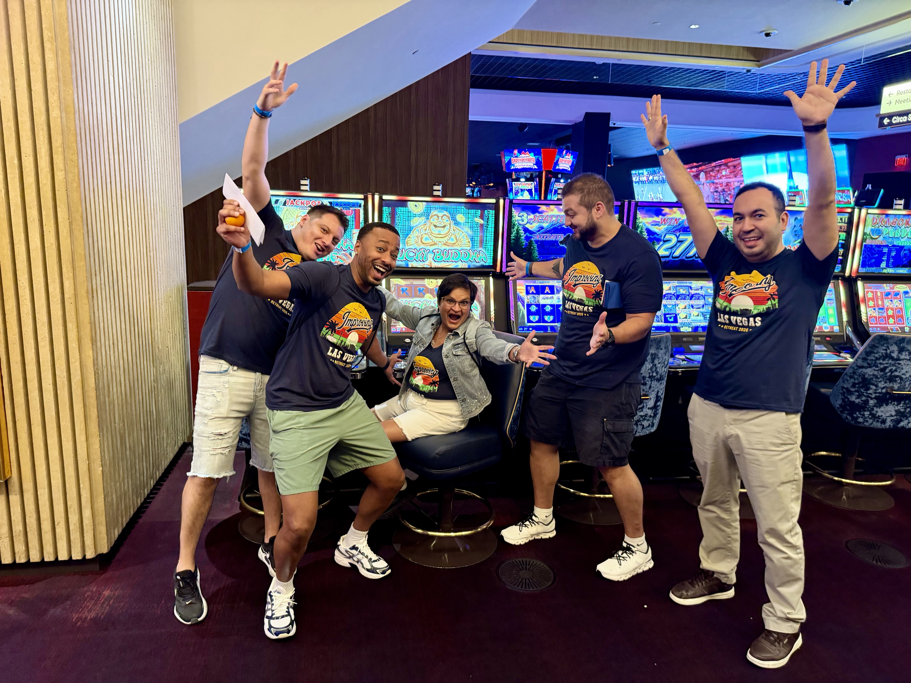
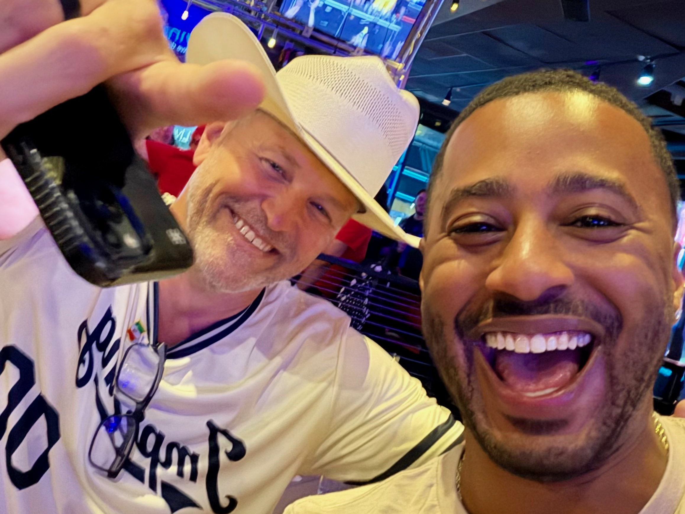

This was Improving's 20th retreat and my first. I was a little under seven months in, I'd never been to Vegas, and while I sit in the Dallas office, I knew Improvers from every location would be there. I didn't know who I'd connect with or how much fun to expect. Was this going to be “fun” with a schedule and a chaperone?

**Not even close.**

The wow started at check-in. Every day had a plan, but nobody was on a leash, with open time built in to explore like the grown adults we are. I've worked with some big-name brands, and I've never seen planning this thoughtful. Thursday kicked off with a welcome happy hour, then the attendee choice event. We'd each picked an experience ahead of time, and I went with fine dining. Over a lovely dinner at Alexxa's in front of the beautiful Bellagio fountains, I connected with new Improvers from the Winnipeg office, Minnesota, and the Houston/Austin team. Amazing night.

Friday, we took over Hard Rock Café for the Enterprise Challenge. Teams from across the company went head to head, with a beer pong tournament built right in. I was just a spectator, and I was in awe at how a whole company knows how to come together and have a good time. Right after the winner was announced, the Mexico team turned it into a dance party, and it was rocking.

Somewhere between the dinner, the drinks, the prizes, and the cash, I realized I work for a company that believes people should enjoy the life they're working for. We're here to do a job, but we're also human, and Improving treated us that way. I'm one of the younger guys, I wore my sneakers and my earrings, and nobody gave me a second look. I got to show up as myself and just enjoy the weekend.

Saturday meant company shirts on, buses loaded at Planet Hollywood, and the Amazing Race on Fremont Street. Nobody announced it, but I'm convinced it was by design: the teams mixed people from different locations, so staying in your comfort zone wasn't an option. I'd heard the race could wear you out, but I laughed and smiled the whole way through. We wrapped the night with dinner and drinks at Circa, where the winners were announced, and I walked away with new friends in offices I don't work in. A weekend was all it took to start building relationships I think can last.

Through all of it, one moment stuck with me. Near the end of Friday night in a huge crowd, our founder and CEO, Curtis Hite, saw a newer face and stopped. We talked. We danced. The rest of the weekend, he remembered me. I'm not sure he knows my name, but that kind of presence is a superpower. It says a lot about why Improving has thrived for 20 years.

When I told my friends and family about the trip, their reaction was basically, “Your job did all that?” **Yes. Yes, it did.**

Every company has things it can improve, and that's a conversation we can have. But as a first-timer, I'm all in. One day I want to be the person saying, “This is my 10th retreat.”

Retreat No. 1 is in the books, and I'm already counting.

Improving. It's what we do.
