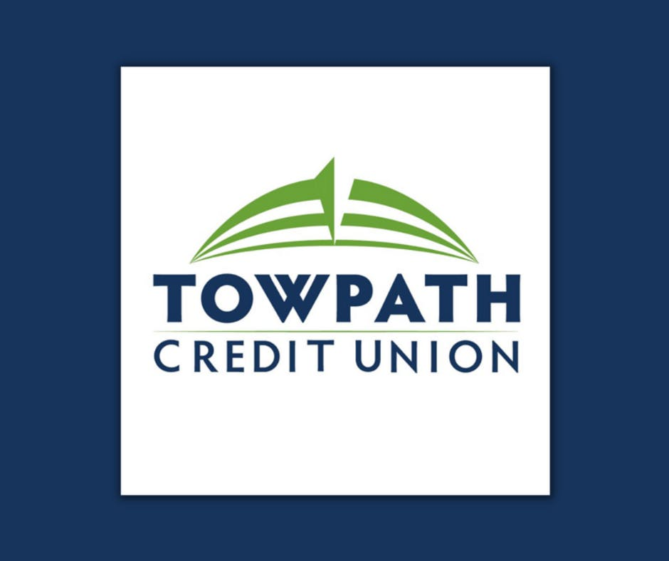

We recently shared the news that Improving has created a Microsoft Services Team. So, we want to share additional insights on some key areas the team will assist clients with. While we focus on the M365, Azure, and D365 Microsoft Clouds, there is one specific area that overlaps all the clouds: Security.

Security, without question, is a topic on top of every company’s radar, and for good reason. There’s no shortage of horror stories hitting the news about dealing with security issues.

Today we are going to examine at a high level what Microsoft means by “Zero Trust” and its key components. The philosophy is simple. It teaches clients to never trust, and always verify.

Over the course of the last couple of years, this has become more critical than ever as almost all companies found themselves needing to adapt to remote and mobile work. Today companies need to ensure that all applications, data, devices, and people are secure. Zero Trust is shifting from a trust-by-default perspective to trust-by-exception. Microsoft sites the following as their guiding principles of Zero Trust:

- Verify explicitly – Always authenticate and authorize based on all available data points.
- Use Least privilege access – Limit user access with Just-In-Time and Just-Enough-Access, risk-based adaptive policies, and data protection.
- Assume breach – Minimize blast radius and segment access. Verity end-to-end encryption and use analytics to get visibility, drive threat detection, and improve defenses.

Microsoft’s guiding principles are backed by a suggested approach to Zero Trust by securing seven key technology pillars

1. Secure Identity
2. Secure Endpoints
3. Secure Applications
4. Secure Data
5. Secure Infrastructure
6. Secure Networks
7. Secure Visibility, Automation, and Orchestration

The Microsoft Zero Trust approach should allow companies to more easily find and detect threats, respond to them, and prevent or block undesired events across the organization.

An example of this Improving is putting Microsoft Zero Trust into action with our client [Towpath Credit Union](https://www.towpathcu.com/). Towpath Credit Union began its digital transformation with a plan to move to the cloud and adopt Microsoft 365 and Azure. Security was and still remains at the center of all decisions on this journey.

Towpath Credit Union adopted a Zero Trust approach and is leveraging real-time monitoring with Defender for Endpoint to detect any suspicious behavior before it can have an impact on performance or security. They are made aware of any known vulnerabilities across all their devices based on the power of Microsoft’s cloud security intelligence. Towpath also has all their devices enrolled with Microsoft Intune so that common policies and configurations are enforced. And when deviations are detected, access is blocked to critical business systems. Intune is also enabling employees to be more productive using mobile devices while ensuring company data remains safe and protected.

To learn more about how Improving can effectively help you get to a Zero Trust environment [reach out to us](https://improving.com/contact). We also encourage you to review the [security content](https://www.youtube.com/playlist?list=PLqXBkW2Bgxfjw4BZZB2tKdjvHsc3KFtoS) from our Cloud Solution Provider webinars.

*This has been part 1 in a 3-part series discussing focus areas of the Improving Microsoft Services Team.*
