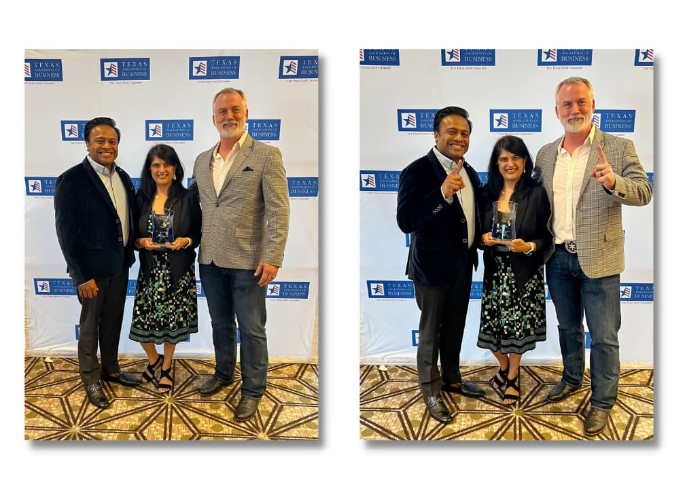
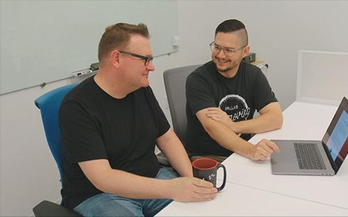

We are thrilled to announce that Improving was named the #1 “Best Companies to Work for in Texas”! The award was given by Texas Monthly, the Texas Association of Business, Texas SHRM, and Best Companies Group in their large category.

Though this is the first time we have been at the top of the list, it is our 12th year on it. The award includes our Dallas, Houston, and Austin enterprises. Dallas President David O’Hara said being recognized as the best company in the entire Lone Star State is a huge deal.

“Dallas is where we started,” he said. "So, to be recognized as the best place to work in Texas is awesome. That means we’ve been able to grow our culture to other parts of the state.”

Surveys are sent out to individual employees, which means we received this award because of every Improver who completed the questionnaire.

"It means a lot because it’s not Improving’s leadership team that is saying we have the best place to work,” David said.“Improvers all over the state are the ones that believe Improving is the best place to work in Texas. That’s fantastic and impactful.”

David believes Improving won this award because our guiding principles* *are not just words on our website. These principles show up in how each Improver lives day to day, so there is congruence in our words and actions.

“We’ve been very intentional with having leadership live out our culture,” David said. “We want to make sure that trickles down to everyone in the company. We’re not always going to be perfect. But if we are at least consistent, then people experience that.”

David was at the annual gala, which was held in October at the JW Marriot in Austin. He said the TAB put on a fantastic event, and the team was delighted to get the recognition.

Learn more about the event and see the top 10 lists by reading [this CBS Austin Article](https://cbsaustin.com/news/local/tab-announces-best-companies-to-work-for-in-texas-2022-is-your-workplace-on-the-list-mobius-community-bank-and-trust-of-texas-improving-enterprises-ryan-llc-jw-marriot-allison-miller-emcee-glen-hamer-brint-ryan).

To find out more about Improving’s career opportunities, [click here](https://improving.com/careers)!
