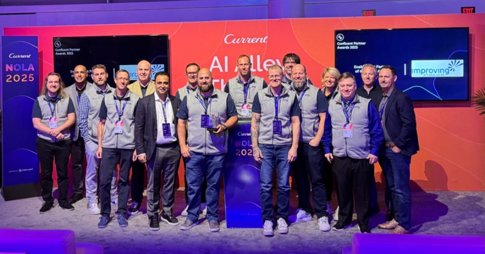
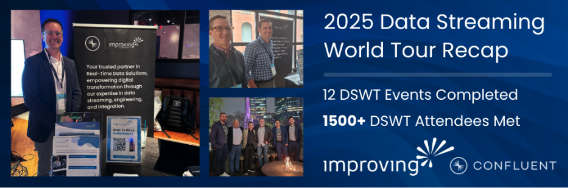
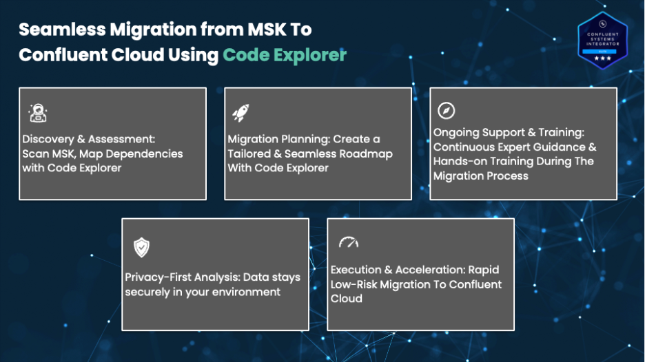

Improving is proud to announce our recognition as the **2025 Confluent Enablement Partner of the Year – AMER**. This award celebrates our commitment to delivering transformative business value through Confluent’s data streaming platform and our ongoing investment in professional development, innovation, and client success. From the profound impact that our team has had in architecting scalable and event-driven architectures to developing real-time data streaming applications and pipelines using Confluent Cloud and Flink, we have worked hand in hand with the Confluent team to drive business value through innovation, proven industry expertise, and our commitment to providing best-in-class solutions for all of our clients.

From engaging with data streaming and technology industry experts across the Data Streaming World tour to leading hands-on training and workshops for clients and enthusiasts to paving the way in AI-accelerated migrations, it has been incredible seeing the work that our team has put forward to help partners such as Confluent provide the best data streaming solutions for our clients.

“We are incredibly proud and honored to be recognized as Confluent’s Enablement Partner of the Year – AMER. The work that our team has done to help empower leading enterprises across North America with modern event streaming architectures and solutions has been truly transformative. Confluent has always been reliable, innovative, and forward-thinking technology partner that has provided our team with the groundbreaking tools and platforms to create solutions that have helped reshape how our clients in the healthcare, manufacturing, financial services, and energy sectors utilize their real-time data for meaningful change. We are looking forward to continuing to build upon the momentum from the past year to help clients simplify and accelerate their migration to Confluent with AI”

— Ehren Seim, Global Alliances Lead, Improving

This award builds on the momentum that our team has had this year and this blog offers a glimpse into our journey with Confluent in 2025 from the Data Streaming World Tour to Current 2025 in New Orleans.

## **Data Streaming World Tour In Review**

As a **Confluent Elite Systems Integrator **partner, Improving has been at the forefront of real-time data-driven solutions and architectures for clients across North America. Our expertise in data streaming, data integration, and data engineering was showcased at the 2025 Data Streaming World Tour (DSWT), where our teams connected with over 1,500 attendees across industries and geographies, from Mexico City to Toronto.

## **Transforming Industries with Data Streaming**

Across healthcare, financial services, manufacturing, and energy, organizations are leveraging our expertise in data streaming, data engineering, and data integration to drive meaningful transformation. We found that over the course of this year, and in previous years, implementing event-driven architectures and real-time data pipelines with Confluent, businesses are overcoming legacy challenges, modernizing operations, and unlocking new opportunities for innovation. Our solutions enable seamless data flow, improved decision-making, and greater agility, empowering enterprises to adapt and thrive in today’s fast-paced digital landscape on Confluent and Confluent Cloud.

In order for businesses to fully realize the benefits of the platform, they need to undergo a migration process, which can be costly, complex, and time consuming. With this realization and support from our partners at Confluent, we developed a migration service offering to help organizations migrate away from platforms such as AWS MSK to Confluent Cloud with our AI accelerator, Code Explorer.

## **Accelerating Migrations with Code Explorer**

Migrating from AWS MSK to Confluent Cloud can be complex and costly, especially for organizations with large, undocumented, or legacy codebases. Improving’s **AI-powered Code Explorer** simplifies and accelerates this transition by performing layered analysis of existing producers and consumers, mapping dependencies, and generating actionable migration plans tailored to each tech stack.

##### **Key Benefits of Code Explorer:**

- **Reduced Migration Complexity**: Deep analysis and tailored migration plans.
- **Minimized Dual-Cost Windows**: Streamlined conversion process.
- **Preserved Data Privacy**: All analysis performed within your environment.
- **Domain-Specific Insights**: Context-aware recommendations for streaming applications.
- **Boosted Productivity**: Clear documentation and knowledge graphs for decision-making.

With Code Explorer, organizations can unlock advanced streaming capabilities, reduce operational overhead, and accelerate innovation on Confluent Cloud. Introducing this migration service offering to our clients alongside Confluent was truly one of the highlights of this year, as it demonstrated how AI-powered solutions, if utilized in meaningful ways to solve complex business problems, can help simplify and accelerate migrations between streaming platforms such as MSK and Confluent Cloud. As a result, our clients can benefit from reduced migration costs and complexity.

## **Hands-On Learning: Flink and Shift Left Workshops**

In 2025, Improving has been proud to deliver a series of hands-on Flink and Shift Left workshops, led by our VP of Technology, Nick Larson, in partnership with Confluent. These workshops have empowered data professionals to build high-quality, reusable data streams and adopt a “shift left” approach to data integration—accelerating the adoption of event-driven architectures and real-time analytics. The enthusiastic feedback from attendees across North America has reinforced the value of practical, expert-led training in unlocking the full potential of Confluent Cloud and Apache Flink.

## **AWS MSK to Confluent Cloud Workshops**

Building on the success of our Flink and Shift Left sessions, we’re excited to announce a new series of workshops for the remainder of the year focused on AWS MSK to Confluent Cloud migrations. These upcoming sessions will be hosted by Nick Larson and Alex Brekken from our team, providing organizations with actionable strategies and hands-on guidance for simplifying and accelerating their migration journeys. Whether you’re looking to modernize legacy data pipelines or unlock advanced streaming capabilities, these workshops will equip your teams with the expertise and tools needed to succeed.

## **Improving at Current 2025**

Improving kicked off Confluent Current 2025 with a packed and energetic happy hour, setting the tone for an incredible week ahead! Devlin Liles and Nick Larson showcased our expertise and innovation in AI Alley, while Mark Soule represented Improving by presenting at the Confluent booth. The highlight of the event was being recognized as Confluent’s 2025 Enablement Partner of the Year — a proud moment celebrating our team’s collaboration, expertise, and impact!

## **Continued Growth and Innovation**

Our integrated approach blends intelligent systems, scalable software architecture, and data-driven strategy to solve complex business challenges. From AI adoption and automation to cloud-native development and advanced analytics, Improving delivers real outcomes through secure, flexible, and future-ready solutions.

“Our partner ecosystem is fueled by bold innovation and close collaboration with clients, creating new opportunities to transform businesses with data. The 2025 Confluent Partner Awards honors the partnerships that are pushing the boundaries through creativity and impact, helping organizations innovate faster and unlock the full potential of real-time data.”

— Derek Russell, Director of Partner Success AMER at Confluent

**Looking Ahead**

As we celebrate this recognition, we remain committed to driving transformation and innovation with Confluent. Whether it’s through hands-on workshops, AI-powered migration accelerators, or industry-specific solutions, Improving is dedicated to helping organizations harness the power of event-driven architectures and real-time data streaming.

**Want to learn more about our partnership with Confluent?** [https://www.improving.com/contact/](https://www.improving.com/contact/) or [https://www.improving.com/partners/confluent/](https://www.improving.com/partners/confluent/).
