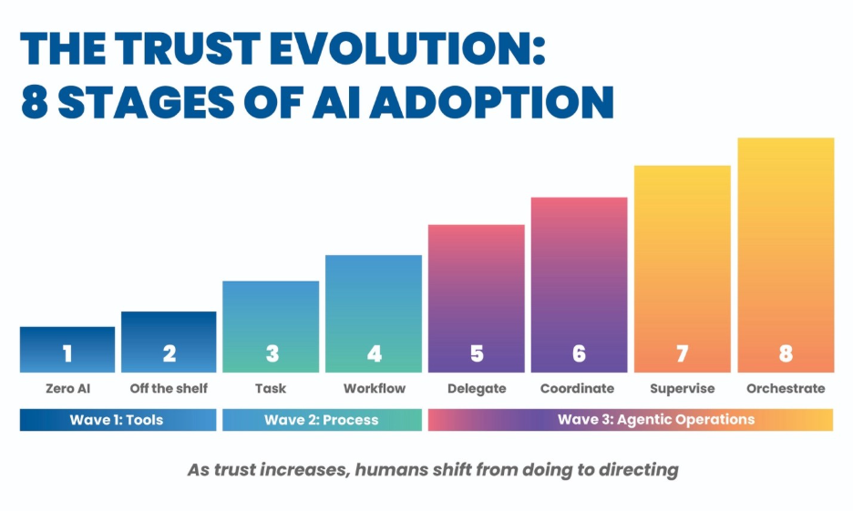

Improving has announced a strategic partnership with Anthropic, an artificial intelligence research and development company focused on building reliable, interpretable, and steerable AI systems.

Through this partnership, Improving will work with Anthropic to help organizations responsibly integrate large language models into enterprise software, digital platforms, and internal workflows—ensuring AI solutions are secure, transparent, and grounded in real business context. As organizations explore generative AI, many face challenges around trust, governance, and practical application. Improving’s collaboration with Anthropic is focused on helping teams move beyond experimentation to production‑ready AI systems that complement human judgment, strengthen software quality, and deliver measurable value.

“AI is most effective when it’s implemented with intention and discipline,” said Curtis Hite, CEO of Improving. “By partnering with Anthropic, we’re combining advanced AI capabilities with Improving’s strength in software engineering and enterprise delivery so our clients can adopt AI responsibly and confidently.”

This partnership aligns with Improving’s Trust Evolution model, which emphasizes that successful AI adoption requires not just advanced models, but growing trust through governance, oversight, and organizational readiness. Anthropic’s focus on safe, interpretable, and steerable AI supports this approach, enabling organizations to move thoughtfully from supervised tools to more advanced AI‑assisted workflows. By combining Anthropic’s technology with Improving’s trust‑led framework, organizations can adopt generative AI incrementally, with appropriate transparency, governance, and human accountability at each stage.

“Anthropic brings a thoughtful, principled approach to building AI,” said Devlin Liles, Chief AI Officer & Chief Consulting Officer at Improving. “Together, we’re helping organizations move from experimentation to real adoption through applying generative AI in ways that are practical, responsible, and supportive of the people doing the work.”

This partnership builds on Improving’s continued investment in helping organizations navigate emerging technologies responsibly. Through training, architecture guidance, and hands‑on delivery, Improving supports clients adopting AI while maintaining excellence in software development, cloud engineering, data platforms, and enterprise modernization.
