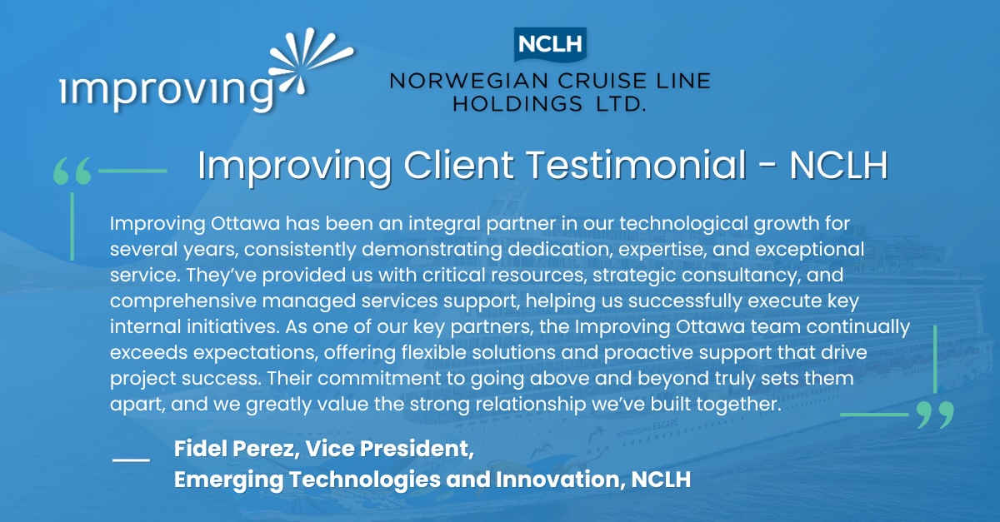
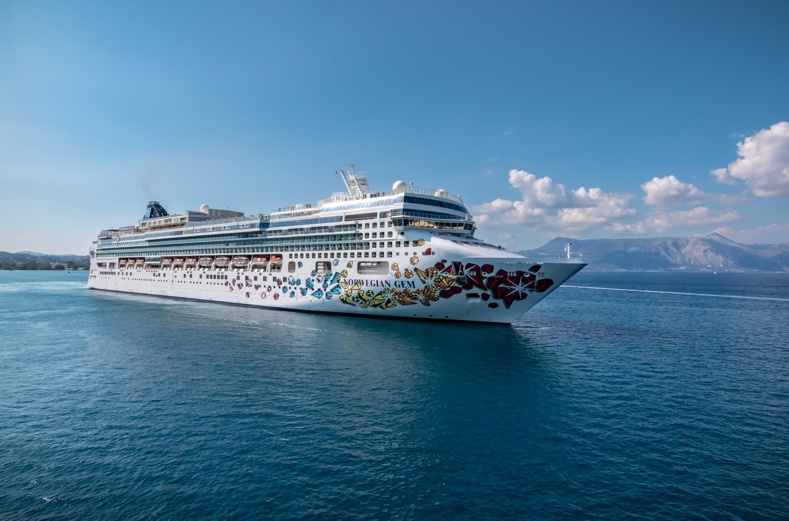

We are thrilled to announce that [Improving Ottawa](https://www.improving.com/locations/ottawa/) has been recognized as an integral partner in technological growth in developing and delivering a modernized reservation system by the Emerging Technologies and Innovation team at [NCLH.](https://www.nclhltd.com/) The following testimonial, from Fidel Perez, Vice President of Emerging Technologies and Innovation at NCLH, highlights our successful collaboration on developing and delivering a cutting-edge, service-oriented reservation platform that has revolutionized NCLH’s guest experience:

*“Improving Ottawa has been an integral partner in our technological growth for several years, consistently demonstrating dedication, expertise, and exceptional service. They’ve provided us with critical resources, strategic consultancy, and comprehensive managed services support, helping us successfully execute key internal initiatives. As one of our key partners, the Improving Ottawa team continually exceeds expectations, offering flexible solutions and proactive support that drive project success. Their commitment to going above and beyond truly sets them apart, and we greatly value the strong relationship we’ve built together.” ***- Fidel Perez, Vice President, Emerging Technologies and Innovation, NCLH**

Improving and the Emerging Technologies and Innovation team at NCLH have worked together to develop a modern reservation system since 2019. With a team of more than 40 developers, coaches, and managed services consultants, Improving has been instrumental in building and enhancing this modernized reservation platform through our expertise in application modernization, application development, platform engineering, and modern data solutions. This solution has become a critical component of NCLH’s operations, affecting over 2 million passengers aboard their 32 ships annually.

Throughout the course of our partnership, Improving developed a thorough understanding of NCLH’s platform and business priorities, which resulted in a quick turnaround for addressing issues and offering solutions that align with their strategic goals. This testimonial is reflective of the dedication and expertise of every Improver involved. Their commitment to delivering exceptional results while pushing the boundaries of innovation in the industry has made this achievement possible.

*“This partnership represents a significant milestone for our organization as our team of experts works closely alongside NCLH’s team to ensure that our solutions meet the highest standards of innovation. To be named Best Partner is a remarkable achievement for Improving. We are very grateful to work on this transformational project and look forward to continuing to work together." ***- Jack Gulas, Improving Managing Director**

### **Our Success – Transformative And Modernized Reservation System**

The solution that our team developed alongside NCLH’s internal technology team is a modern, service-oriented platform designed to manage the complexities of NCLH’s operations, including reservations, pricing, and vacation planning. Before our solution, NCLH relied on a fragmented legacy system that hindered innovation and growth. With Improving’s guidance, NCLH has transitioned to a unified, scalable platform that supports continuous updates and allows for seamless integration of future innovations.

Our solution is more than just a reservation system; it’s a cornerstone of NCLH’s forthcoming growth and success. With Improving’s continued support, the company can confidently innovate and evolve, knowing they have a platform and partner that is committed to their long-term success.

### **About Improving**

Improving is a modern digital services company offering enterprise [software consulting](https://www.improving.com/services/consulting/), [development](https://www.improving.com/services/development/), and [training](https://www.improving.com/services/training/) to Fortune 500 and Global 1000 enterprises across the world. Our innovative solutions help clients achieve their tactical and strategic goals, allowing them to excel in today’s competitive, ever-evolving market.

Looking to jumpstart your next technical project? [Contact Improving today.](https://www.improving.com/contact)
