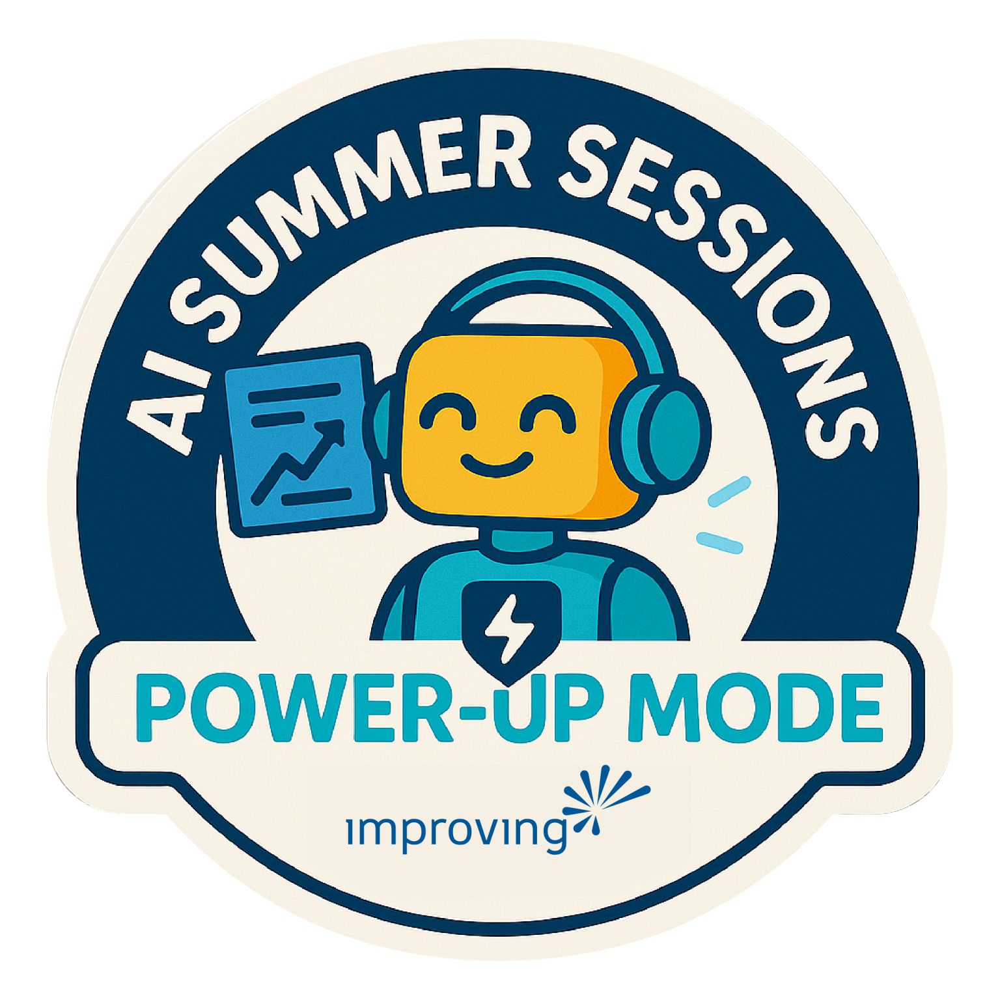
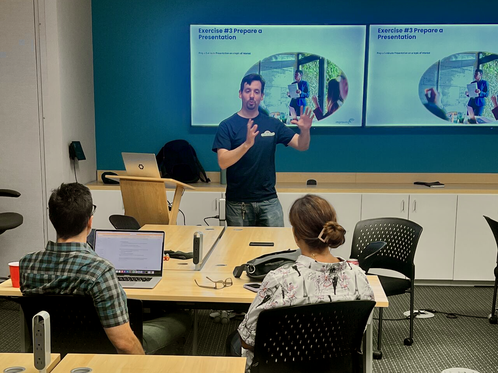

This summer, Improvers came together with a shared purpose: to serve our community by equipping high school students and their parents with practical ways to understand and use AI responsibly. The result was **AI Summer Camp**, a three-part series we hosted at Improving’s Houston office.

### **Why We Did It**

At Improving, we believe technology is most impactful when it’s accessible, understandable, and human-centered. The rapid rise of generative AI has sparked both excitement and concern. Parents want to know: *Is this helping my student learn, or making it too easy to cut corners?* Students want to know: *How can I use this in school without losing my own voice?*

The camp was our way of saying: *We hear you. Let’s learn this together.*

### **What We Offered**

Over three Saturdays, Improvers led students through sessions we called **Wake-Up Mode, Power-Up Mode, and Genius Mode**. Each built on the last:

- **Wake-Up Mode**: Students learned what AI is—and isn’t. We showed them where AI “hallucinates,” why they shouldn’t let it think for them, and how to start asking better questions.
- **Power-Up Mode**: We practiced real tasks—essays, slides, and projects—where AI served as a thought partner rather than a replacement.
- **Genius Mode**: Students discovered how AI can help with common struggles: “I don’t get this,” “This is boring,” or “I don’t know where to start.” They left with strategies to study smarter and build confidence.

Our three instructors shared stories from “back in my day” while connecting those lessons to today’s tech-fueled classrooms. Meanwhile, parents joined their own sessions to explore the ethical, practical, and motivational sides of AI.

### **Improvers Behind the Scenes**

This camp came together the way much of our work does: through collaboration. Improvers from different backgrounds contributed their ideas, energy, and time:

- Designing activities that spoke to both extroverts and introverts.
- Sharing stories of how AI shows up in their own careers and hobbies.
- Facilitating thoughtful discussions on learning styles, motivation, and ethics.

Together, we created a space where students felt safe to experiment, parents felt included, and everyone walked away more prepared for the future.

### **What’s Next**

AI isn’t slowing down, and neither are we. As Improvers, we see opportunities not just to deliver projects, but to invest in the next generation of learners and leaders. This camp was one small way we lived out our values of **excellence, involvement, and community impact**.

And if you ask us, the best part was simple: watching students light up when they realized, *“I’m more capable than I thought—AI just gives me leverage.”*

If you want to find out how Improving can help you put on a similar AI course, [reach out to us.](https://www.improving.com/contact/)
