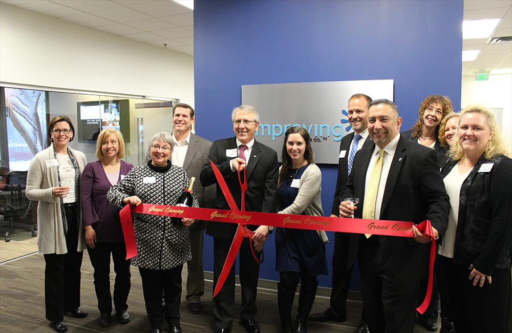

Our Minneapolis office, also known as Twin Cities, recently moved to a new office in Bloomington. The space is designed with a welcoming and open atmosphere and has a large classroom set up for process training and the ability to host some of the numerous community user groups in the Twin Cities area.

We celebrated the grand opening with a ribbon-cutting ceremony on February 2nd. The Bloomington Chamber of Commerce Members were in attendance to join in on the celebration with Improvers, clients, friends, and family. Mother Nature decided to throw us a curve ball with a foot of snow, however, we extended the celebration to a second evening and had around 100 people through the doors to celebrate with us in the span of two days.

We look forward to the continued growth and community involvement in the Twin Cities and the surrounding area.

This is an incredibly exciting event for us as well celebrate the new space. I look forward to our continued growth and future in the Bloomington community.

Leroy Thydean, Twin Cities President, Improving

### **

##### **
