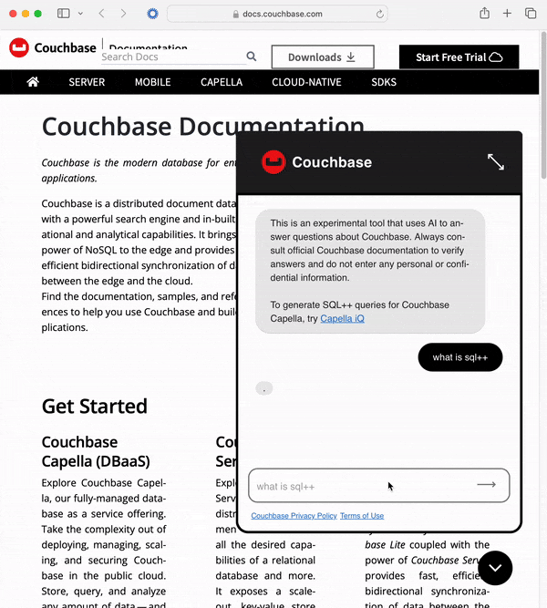

Modern applications, and their developers, benefit greatly from quick and seamless access to technical documentation in today's fast-paced digital environment. A leader in cloud database platforms, Couchbase realized that public documentation needed to be improved in terms of its user experience, especially for engineers who were onboarding and needed help navigating this vast library of content. Naturally, with the prevalence of AI, the Couchbase team discovered an opportunity to leverage it to develop a robust chatbot solution. This opportunity is where our Improving team in Vancouver stepped in to provide their AI, software development, and engineering expertise.

Couchbase looked for a way to improve the core usability and accessibility of its documentation. The expectations of users, particularly developers, were no longer fulfilled by conventional menu navigation and keyword-based searches. The emergence of Generative AI (GenAI) presented a perfect opportunity to evolve from traditional approaches to documentation. Couchbase’s goals were clear: they needed to simplify and accelerate the onboarding process, enabling users to find what they needed quickly and effortlessly.

### **Our Approach: Harnessing the Power of AI**

Improving worked directly with Couchbase's documentation and partnership teams to create a cutting-edge AI chatbot that redefined how users engaged with their documentation. Our expertise in Artificial Intelligence (AI) and Machine Learning (ML), together with AWS' extensive capabilities, laid the groundwork for this pioneering initiative.

The Couchbase AI chatbot was created using AWS Bedrock, a managed service that provides access to some of the most popular Large Language Models (LLMs). By combining these models, we constructed an intelligent system capable of understanding user inquiries and providing accurate, contextually relevant responses. Using Python and Vue, we created the backend glue code as well as a sleek, user-friendly front end that powered the chatbot.

### **Seamless and Efficient Search Capabilities**

The chatbot was designed to make searching easier by eliminating the need for clunky navigation and search bars. Instead, individuals might communicate naturally with the bot by asking inquiries in plain language. Using the LangChain Library, the bot turned each user question into a smart prompt and delivered a nuanced, intelligent response, making documentation easier to absorb.

Furthermore, one of the most notable aspects was its capacity to instantly react to content changes. Couchbase's documentation is constantly evolving, and the AI chatbot eliminates the need for manual involvement when upgrading the bot's knowledge base. This automated content update technique saved time and minimized errors, hence increasing the overall user experience.

### **The Business Impact: A Game-Changer for Couchbase**

The impact of this AI Chatbot solution was profound. Developers, the primary users of Couchbase’s documentation, experienced a vastly improved onboarding process. By removing friction points, the chatbot allowed users to get up to speed faster, ultimately enhancing their productivity and boosting satisfaction with Couchbase’s offerings. The chatbot also provided consistent and contextually accurate responses, making it easier for users to engage with complex technical content.

### **Key Lessons Learned**

Throughout the development phase, we gained some helpful insights. First, establishing defined success criteria from the beginning was critical to keeping the project on pace. Second, working with huge language models showed an important fact: AI does not always deliver the same response to identical problems. This variability was included during our evaluation process, ensuring that responses remained useful despite rare fluctuations. Finally, we observed that ongoing iteration and adjustment were required as we learned more about user behaviour and system performance.

### **Pioneering AI-Powered Documentation**

The Couchbase AI Chatbot demonstrated Improving's ability to apply powerful GenAI technologies to real-world business situations. We were able to develop a solution that altered how users interacted with technical documentation by collaborating with Couchbase and Amazon Web Services. As AI evolves, as an organization, we are enthusiastic to explore new ways to drive innovation and create value for our clients through strategic collaboration and cutting-edge solutions. This project was more than just creating a chatbot; it was about reimagining the core user experience with respect to documentation, simplifying difficult interactions, and demonstrating the ability of AI to improve overall developer productivity.

Want to learn more about Improving's [AI expertise](https://www.improving.com/expertise/ai-ml/), [reach out to us](https://www.improving.com/contact)!
