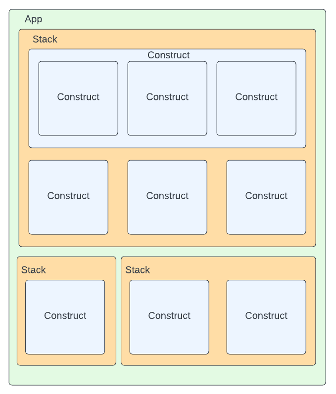
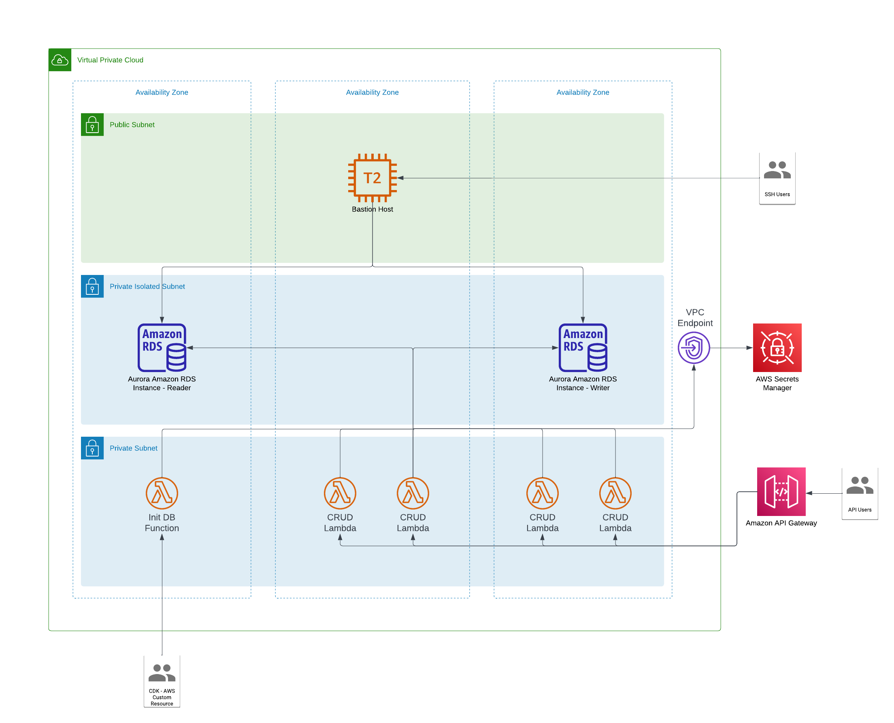

Infrastructure as code is a non-negotiable part of building any sort of maintainable platform. The first thing that typically comes to mind when hearing Infrastructure as Code (IaC) are likely tools like Hashicrorp’s Terraform and AWS CloudFormation with infrastructure being defined explicitly in JSON, YAML, or a tooling-specific language such as Terraform’s HCL. Though these are all viable ways of defining our infrastructure there are some notable shortcomings. Specifically, these are all declarative languages, and because of that, we must explicitly define all our infrastructure and the pieces that tie it together. With these, there tend to be a lot of boilerplates, and there is little to no abstraction at this level which results in unwieldy infrastructure definitions for large or complex systems.

Enter AWS Cloud Development Kit (AWS CDK) and the Construct Programming Model (CPM) in 2019. After struggling internally with the lack of modularity and having a need to abstract away details of common architecture patterns, Amazon created the AWS CDK giving us a way to define infrastructure as code using an imperative programming language. Though it initially started as a Java project internally, it was open-sourced as a Typescript project. Support for other languages is provided through another open-source tool, JSII, which creates bindings in those languages allowing them to interact with JavaScript classes. The list of compatible languages at the time of writing this includes Typescript, JS, Python, Java, C#, and Go (preview). Since its open-source release, there have been multiple implementations of the CPM derived from Amazon’s solution (AWS CDK). At the time of writing this, those implementations include CDKtf (Terraform), CDK8s (Kubernetes), and Projen a tool for managing project configuration files like package.json, tsconfig.json, etc. The last of those shows that the use of the CPM doesn’t have to be isolated to just infrastructure as it is a viable methodology for anything that is configured via declarative language.

Though the examples in this post will be written for AWS CDK it should be noted that the benefits of leveraging the CPM are not exclusive to just Amazon’s offering. Regardless of the implementation you might choose, you’ve got the full power of your programming language of choice in building your infrastructure no matter how simple or complex that might be. I will call it out directly if a feature is specific to AWS CDK.

Before continuing there are a few key terms that we should be aware of and their relationship to each other: app, construct, and stack (chart for CDK8s).

**Construct: **The core building block of any CDK app. A construct corresponds to one or more synthesized resources, which could be a VPC, a Kubernetes pod, or even all the resources required for a database cluster and bastion host. We’ll discuss the abstraction of constructs in the next section of this post.

**Stack (Chart for CDK8s): **A stack is the deployment vehicle of a CDK app, and there can be multiple in one application. Stacks can be viewed as a logical grouping of related pieces of infrastructure represented by Constructs. Each Stack/Chart when synthesized is going to produce a declarative configuration file that corresponds to the CDK of choice: a CloudFormation template for AWS CDK, a Terraform configuration file for CDKtf, a Kubernetes Manifest for CDK8s, etc.

**App: **A CDK App is a tree of constructs: the root node of this tree is the App construct, from where it can branch to one or more stack (or chart) constructs, stacks then have one or more constructs that themselves might encompass one or more constructs.

The diagram below provides a high-level view of what the structure of a CDK app might look like



Accompanying this post is an example project which uses the AWS CDK. I created this project primarily to showcase how simple it is to set standards for infrastructure deployments by extending existing constructs as well as creating and using abstract constructs which define entire architecture patterns or processes. The diagram below provides a high-level view of the architecture the project deploys. Note that because I’ve opted for a multi-AZ RDS cluster deployment, that component of the architecture is not free tier eligible. So, if you choose to deploy this infrastructure, ensure you clean up afterward to avoid excess charges. The project can be found here: [https://github.com/wwermager/cdk-with-custom-constructs](https://github.com/wwermager/cdk-with-custom-constructs)



## Abstracting Infrastructure

There are three tiers of abstraction provided by constructs: level 1 (L1), level 2 (L2), and level 3 (L3). The latter of which is the most abstract. L1 constructs are a 1:1 mapping with their underlying resource in the base declarative language. L2 constructs are where the CPM really starts to shine. At L2 we no longer must deal with excess boilerplate that comes with using that resource at the lowest level. Additionally, we get access to helper methods and default configurations that make our lives significantly easier. As an example, one immensely useful helper method of many **AWS **CDK Constructs is *grant *which allows us to create IAM policies needed to access resources with a single line of code.

```javascript
// From lib/api-stack.ts 
props.dbInfra.dbCluster.secret?.grantRead(isolatedApiFunction); 
```

This one line gets synthesized into the following CloudFormation resource below. This alone shows just how much more succinct and readable our infrastructure as code can be making use of a CPM implementation.

```json
"getlambdafunctionServiceRoleDefaultPolicyC1D2F054": { 
 "Type": "AWS::IAM::Policy", 
 "Properties": { 
  "PolicyDocument": { 
   "Statement": [ 
    { 
     "Action": [ 
      "secretsmanager:DescribeSecret", 
      "secretsmanager:GetSecretValue" 
     ], 
     "Effect": "Allow", 
     "Resource": { 
      "Fn::ImportValue": "DatabaseStack:ExportsOutputRefrdswithbastionhostrdsdatabaseclusterSecretAttachment7F0016B283030634" 
     } 
    } 
   ], 
   "Version": "2012-10-17" 
  }, 
  "PolicyName": "getlambdafunctionServiceRoleDefaultPolicyC1D2F054", 
  "Roles": [ 
   { 
    "Ref": "getlambdafunctionServiceRole4009E415" 
   } 
  ] 
 }, 
 "Metadata": { 
  "aws:cdk:path": "ApiStack/get-lambda-function/ServiceRole/DefaultPolicy/Resource" 
 } 
} 
```

Finally, there are L3 constructs, also commonly called patterns. These are the most abstract of the constructs and are used for common architecture patterns or some complex functionality. In the example application linked above the *AuroraMysqlWithBastionHost* and *MysqlSetup *constructs are examples of L3 constructs. The first, a common architecture pattern, deploys the database, networking infrastructure, and a bastion host. The latter deploys a lambda function which instantiates the DB with a table and some data on our first deployment of the database stack providing us with complex functionality. Those constructs can then be deployed in a stack, configured by the properties exposed by their interface. The roughly 20 lines of code below synthesizes a CloudFormation template that is over 2000 lines of formatted JSON.

```javascript
// From lib/api-stack.ts 
this.dbInfra = new AuroraMysqlWithBastionHost( 
  this, 
  "rds-with-bastion-host", 
  { 
    bastionHostInitScriptPath: path.join( 
      __dirname, 
      props.config.bastionHostInitScriptPath 
    ), 
    bastionhostKeyPairName: props.config.bastionhostKeyPairName, 
    dbAdminUser: props.config.dbAdminUser, 
    defaultDbName: props.config.defaultDbName, 
    dbSecretName: props.config.dbSecretName, 
    dbPort: props.config.dbPort, 
  } 
); 
 
new MysqlSetup(this, "mysql-setup", { 
  dbInfra: this.dbInfra, 
  lambdaDirectory: path.join(__dirname, props.config.lambdaApisDirectory), 
  defaultHandler: `utils/${props.config.defaultHandler}`, 
  dbTableName: props.config.dbTableName, 
}); 
```

## Sharing Patterns and Setting Standards

In the *AuroraMysqlWithBastionHost * construct mentioned previously, I’m leveraging a publicly available L3 construct found [here](https://github.com/udondan/cdk-ec2-key-pair) to automatically create a keypair to connect to the EC2 bastion host. I highlight this as it shows just how easy it is to share/consume custom constructs, a key advantage of the CPM. By simply adding the library to our project’s dependencies (*package.json in this case) *we’re able to make use of it in any constructs and stacks we create. It should be noted that constructs written in Typescript offer a bit more flexibility in how they can be shared. Since with [JSII,](https://github.com/aws/jsii) language bindings can be created for any of the supported languages, however, there’s nothing stopping you from writing and sharing constructs specifically for your language of choice.

This ease of sharing and consuming constructs is a huge selling point in using a CPM implementation. With inheritance on our side, it becomes trivial to extend an existing construct and set or require certain properties. In the example project, I’ve done this for both the *Vpc *and *Function* constructs. Here’s an example of wrapping the base *Vpc* construct with an explicit subnet configuration.

```javascript
// From lib/common/network/database-vpc.ts 
export class DatabaseVpc extends ec2.Vpc { 
  constructor(scope: Construct, id: string, props?: VpcProps) { 
    super(scope, id, { 
      ...props, 
      subnetConfiguration: [ 
        { 
          cidrMask: 28, 
          name: "public-subnet", 
          subnetType: ec2.SubnetType.PUBLIC, 
        }, 
        { 
          cidrMask: 28, 
          name: "private-with-egress", 
          subnetType: ec2.SubnetType.PRIVATE_WITH_EGRESS, 
        }, 
        { 
          cidrMask: 28, 
          name: "rds-private-subnet", 
          subnetType: ec2.SubnetType.PRIVATE_ISOLATED, 
        }, 
      ], 
    }); 
  } 
} 
```

Below is an example of extending the base *Function* construct so that it requires the function to be placed in a VPC which is specifically of the type *DatabaseVpc.*

```javascript
// From lib/common/lambda/isolated-function.ts 
export interface IsolatedFunctionProps extends lambda.FunctionProps { 
  readonly vpc: DatabaseVpc; 
} 
 
export class IsolatedFunction extends lambda.Function { 
  constructor(scope: Construct, id: string, props: IsolatedFunctionProps) { 
    super(scope, id, { 
      ...props, 
      vpc: props.vpc, 
    }); 
  } 
} 
```

The ability to override defaults in this way makes the CDK a powerful tool in your governance toolbox and standardizing infrastructure for business-specific requirements. To provide a real-world example, on a previous project I was on there was an infrastructure team dedicated to defining and extending constructs in such a way that they met the business’s security requirements and internal best practices. They then bundled up these constructs and made them available to all internal teams via internal repositories. Application teams were then free to build the infrastructure they needed for their applications using these constructs. Only where a team chose not to use these curated constructs, would they be required to work out approvals or use-case-specific exceptions from information security teams. These practices surrounding the CDK saved us a significant amount of time that might have typically been spent in meetings getting infrastructure approved, waiting for infrastructure to be deployed by some other team, or learning some esoteric IaC language.

## What’s the Catch

Though I may be a bit biased about the use of a CPM implementation when available due to my previous project experience, there are most definitely some things to be conscious of when using one. Though the CPM does empower developers and infrastructure teams to move faster in building complex systems, the abstractions and flexibility that gives us that speed is not a substitute for solid foundational knowledge of the underlying resources we’re building and the best practices surrounding them. An application team with little to no cloud experience, should not be deploying cloud infrastructure without some oversight. Making use of internally curated constructs for your business needs can help alleviate this concern.

Even with in-depth knowledge of the platform of your choosing, the extreme level of abstraction that is possible, especially when using L3 constructs (patterns), might be cause for concern. This concern can mostly be mitigated by the fact that at the end of the day, we are still deploying the same CloudFomration template, Terraform configuration, or Kubernetes manifest we would have had to build anyways. For example, in the example AWS CDK project I’ve provided if you build it you can find the generated CloudFormation templates in the *cdk.out* directory. Even better than looking at the synthesized output would be writing thorough unit tests. AWS CDK, CDKtf, and CDK8s all provide a set of utilities for testing. We can use these tools to ensure that only the resources we expect are being created and the configurations we’ve given are being applied. Provided below is an example test verifying that the VPC the database stack deploys in the sample application has 3 subnets (see the custom Vpc construct above) for each availability zone in our deployment region.

```javascript
// From test/database-stack.ts 
const ec2Client = new EC2Client({ region: process.env.AWS_REGION }); 
const app = new cdk.App(); 
const stack = new DatabaseStack.DatabaseStack(app, "database-stack", { 
  env, 
  config, 
}); 
const template = Template.fromStack(stack); 
// TEST CASE 
it("should deploy 3 subnets for each availability zone in our region.", async () => { 
  const azs = await ec2Client.send(new DescribeAvailabilityZonesCommand({})); 
  template.resourceCountIs( 
    "AWS::EC2::Subnet", 
    azs.AvailabilityZones.length * 3 
  ); 
}); 
```

Lastly, though it’s not as much a concern as it is a potential challenge in use, these projects are in various states of completeness. When a construct is added or updated to AWS CDK the L1 construct is immediately available due to that 1:1 mapping, however, L2 and L3 constructs can tend to lag as underlying resources receive updates. On the other hand, CDKtf is not yet generally available, so there is some inherent risk in choosing to use it as there is the possibility of breaking API changes with each new version. Another challenge with CDKtf is that most of the constructs for available providers appear to be L1 so there’s not much in the way of helper methods like AWS CDK’s *grant *method highlighted earlier. No fault to Terraform on this one though as providing a single method that works with all relevant providers` APIs is a significantly more complex task. Note that if you are using the AWS provider through CDKtf, you might be able to make use of Terraform’s [AWS Adapter](https://developer.hashicorp.com/terraform/cdktf/create-and-deploy/aws-adapter) which allows one to use AWS CDK constructs directly within CDKtf, for any other provider though you will be stuck in explicitly creating permissions. It should be noted that this AWS Adapter is also only in technical preview.

## Parting Thoughts

The CPM and its implementations are an excellent way of speeding up the process of getting from an architecture diagram to a robust solution. The ability to easily customize and create constructs allows us to create resources that meet specific business needs or even provide entire architecture patterns that can be easily distributed and reused publicly or across just our organization. Creating these constructs, our infrastructure, in a fully-fledged programming language provides us with significantly more power than we have with the declarative nature of most IaC solutions. Additionally, we can ensure we write robust unit tests against our stacks to guard against accidental changes and to ensure we’re deploying exactly what we expect to deploy. Though some of the CPM implementations are still a work in progress, I strongly urge you to give one of these a try in your next project where there’s a fit. Personally, I’m very eager to start working with Terraform’s CDK offering despite its relative infancy. Unless a project is entirely AWS native it’s almost certain that Terraform will be the go-to choice for IaC. Helpful Resources

- [AWS CDK](https://docs.aws.amazon.com/cdk/v2/guide/getting_started.html)
- [CDKtf](https://developer.hashicorp.com/terraform/tutorials/cdktf/cdktf-install) - Terraform
- [CDK8s](https://cdk8s.io/docs/latest/getting-started/) - Kubernetes
- [Projen](https://github.com/projen/projen) - Template Project Generation using CPM
- [JSII](https://github.com/aws/jsii) - Generate Language Bindings
