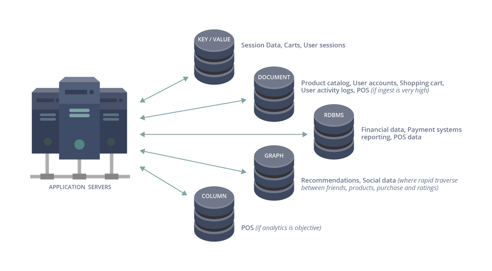
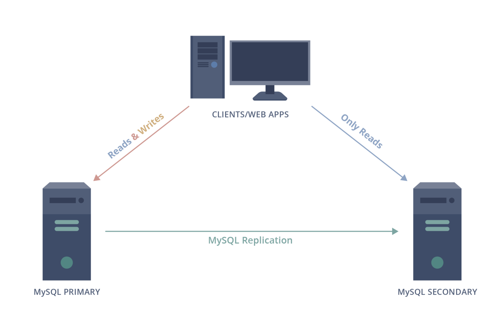
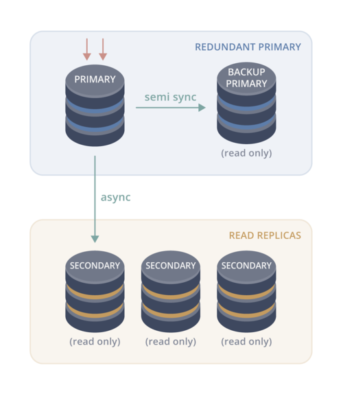
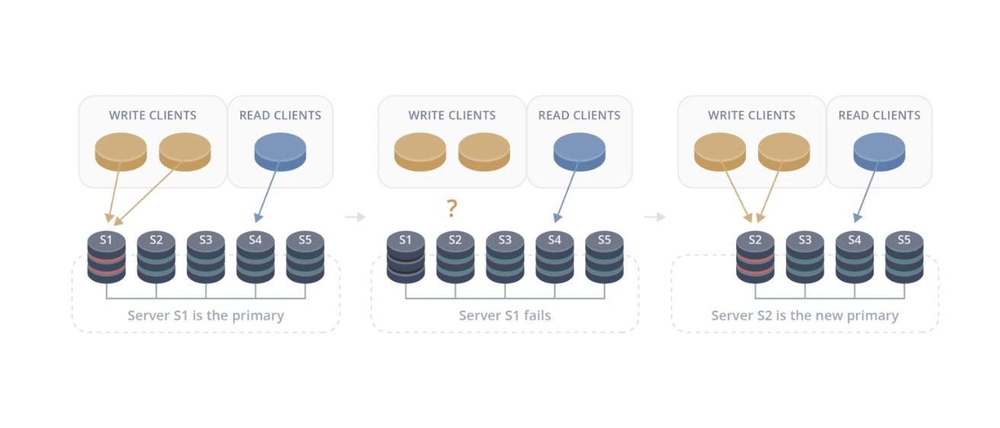
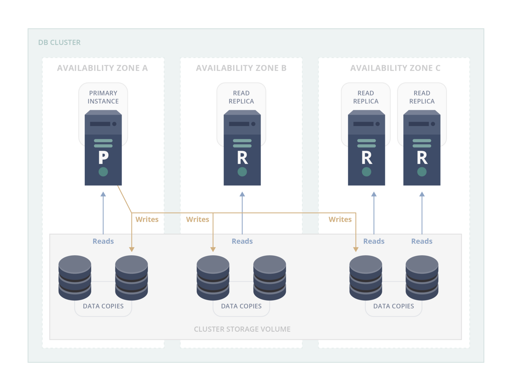
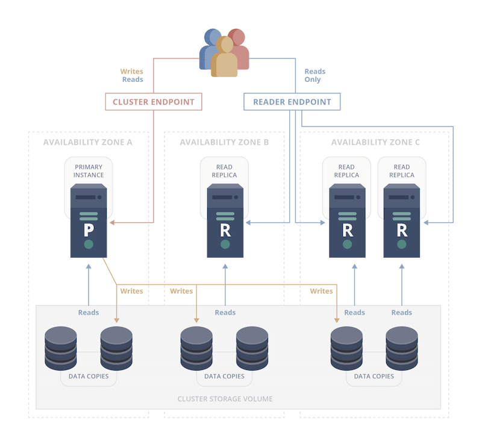
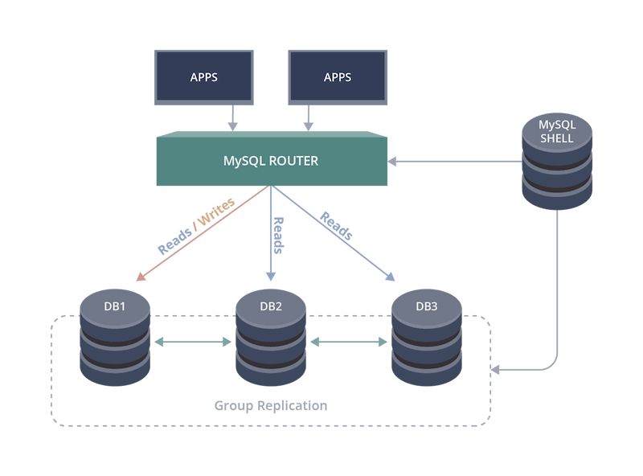
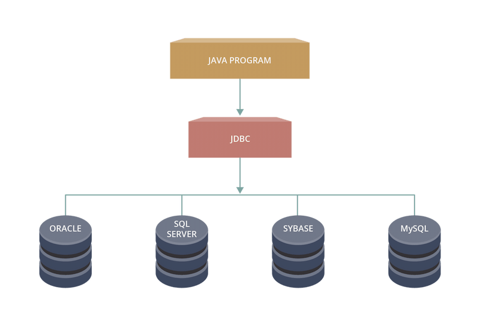
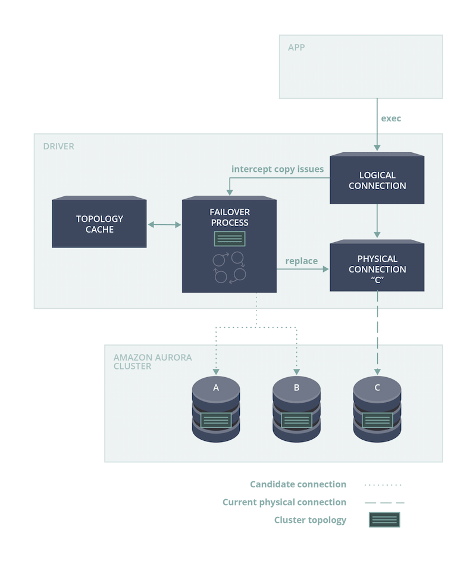
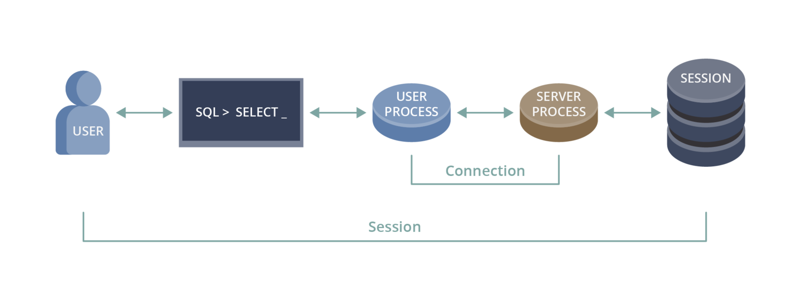

Databases are an essential part of any modern system, and as their popularity has increased, so have standards for performance, availability, and persistence. Although modern databases offer significant improvements in these areas, eventual database failures are inevitable.

This blog post explores different strategies that can be used in order to correct database failures as fast as possible.

There are many different types of databases in use these days. Among the most common are:

- Relational databases
- NoSQL databases
- Graph databases
- Key/Value Stores

Over the last few decades, applications have become larger and heavier. They operate with massive amounts of data, and databases have needed to adapt to the accompanying demands. As a result, single-server databases have been widely replaced with multi-server databases hosted in the cloud. These systems are commonly referred to as database clusters. Cloud databases offer a huge advantage due to their ability to quickly scale, but they also add some extra complexity and challenges from the client application’s perspective. For example:

- Network accessibility: database instances may crash or become inaccessible at any moment, and client applications need to gracefully handle these spontaneous failures.
- Establishing new connections: multi-instance databases introduce uncertainty about which instance the application should connect to. Which instances are heavily loaded? Have any new instances been added? Are all instances in an available state? Client applications should be aware of the database topology and keep track of its state over time.

To achieve consistency of data across instances, database clusters commonly share data between each instance. They also provide fault tolerance and scalability by performing complex processes that are abstracted away from the application. These processes include:

- Data replication between instances
- Resolution of data conflicts
- Data backups and recovery

When using database clusters, client applications need to be careful about differentiating between reading data and writing data. Database cluster topologies can take different forms, but in general, they often contain instances of two types: writers, and readers (also referred to as replicas). As expected, writers can change data, while readers can only retrieve data. Reader instances provide a way to load balance data requests and thus improve performance. In this case, the client application should distinguish between read and write statements, and direct them to the appropriate database connections according to the connected instance’s role (reader or writer).

## **Database Cluster Topologies**

There are many different implementations of database cluster topologies. Each implementation has its pros and cons, and system architects can use whichever one best suits their system requirements. Some common implementations are shown below.

### What Happens When an Instance Dies?

So what actually happens when a database instance dies? Let’s use one of the more common cluster topology implementations as an example: a single writer with multiple read replicas. The diagram below shows a cluster containing five instances. In this example, the first database instance (S1) experiences a failure. How should the client application respond?

The simplest scenario is if S1 was a reader instance. Since the connection was to a reader instance, we know that the connection was only being used for read-only statements. When the client application detects a problem with the connection, it can replace it with a new connection to any other available instance. Since the connection was operating in read-only mode, we know that only read-only statements were being executed against the connection, and switching from one reader to another is safe.

In the other scenario, the scenario shown in the diagram above, instance S1 was a writer instance. In this case, on the server side, the database cluster needs to elect a new writer instance and properly re-configure the cluster. The newly-elected writer instance takes over writer responsibilities and becomes the main source of data changes. This process is called failover. There is an unavoidable downtime associated with cluster failover, and client applications need to properly handle it. In this scenario, the client application will need some way to reconnect to the new writer node once it is available. The mechanism to perform this action depends on the cluster implementation being used. Let’s take a look at one example of a cluster implementation and how it solves this problem.

The cluster implementation above has some unique features:

- Replication: usually, replication is performed through direct communication between the writer and reader instances. A writer sends a log of changes to the reader instances, and each reader applies these changes to its own copy of the database files. This implementation instead takes a shortcut and applies data changes directly to the reader data files. This operation is safe because client connections cannot change the data in the reader instances, and it’s faster than the typical approach. The reader simply serves the updated data to the client application.
- Availability zones: the database instances are deployed on physical hardware wired to different power lines. The data center is organized in such a way that at least 2 availability zones survive any power outage. This approach helps minimize cluster downtimes. The same approach is applicable for any software updates/upgrades: an update can be applied to an instance in one particular availability zone while the instances in the other availability zones remain active and usable.

To provide access to the various instances in the cluster, this database system exposes special “cluster” and “reader” endpoints. The endpoints are domain names and they never change, but the underlying IP addresses that they point to can change. The cluster endpoint provides a useful function: it always points to the current writer instance. If the writer instance changes during a failover process, then the cluster endpoint will now direct connections to this newly-elected writer instance. This solves the problem mentioned above: in the event of a writer instance failing, the client application can use the cluster endpoint to connect to the new writer instance.

The reader endpoint works in a similar way, but it provides the client application with a single (random) reader connection from the list of available reader instances. Every time the client connects using the reader endpoint, the resulting connection could be to any of the available readers. This simplifies access to reader instances and helps to balance the load between them.

With this endpoint system in place, the client application doesn’t need to know anything about individual database instances (like IP addresses or the associated DNS names). It just needs a cluster or a reader endpoint. At this point, you might think that the complexity involved in selecting which instance to connect to has been solved. However, there’s a few more aspects we will need to consider.

Using endpoints requires us to accept that the domain names need to be resolved to associated IP addresses every time the client application uses them. DNS resolution is performed by making a call to the nearest DNS server, which uses cached data. In the case of writer failover, when the writer instance has changed, there’s no guarantee that the updated DNS record will be propagated immediately. In other words, there may be a range of times in which a new writer has been elected, but the client application cannot yet access it through the cluster endpoint, which is still being resolved to the new IP address. In this scenario, the client application could potentially be directed to an obsolete IP address instead of the writer instance it requested.

But what if there was a smart component sitting between the client application and the database cluster that knows everything about the cluster’s topology and status? Something like this:

If this was the case, the client application could simply connect to the router using a single access point, without requiring any complex configuration. The router would be aware of the current cluster topology, which instance is the writer, and which instances are currently down. Because it is aware of the cluster’s topology and state, it would be able to distribute load evenly across the reader instances. Additionally, it could be used by entirely different applications to access the same cluster or even other database clusters. This could be done without requiring the client application to re-implement the same logic for every application/cluster pairing.

Let’s look at this idea from a different angle. The diagram below presents a model of a database driver. In this model, the client application uses a common interface to access a database - for example, the JDBC interface for a Java application. The JDBC interface unifies access to different databases by hiding database-specific details inside the driver logic.

What if a driver could be used for the implementation of the router we discussed earlier? A driver that, besides providing general connectivity, is also aware of the current cluster topology? Let’s refer to it as a smart driver. The smart driver could use its up-to-date knowledge of the topology to provide a faster connection to the new writer in the event of failover. Let’s take a look at how this could be achieved.

Drivers serve a logical connection to an application and internally associate it with a physical connection to a database instance. With this model, we could easily switch the underlying physical connection from one instance to another, without requiring action from the client application. To enable the fast failover functionality that we desire, our smart driver needs to keep track of the cluster topology using the current connection to the database. When a database failover is detected, the driver knows the current topology, but not which instance is the new writer yet. To solve this issue, the driver could use the list of available readers to establish a new connection to the database. Using this connection, it would continuously fetch and analyze the cluster topology. As soon as a newly-elected writer becomes available, the driver replaces the physical connection to the old writer with a physical connection to the new one. This entire process could even be performed without interrupting the client application.

However, there’s one more thing we need to consider in order to properly abstract this process away from the application: each connection to a database instance is associated with a specific session context.

A session context is a group of settings, temporary variables, and temporary database objects that can be directly or indirectly created throughout the lifetime of a connection. A temporary table or function, the last inserted ID from the latest INSERT/UPDATE statement, timezone settings, locale settings – all of these are good examples of session context.

When the driver changes the underlying physical connection during failover, it also indirectly loses the information related to the session context. If the flow of SQL statements depends on this context, the client application may experience errors or data losses. This is obviously less than ideal. How can we fix this problem? Unfortunately, the solution is quite complex. One option would be to parse the SQL statements sent through the driver and track the session state accordingly. However, the diverse variety of ways that session state can be set makes this task quite challenging, and the scope of how to implement this functionality is beyond the scope of this post. Another option would be to notify the application of a connection switch and leave the responsibility of managing the session state to the application itself. In some ways, this approach makes sense, as the application has the most complete perspective on what is trying to be achieved by the SQL statement executions. However, in this scenario we cannot fully abstract the process away from the application - an exception will have to be thrown alerting the application of the connection switch so that it can re-configure the session state as needed.

So there you have it! In this post, we’ve taken a look at database clusters and how they operate, database failures and how to handle them, and a few of the challenges and strategies used to minimize downtimes when failures occur. Hopefully you have gained some new insights into the world of database clusters and the way that they operate. If you enjoyed reading this post, be sure to check back in the future for more information about related topics; hope to see you again soon!
