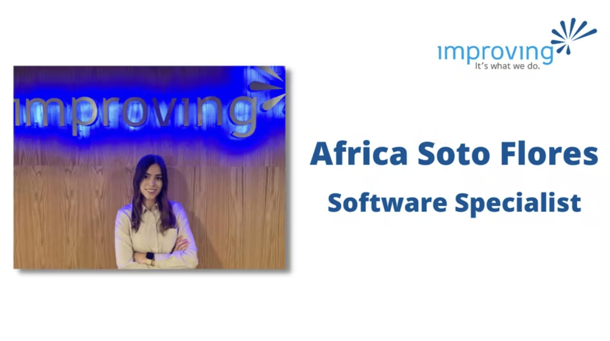
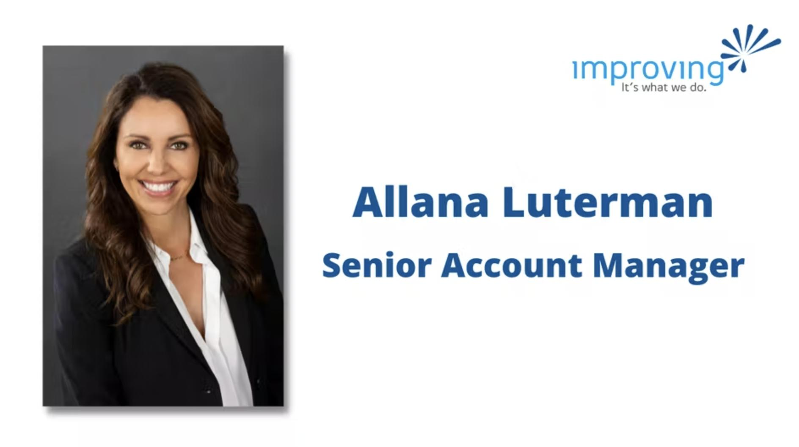
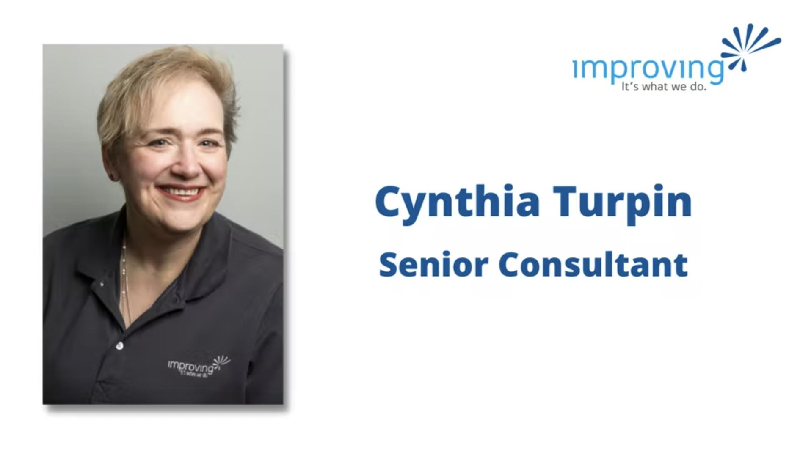
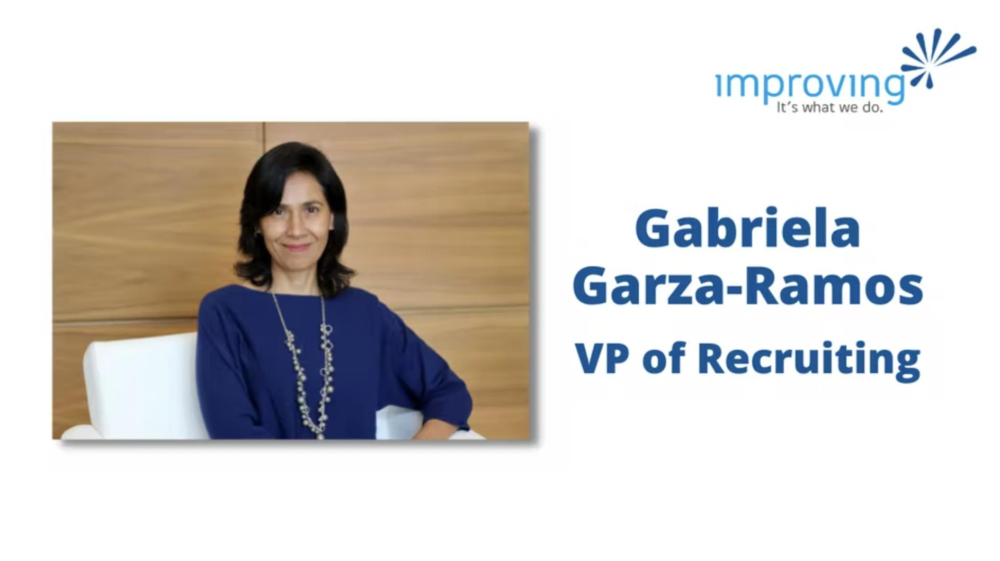
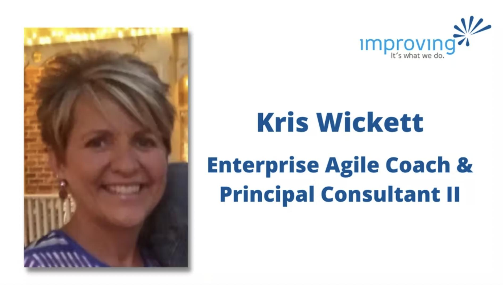

International Women’s Day is a chance to both recognize and celebrate women all over the world. At Improving, we are lucky to have so many incredible, strong, and resilient women.

So, we decided to ask them a few questions about what being a woman means to them.

**What does being a woman mean to you? **Being a woman means strength, commitment, and sensitivity. It also has a special meaning to me since the person I admire the most is a woman, my mother. She has taught me that we have an opportunity every day to demonstrate that we are as capable of carrying out any activity as any other person would do but adding the touch of sensitivity and love that makes it special.

**Are there any assumptions about women that you would like to change? **We, as a society, tend to think that women don’t belong in the workplace. Women are not encouraged to aspire to a successful professional career because there is a different stereotype and path that is supposed to be followed. But we belong to the place where we are fulfilling our dreams and finding happiness, no matter where that is.

**What is your greatest strength?** I’d say it’s tenacity. I work hard every day to reach my goals despite the obstacles or adversities that arise. I’m also committed to giving my best in any activity that I do, from the smallest to the biggest.

**If you could go back and talk to your younger self, what would you say? **Stop worrying and start doing. Work for what you want and learn as much as you can from the people around you. Don't be afraid to ask all your questions or be part of the conversation, your ideas are important regardless of how many years of experience you may have.

**What does being a woman mean to you?** Being a woman means balance. It’s important to both empower and ignite passion in young women, while simultaneously acknowledging the beauty in femininity. Further, the idea of prioritizing filling your cup is something many women forget about. Women have the incredible gift of being able to balance so many things, but we often forget to prioritize our own wants and needs.

**What is your greatest strength?** I allegedly have permanent rose-colored glasses. My optimism and positivity have aided in my ability to navigate life, as I’ve integrated both in personal and work environments. I truly think the secret to a fulfilled life is the idea of random acts of kindness.

**If you could learn anything, what would it be?** I would really love to learn a second language… And I mean REALLY learn it! Spanish would be the first on the list. There’s so much value in being able to communicate with people in their language.

**What advice would you give women entering the workforce?** Regardless of your age and your journey, you can always enter (or re-enter) the workforce. 1) Confidence will always land you the meeting and will often land you the job. 2) Don’t underestimate your abilities because of what you appear to be on paper. The years of experience are mostly irrelevant if you can work harder than everyone else, and think differently. 3) When people see strengths in you that you might not see, believe them.

**Are there any assumptions about women that you would like to change? **Vulnerability is seen as a negative quality, but it is such a powerful thing. If it was expressed more that going the extra mile and being vulnerable was seen as a positive, we could overcome so many challenges.

**What is your greatest strength?** The biggest things that have worked for me, especially in my chosen career field, have been flexibility and perseverance. With IT, you cannot let anything get you down. There will always be a new technology and there will always be something you do not know. I have learned to believe in myself and recognize how far I have grown.

**What advice would you give women entering the workforce? **Do not give up. I feel like a lot of women have expressed to me that they have imposter syndrome, like someone will figure out that they are not as smart as they think they are or that they do not know everything.

Remember, you are not hired because you know all the things! You are hired because you are persistent, you don’t give up, and you like challenges. So keep trying and feel free to reach out and get help.

**If you could go back and talk to your younger self, what would you say? **Worry less about how you look. Worry less about the right thing to say in every situation. People will not remember how you look or what you said, they will remember how you made them feel.

**What does being a woman mean to you? **Professionally, I have been lucky to grow up and live in a country where it's is easier than other places. There are no limits for women can do and we can be anything we put our minds to. Personally, the fact that I have conceived, given birth, and raised a beautiful young lady, I would consider it my biggest and proudest accomplishment.

**What is your greatest strength?** The fact that I have had the opportunity to live and experience two different cultures allows me to see things from a different perspective. Also, my consistency and discipline. I believe that the hardest part is just to start. Once you have taken the first step and put in the effort, the rest will come.

**If you could learn anything, what would it be? **I would love to learn how to play a musical instrument, maybe the piano or guitar. I feel it gives you another avenue to express and connect with the world. I have not put the time or effort to learn, however, is never too late.

**What advice would you give women entering the workforce? **You can do and be anything you want to! Look for the positive in any situation. Surround yourself with people that you respect and that respect you. Find yourself a mentor, it will be life-changing. Do not be afraid to ask for advice. You will be surprised how many people are willing and happy to help.

**What does being a woman mean to you?** This is an interesting question that always makes me pause and reflect on how very fortunate I am to not really think about it from that perspective. I grew up in a family and a community where there was no difference between what a woman could do compared to what a man could do. My mom was very progressively independent and my dad was very involved in everything from childcare to cleaning to working in technology, which is even more fun as I followed in his footsteps without even trying!

**Are there any assumptions about women that you would like to change?** There are quite a few, but I will stick with the one that I am most passionate about. In my opinion, leadership is not about winning and losing or being the biggest. It’s about having the strength, empathy, and kindness to find solutions that are a win/win for all parties, and for some reason, there is an assumption that this approach shows weakness.

For me, it is exactly the opposite. What an asset it is to have someone who can look at things from many perspectives, really have everyone’s best interest at heart, and make the best decision with the information available at that time. In my opinion, it’s easy to come in and just try to power your way into having things done or demand something, compared to being patient enough to negotiate a thoughtful solution.

**If you could learn anything, what would it be?** This answer may be a surprise as I am a lifetime learner, so it’s hard to pick just one thing, but I wish I could learn to draw. So, maybe it’s not about learning as much as having the ability to do it. I have taken classes and continue to practice, but I am still a no-go with it (even when playing Pictionary :P).

I would like to learn to draw because I am a visual person and pictures are what click for me when I am learning. And, the role I am in it is important to have different ways to express ideas/concepts. On a positive note, because of not being able to do this, I have had the opportunity to partner with others who can create magic. For that I am grateful!

**If you could go back and talk to your younger self, what would you say?** Build deep, long-lasting relationships of all kinds and be a lifelong learner. Continue to trust your gut and your internal compass will lead you in the right direction. Continue to be you, as no one does it better!

**What does being a woman mean to you?** In truth, I don’t tie much of my personal identity to being a woman but instead, see it as part of what makes me unique. In the end, we are all human with our own hopes, dreams, passions, and journeys. I think the uniqueness that each of us brings to the table is truly beautiful.

**Are there any assumptions about women that you would like to change?** The assumption is that interests or expertise are at all tied to gender. I would love to see a day where men aren’t assumed or expected to know more about cars, technology, carpentry, or other traditionally male professions, and women aren’t assumed or expected to know more about fashion, personal care, artistry, or other traditionally female professions.

**What advice would you give women entering the workforce?** To be the biggest cheerleader for yourself and the people around you. We are all doing our best in this crazy thing called life and the journey is so much more enjoyable when we can celebrate others’ achievements and our own with equal fervor.

**If you could go back and talk to your younger self, what would you say?** I would say to take more risks in life and pour all your blood, sweat, and tears into your dreams even knowing it might not work. You may not end up anywhere close to where you imagined but if you give it your all, it is unlikely you will regret the journey.
