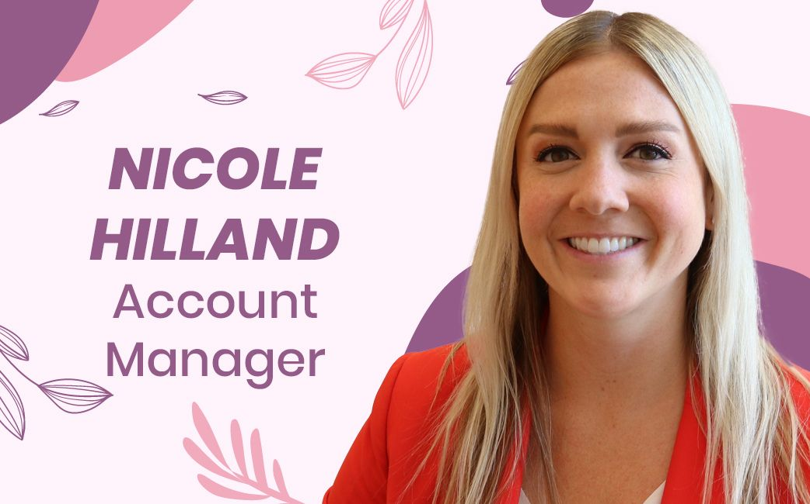
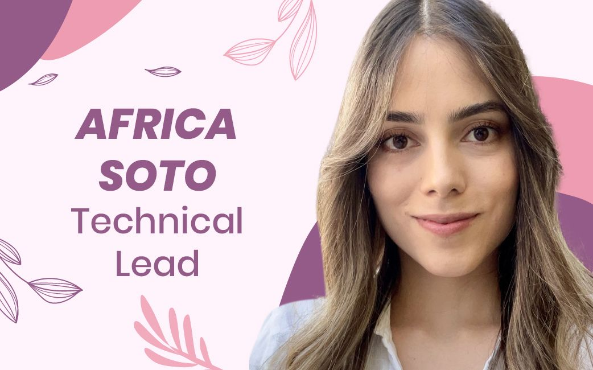
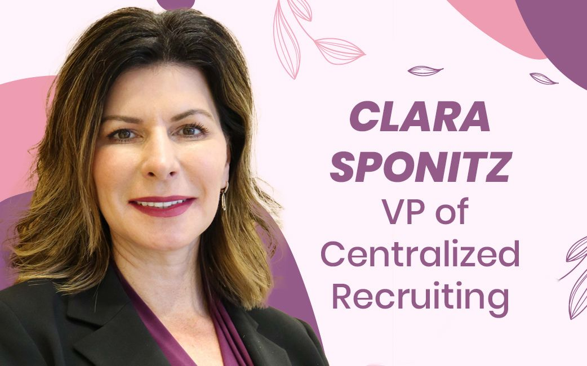
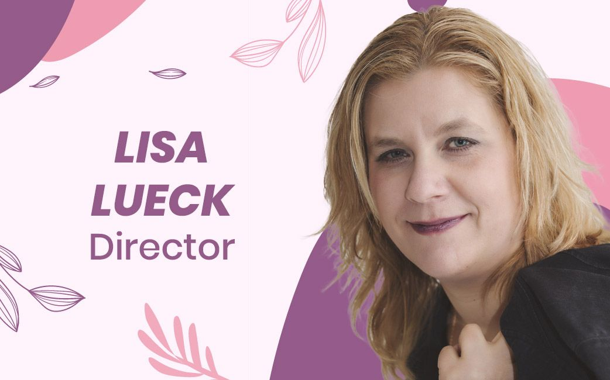
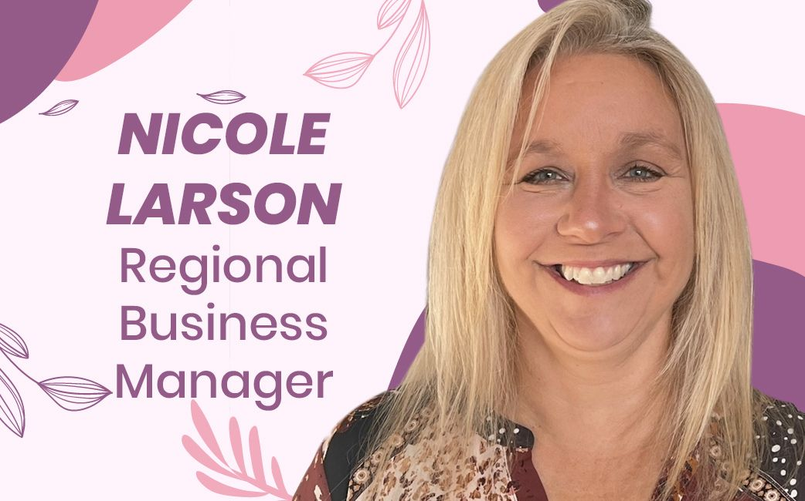
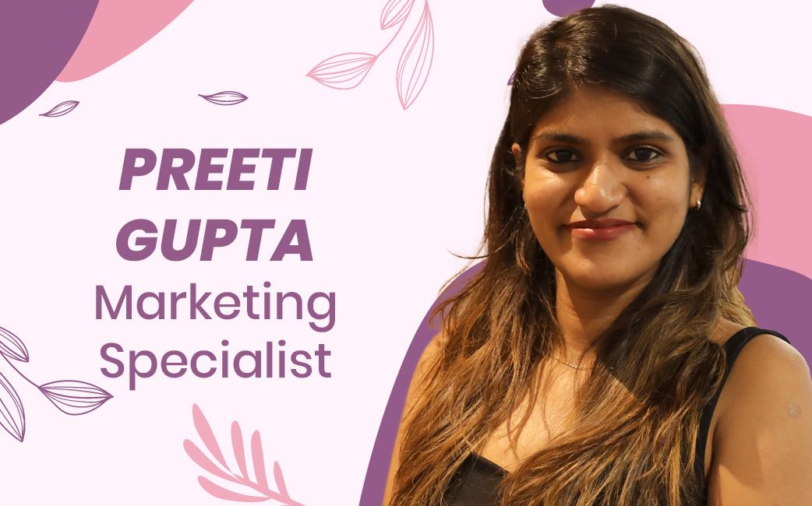
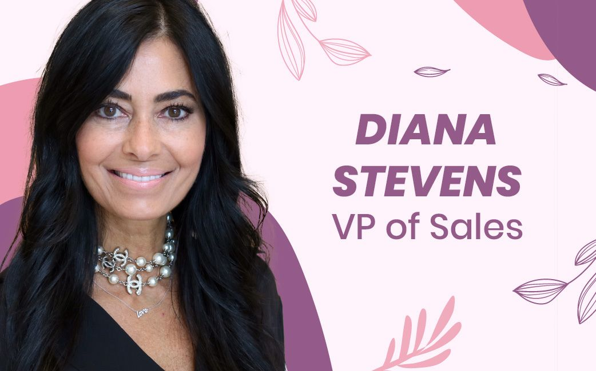

International Women’s Day is a chance to both recognize and celebrate women all over the world. At Improving, we are lucky to have so many incredibly strong and resilient women.

We decided to ask some of them a few questions about what being a woman means to them.

### What does International Women's Day mean to you?

International Women's Day to me is about celebrating the achievements of women and seeking gender equality, not only in the workforce but in every aspect of our lives. It’s a day to pause and reflect on how far we've come toward gender equality. It's also a day to remember those that fought for things that we may take for granted today.

There is still a lot more to be done, and a continued theme I see is that women should not be competing against one another, but instead lifting each other up. Seeing this in all aspects of life really inspires me and makes me feel hopeful for future generations.

### What is the best part of your work?

Connecting with people. I love learning about people and finding ways to help solve unique challenges. Improving's Leadership team invests in understanding who you are, what you're passionate about, and where that can take you along your career path. As a result, I think it's really put me in a great place to elevate myself as a woman in the Technology Industry.

In saying that connecting with people is the best part of my job. We have such an amazing team, across all of our Enterprises. I continue to be inspired by my other Improvers which challenges me to keep growing and get better.

### What advice would you give to your former self?

Don't let anyone intimidate you. You might be young, but your ideas are always important. So, don't be afraid to be part of the conversation and believe in yourself. You can accomplish whatever you put your mind to. Aim high and you will get the results. You just need to stop worrying and start going after what you want.

### Why are inclusion and diversity important in this industry?

I think sometimes we don't realize that there is diversity everywhere. In our group of friends, in our families, and especially in the companies we work for. At Improving, we get to work with people from different countries and different cultures. I think we have to make sure that we respect and embrace each others’ differences so we can create a better and safer environment for all of us.

### Why is it important to have women in the IT industry?

Diversity is the first thing that comes to mind. Diversity accelerates innovation. Also, technology is one of the fastest-growing industries and it is here to stay. Women make up half of the population, and although IT has primarily been a male-dominated field, it’s important that we encourage our girls to get involved in STEM programs.

### What advice would you give to your former self?

I have to be honest, I think some of these may sound fairly generic. I don't know if it's a female thing or how we are raised to be people pleasers, but first I would say trust your gut and stand up for what you believe in. Stop worrying so much about what others may think of you.

It's okay to say no and you can't do everything for everyone. I was the type that never wanted to disappoint anyone. Don't stress so much about things that are completely out of your control. Learn to let go. And as the saying goes, don't sweat the small stuff.

### Why are inclusion and diversity important in this industry?

It's important to be inclusive and have a diverse workforce in the IT industry or in any science, technology, engineering, or math field to increase creativity and innovation when solving complex problems. Each person brings their different knowledge, experiences, and life lessons to broaden the options of the solution which results in a creative solution.

Leaning into creating inclusive and diverse workplaces gives us a larger talent pool to draw from than our standard North American cultures. Inclusion and diversity are important to reduce the bias that gets developed into our technology solutions. We want to avoid this bias by getting different ethnic backgrounds, and people who identify as different genders, together in a room to get those creative and innovative ideas flowing.

### What is the best part of your work?

I have two answers for this: the people that I work with and the clients. My colleagues bring professionalism, expertise, and friendship. I love seeing our clients succeed by having Improving come in, add value, and get them self-sustaining, whether that be in modern digital services, in our data services, or in the field I am in, which is, Agile coaching and consulting.

### What does International Women's Day mean to you?

To me, International Women's Day means the inclusion of women from across the world.

We can show the world that we're making a difference, not just in the U.S. or any other larger country, but everywhere. The day showcases the many different ways women are strong and capable, especially when we band together. It also is a way to recognize we can be in all job fields, not just the ones labeled as women’s career fields.

I think it’s also the time when we can show our youth and other women that we have value, not just inside the home but outside of the home as well. We are capable, we are worthy, and we can make a difference.

### What about your job makes you proud?

The best part of my job is working with great people in an environment that makes me feel like I'm part of a family, and that includes my actual family. Improvers really seem to care. In times of need, we come together as a family and that's just so important. I've been in environments where it just does not work that way and I need that type of work culture so I can balance my work and life.

And then, I love to just be able to help others. That's the other piece. Especially since I work with Improving’s benefits, my goal is to help others.

### What about your job makes you proud?

The thing that makes me proud about my job is the trust and support people give me. The people I work with continually believe in me, which gives me the confidence to do more than I could ever imagine I could do. I have never had this type of work environment before, and I am so thankful for it.

I have also made a lot of good friends at Improving. I’ve traveled to visit them, hung out with them outside of the office, and have been able to learn about different cultures through them.

### What does International Women's Day mean to you?

International Women's Day is just a great day for me. I like to take a moment and celebrate the accomplishment of women in every field. Doesn't matter if it is science, science and technology, education, health, everyone deserves to be celebrated.

### What advice would you give to your former self?

Be authentic, stay true to yourself, don’t take life for granted, make every day count, and start on your bucket list when you are young. Smile more, worry less. Positivity is infectious, and happiness is a choice! Never judge yourself in comparison to others, instead judge yourself against what you know you’re capable of. Continually learn new ways to improve yourself. If you don’t, you will be left behind by others who are doing it. Happiness isn’t a destination, but a lifetime journey.

Spend as much time with your children when they are small. It doesn’t matter if the bathrooms get cleaned right now or the laundry is folded. Your children will treasure the time you spend with them more than anything else. Lavish your love on them because before you know it, they will be grown and gone. Save early for your retirement. If your company offers a 401K plan, take full advantage of it. If not, save 10-20% of your income right off the bat. You will thank yourself when you are 50!

### What is the best part of your work?

I never imagined I would be in technology when I was young. Instead, I thought I would be in fashion and design. I have now been in technology for 33 years and have loved almost every day of it. It’s exciting and different every day. I love people and building relationships and I am passionate about what I am selling, which are some very awesome consultants who build software for my customers. I actually love getting up and going to my job even after all of these years because I work with the best people, and they make it fun!
