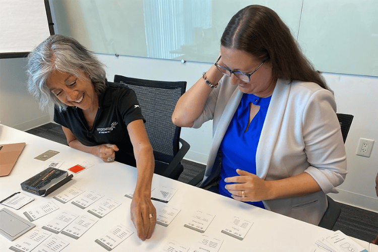

**International Women’s Day is a chance to both recognize and celebrate women all over the world. At Improving, we are lucky to have so many incredibly strong and resilient women.** **Meet four of our incredible Improvers as they share their insights and experiences in celebration of this day.**

### **What does being a woman mean to you?**

As a woman, especially in a male-dominated industry, I think just having that unique perspective provides value in many situations. It's about embracing our strengths, not hiding them, whether that's the attention to detail or being a great listener and communicator. - *Kimberly Roberts, Director, Business Operations*

Women are different than men, just like you are different from the woman sitting across from you. Own it. We may be a minority in the tech industry, but we all have a voice, and yours is equally as important as the ones next to you. - *Susan Fojtasek, Chief of Staff*

Being a woman is a complex experience that for me embodies a lot of strength, resilience, and adaptability. In male-dominated industries like ours, it often means challenging stereotypes, breaking barriers, and serving as a catalyst for change as we navigate our own unconscious bias. - *Victoria Ochoa Landeros, Mexico Talent Acquisition Director*

### **How do you stay motivated and continue to grow in your career?**

I think growth also depends on the relationships we cultivate, mainly with our colleagues and teams. I try to set personal and professional goals for myself weekly, monthly, yearly. Being able to check that box when I'm done makes me very happy. I also try to push myself to be uncomfortable. That is when I know that I am growing. - *Susan Fojtasek, Chief of Staff*

As absolutely corny as it sounds, I think what keeps me motivated is my daughter and this next generation coming in. I really appreciate how there are more initiatives now specifically focused around women in STEM. I think it's our responsibility to make things better for the next generation. - *Sunelle Pink, Director of Human Resources*

I believe that by doing our best and seeing the outcome of our effort, we're going to find motivation in ourselves. - *Daniela Medrano, Consultant*

I think that being passionate about your career and loving what you do, it's going to make you want more from yourself and always be better. I stay motivated by constantly learning and embracing opportunities to solve complex problems. - *Kimberly Roberts, Director, Business Operations*

I stay motivated by learning new things, working on interesting projects, and surrounding myself with inspiring people. I also take time to reflect on my progress and set new goals.- *Paloma Olivera, Consultant*

### **What advice would you give to young women who are just starting their careers in tech?**

For young women starting in tech, and everywhere actually, I would like you to know that identifying your passions is the first step in your growth. Match them with the right roles that you want to pursue, and build a strong and meaningful network of people and mentors who can guide your career. Don't let fear of failure hold you back. Speak up and advocate for your ideas and achievements. Document them, enjoy them, and celebrate them. - *Victoria Ochoa Landeros, Mexico Talent Acquisition Director*

Believe in yourself, don't be afraid to ask questions, keep learning, find mentors, build a support network, and share your ideas with confidence. *Paloma Olivera, Consultant*

Make sure that you're celebrating your wins as much as focusing on what you need to develop. I think it's really natural when you start in your career to focus on areas of development and things you can do better. I think by celebrating those wins and the things that you're good at, you build confidence. - *Sunelle Pink, Director of Human Resources*
