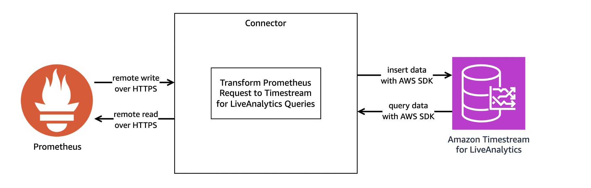
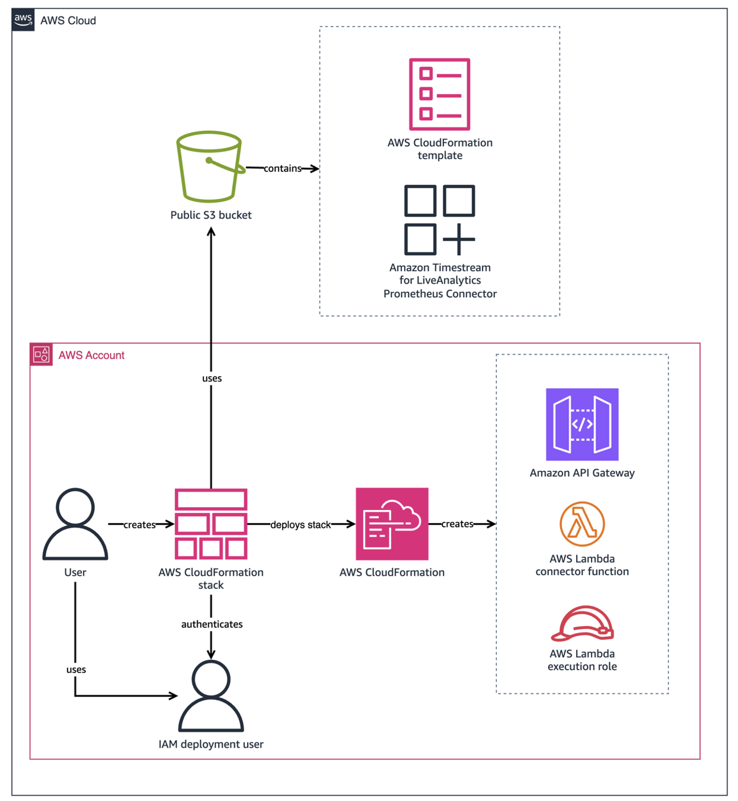
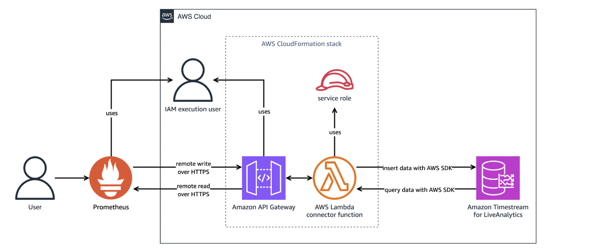
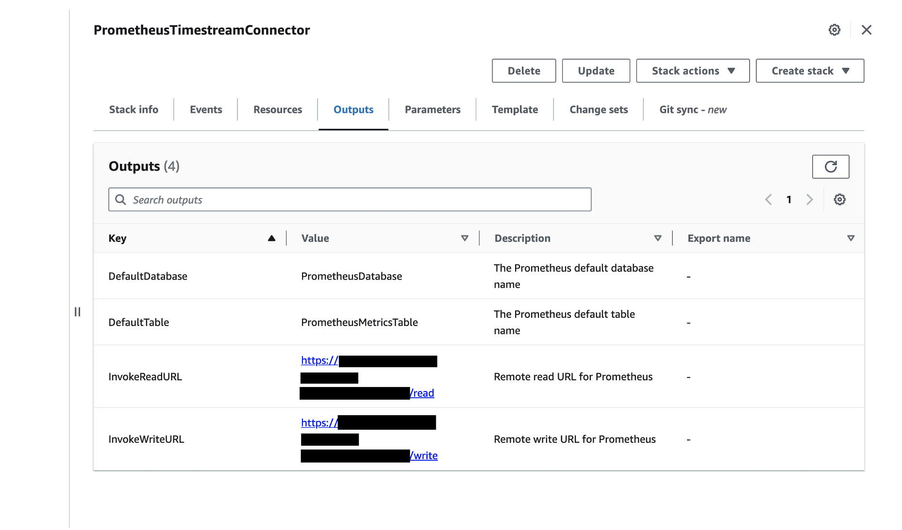
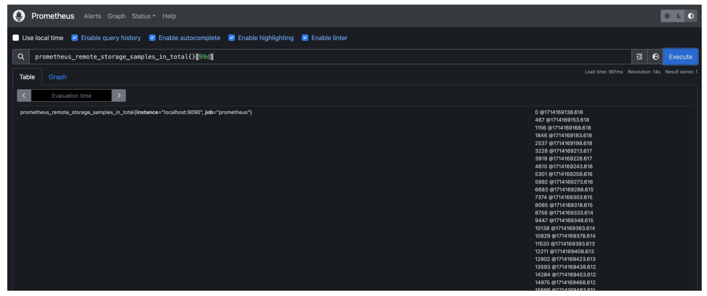
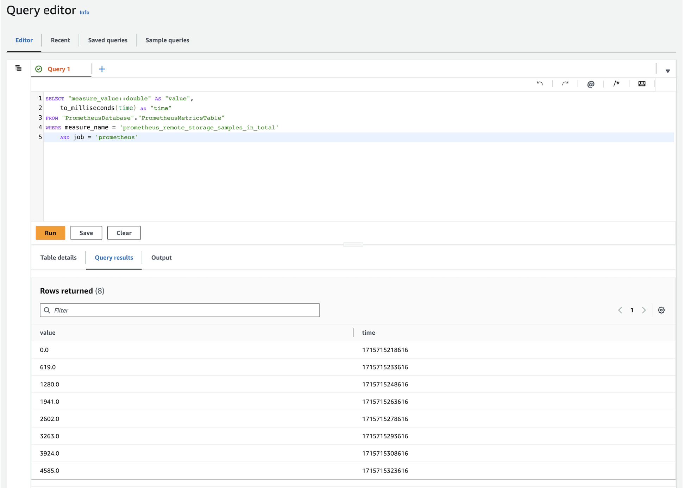
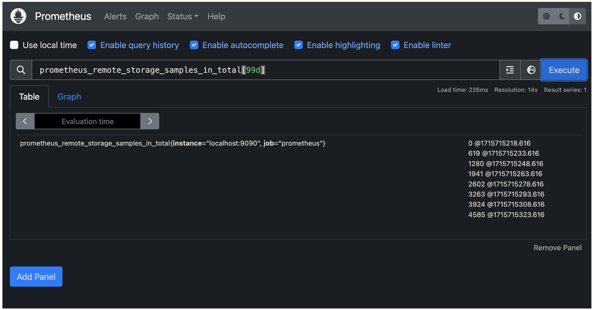

[Amazon Timestream for LiveAnalytics](https://docs.aws.amazon.com/timestream/latest/developerguide/what-is-timestream.html) is a scalable serverless time series database that makes it simple to store and analyze trillions of time series data points per day. Timestream for LiveAnalytics is auto-scaling, provides data lifecycle management, and offers high availability.

[Prometheus](https://prometheus.io/docs/introduction/overview/) is an application used for systems monitoring and alerting. Prometheus stores metrics as time series data, with each metric having an associated name. Prometheus collects data using a pull model, querying a list of data sources at a specified polling frequency. In Prometheus, local storage has a [size limitation](https://prometheus.io/docs/prometheus/latest/storage/#remote-storage-integrations). In Prometheus, storage can be increased by using remote storage solutions. [The Amazon Timestream](https://aws.amazon.com/timestream/) for LiveAnalytics Prometheus Connector allows Prometheus to use Timestream for LiveAnalytics as its remote storage system.

By integrating Prometheus with Timestream for LiveAnalytics, you can unlock the full potential of your monitoring data, thereby gaining a more comprehensive understanding of system behavior and driving more informed decision-making. Specifically, Timestream for LiveAnalytics offers the following benefits:

- **Serverless and Scalability: **Using the serverless architecture of Timestream for LiveAnalytics, store large amounts of time series data without worrying about local storage limitations, allowing for longer retention and more comprehensive analysis.
- **Correlation and analysis: **Integrate Prometheus data with other data sources in Timestream, enabling deeper insights and correlations across different data sets.
- **SQL-based querying: **Quickly access and analyze Prometheus data using SQL, making it simple to perform ad-hoc queries, create custom dashboards, and build reports.
- **Enhanced data exploration: **Use the advanced analytics capabilities in Timestream for LiveAnalytics, such as aggregation, filtering, and grouping, to gain a deeper understanding of system performance and behavior.
- **Cost-effectiveness: **Reduce storage costs by offloading Prometheus data to a scalable, cloud-based storage solution.

The source code of the Timestream for LiveAnalytics Prometheus Connector and additional documentation are available in the [Amazon Timestream for LiveAnalytics Prometheus Connector](https://github.com/awslabs/amazon-timestream-connector-prometheus) repository.

In this post, we show how you can use the Timestream for LiveAnalytics Prometheus Connector to use Timestream for LiveAnalytics as remote storage for Prometheus with one-click deployment.

## Solution Overview

The Timestream for LiveAnalytics Prometheus Connector acts as a translator between Prometheus and Timestream for LiveAnalytics. The Prometheus Connector receives and sends time series data between Prometheus and Timestream for LiveAnalytics through Prometheus’ [remote write and remote read](https://prometheus.io/docs/prometheus/latest/storage/#remote-storage-integrations) protocols. The following image provides an overview of the connector architecture.



The connector can be run locally, run as a Docker container, or deployed as an [AWS Lambda](https://aws.amazon.com/lambda/) function. This post focuses on the recommended option, one-click deployment, which deploys the connector as a Lambda function using an [AWS CloudFormation](https://aws.amazon.com/cloudformation/) [template](https://docs.aws.amazon.com/AWSCloudFormation/latest/UserGuide/cfn-whatis-concepts.html#cfn-concepts-templates) stored in a public [Amazon Simple Storage Service (Amazon S3)](https://aws.amazon.com/s3/) bucket. The following image provides an overview of the resources created when the connector is deployed as a CloudFormation [stack](https://docs.aws.amazon.com/AWSCloudFormation/latest/UserGuide/cfn-whatis-concepts.html#cfn-concepts-stacks) with one-click deployment.



The following image shows the resources deployed by the CloudFormation stack when in use.



The CloudFormation stack can take around five minutes to finish creating resources. You can review the progress in the AWS CloudFormation console on the Events tab of the stack. When complete, the stack status displays as `CREATE_COMPLETE`. The stack deploys the following resources:

- The Amazon Timestream for LiveAnalytics Prometheus Connector as a Lambda function, which acts as a translation layer between Prometheus and Timestream for LiveAnalytics.
- An [Amazon API Gateway](https://aws.amazon.com/api-gateway/), which routes incoming requests from Prometheus and returns responses.
- An AWS IAM role, used to permit the deployment of the Lambda function and API Gateway.
- An AWS IAM policy, used to output logs to [Amazon CloudWatch](https://docs.aws.amazon.com/cloudwatch/).

The CloudFormation stack provides the following parameters:

- `APIGatewayStageName`: The default stage name of the API Gateway. Defaults to “dev”.
- `MemorySize`: The memory size in MB of the Lambda function. Defaults to 512.
- `ApiGatewayTimeoutInMillis`: The maximum amount of time in milliseconds an API Gateway event will wait before timing out. Defaults to 30000.
- `LambdaTimeoutInSeconds`: The amount of time in seconds to run the connector on AWS Lambda before timing out. Defaults to 30.
- `ReadThrottlingBurstLimit`: The number of burst read requests per second that the API Gateway permits. Defaults to 1200.
- `WriteThrotlingBurstLimit`: The number of burst write requests per second that the API Gateway permits. Defaults to 1200.
- `DefaultDatabase`: The Prometheus default database name. Defaults to “PrometheusDatabase”.
- `DefaultTable`: The Prometheus default table name. Defaults to “PrometheusMetricsTable”.
- `ExecutionPolicyName`: The name of the basic execution policy created for AWS Lambda. Defaults to “LambdaExecutionPolicy”.
- `LogLevel`: The output level for logs. Valid values include info, warn, debug, and error. Defaults to info.

You are responsible for the costs of the AWS services used in this solution.

Using the Timestream for LiveAnalytics Prometheus Connector:

This post is meant to be used as a getting started guide and does not cover configuring TLS encryption between Prometheus and the Amazon API Gateway. TLS Encryption is highly recommended when the Prometheus Connector is deployed for production. To enable TLS encryption for production, see [Configuring mutual TLS authentication for an HTTP API](https://docs.aws.amazon.com/apigateway/latest/developerguide/http-api-mutual-tls.html).

## Prerequisites

A few prerequisites are required before using the connector.

1. **Sign up for AWS** — Create an AWS account before beginning. For more information about creating an AWS account and retrieving your AWS credentials, see [Signing Up for AWS](https://docs.aws.amazon.com/timestream/latest/developerguide/accessing.html#SettingUp.Q.SignUpForAWS).

2. **Create an IAM User** — Create an IAM user with the necessary permissions for deploying the connector with one-click deployment. See the “[IAM User Configuration](https://aws.amazon.com/blogs/database/introducing-the-amazon-timestream-for-liveanalytics-prometheus-connector/#iam-user-configuration)” section below.

3. **Amazon Timestream** — Create a database named PrometheusDatabase with a table named PrometheusMetricsTable in the target deployment Region for Amazon Timestream for LiveAnalytics. To create databases and tables in Amazon Timestream, see [Accessing Timestream for LiveAnalytics](https://docs.aws.amazon.com/timestream/latest/developerguide/accessing.html) and the [Amazon Timestream for LiveAnalytics Tutorial](https://docs.aws.amazon.com/timestream/latest/developerguide/getting-started.db-w-sample-data.html).

4. **Prometheus** — Download Prometheus from their [Download](https://prometheus.io/download/) page, minimum version 0.0. To download Prometheus on an [Amazon Elastic Compute Cloud (Amazon EC2)](https://aws.amazon.com/ec2/) instance, use wget. For example, on Amazon Linux 2023:

```markup
wget https://github.com/prometheus/prometheus/releases/download/v2.52.0-rc.1/prometheus-2.52.0-rc.1.linux-amd64.tar.gz && \
tar -xvf prometheus-2.52.0-rc.1.linux-amd64.tar.gz
```

*To learn more about Prometheus, see their *[*introduction documentation*](https://prometheus.io/docs/introduction/overview/)*.*

### IAM User Configuration

In order to use Timestream for LiveAnalytics as remote storage for Prometheus, an access key must be generated and deployment and execution permissions must be configured.

#### Access Key

An access key is required to allow Prometheus to read and write from Timestream. The IAM user used for execution must have an access key. Despite it being an AWS security best practice to use roles instead of access keys, an IAM role cannot be used instead of an access key due to a limitation with Prometheus. MFA is not currently supported.

#### **To create an access key:**

1. Go to the [AWS IAM console](https://console.aws.amazon.com/iam/home).

2. In the navigation pane, choose **Access management**, **Users**.

3. Select or [Create](https://docs.aws.amazon.com/IAM/latest/UserGuide/id_users_create.html) the user you want to use for execution from the list of users.

4. Under the **Summary** section choose **Create access key**.

5. For **Use case** select **Other** and choose **Next**.

6. Optionally, give the access key a description.

7. Choose **Create access key**.

8. Take note of your access key ID and save your secret access key to a file named secretAccessKey.txt.

#### *Deployment Permissions*

The user **deploying** this project **must** have the following permissions. These deployment permissions make sure the CloudFormation stack can deploy the necessary resources. Make sure the values of `account-id` and `region` in the resources section are updated before using this template directly.

*Note – All permissions have limited resources except actions that cannot be limited to a specific resource. API Gateway actions cannot limit resources as the resource name is auto generated by the template. See the following documentation links for CloudFormation, SNS, and IAM limitations on actions: *[*CloudFormation*](https://docs.aws.amazon.com/service-authorization/latest/reference/list_awscloudformation.html#awscloudformation-actions-as-permissions)*, *[*SNS*](https://docs.aws.amazon.com/service-authorization/latest/reference/list_amazonsns.html#amazonsns-actions-as-permissions)*, and *[*IAM*](https://docs.aws.amazon.com/service-authorization/latest/reference/list_awsidentityandaccessmanagementiam.html#awsidentityandaccessmanagementiam-actions-as-permissions)*.*

*Note – This policy is too long to be added inline during user creation and must be created as a policy and attached to the user instead.*

```markup
{
    "Version": "2012-10-17",
    "Statement": [
        {
            "Sid": "VisualEditor0",
            "Effect": "Allow",
            "Action": [
                "cloudformation:ListStacks",
                "cloudformation:GetTemplateSummary",
                "iam:ListRoles",
                "sns:ListTopics",
                "apigateway:GET",
                "apigateway:POST",
                "apigateway:PUT",
                "apigateway:TagResource"
            ],
            "Resource": [
                "arn:aws:apigateway:<region>::/apis/*",
                "arn:aws:apigateway:<region>::/apis",
                "arn:aws:apigateway:<region>::/tags/*"
            ]
        },
        {
            "Sid": "VisualEditor1",
            "Effect": "Allow",
            "Action": [
                "iam:GetRole",
                "iam:CreateRole",
                "iam:AttachRolePolicy",
                "iam:PutRolePolicy",
                "iam:CreatePolicy",
                "iam:PassRole",
                "iam:GetRolePolicy"
            ],
            "Resource": "arn:aws:iam::<account-id>:role/PrometheusTimestreamConnector-IAMLambdaRole-*"
        },
        {
            "Sid": "VisualEditor2",
            "Effect": "Allow",
            "Action": [
                "cloudformation:CreateChangeSet",
                "cloudformation:DescribeStacks",
                "cloudformation:DescribeStackEvents",
                "cloudformation:DescribeChangeSet",
                "cloudformation:ExecuteChangeSet",
                "cloudformation:GetTemplate",
                "cloudformation:CreateStack",
                "cloudformation:GetStackPolicy"
            ],
            "Resource": [
                "arn:aws:cloudformation:<region>:<account-id>:stack/PrometheusTimestreamConnector/*",
                "arn:aws:cloudformation:<region>:<account-id>:stack/aws-sam-cli-managed-default/*",
                "arn:aws:cloudformation:<region>:aws:transform/Serverless-2016-10-31"
            ]
        },
        {
            "Sid": "VisualEditor3",
            "Effect": "Allow",
            "Action": [
                "lambda:ListFunctions",
                "lambda:AddPermission",
                "lambda:CreateFunction",
                "lambda:TagResource",
                "lambda:GetFunction"
            ],
            "Resource": "arn:aws:lambda:<region>:<account-id>:function:PrometheusTimestreamConnector-LambdaFunction-*"
        },
        {
            "Sid": "VisualEditor4",
            "Effect": "Allow",
            "Action": [
                "s3:GetObject",
                "s3:GetBucketPolicy",
                "s3:GetBucketLocation"
            ],
            "Resource": "arn:aws:s3:::timestreamassets-<region>/timestream-prometheus-connector/timestream-prometheus-connector-linux-amd64-*.zip"
        },
        {
            "Sid": "VisualEditor5",
            "Effect": "Allow",
            "Action": [
                "s3:GetObject",
                "s3:GetBucketPolicy",
                "s3:GetBucketLocation",
                "s3:PutObject",
                "s3:PutBucketPolicy",
                "s3:PutBucketTagging",
                "s3:PutEncryptionConfiguration",
                "s3:PutBucketVersioning",
                "s3:PutBucketPublicAccessBlock",
                "s3:CreateBucket",
                "s3:DescribeJob",
                "s3:ListAllMyBuckets"
            ],
            "Resource": "arn:aws:s3:::aws-sam-cli-managed-default*"
        },
        {
            "Sid": "VisualEditor6",
            "Effect": "Allow",
            "Action": [
                "cloudformation:GetTemplateSummary"
            ],
            "Resource": "*",
            "Condition": {
                "StringEquals": {
                    "cloudformation:TemplateUrl": [
                        "https://timestreamassets-<region>.s3.amazonaws.com/timestream-prometheus-connector/template.yml"
                    ]
                }
            }
        }
    ]
}
```

#### *Execution Permissions*

The user **executing** this project **must** have the following permissions. Make sure the values of `account-id` and `region` in the resource section are updated before using this template directly. If the name of the database and table differ from the policy resource, be sure to update their values.

*Note – Timestream:DescribeEndpoints resource must be **`*`** as specified under *[*security_iam_service-with-iam*](https://docs.aws.amazon.com/timestream/latest/developerguide/security_iam_service-with-iam.html)*.*

```markup
{
  "Version": "2012-10-17",
  "Statement": [
    {
      "Effect": "Allow",
      "Action": [
        "timestream:WriteRecords",
        "timestream:Select"
      ],
      "Resource": "arn:aws:timestream:<region>:<account-id>:database/PrometheusDatabase/table/PrometheusMetricsTable"
    },
    {
      "Effect": "Allow",
      "Action": [
        "timestream:DescribeEndpoints"
      ],
      "Resource": "*"
    }
  ]
}
```

These permissions allow the Lambda function to write to and read from Timestream for LiveAnalytics.

## Deploying the Timestream for LiveAnalytics Prometheus Connector with One-Click Deployment

Use an AWS CloudFormation template to create the stack. To install the Timestream for LiveAnalytics Prometheus Connector service, launch the AWS CloudFormation stack on the AWS CloudFormation console by choosing the “Launch” button in the AWS Region where you created the Amazon Timestream for LiveAnalytics database and table:

US East (N. Virginia) us-east-1: [VIEW](https://timestreamassets-us-east-1.s3.amazonaws.com/timestream-prometheus-connector/template.yml), [View in Composer](https://console.aws.amazon.com/composer/canvas?region=us-east-1&templateURL=https://timestreamassets-us-east-1.s3.amazonaws.com/timestream-prometheus-connector/template.yml), [Launch](https://console.aws.amazon.com/cloudformation/home?region=us-east-1#/stacks/new?stackName=PrometheusTimestreamConnector&templateURL=https://timestreamassets-us-east-1.s3.amazonaws.com/timestream-prometheus-connector/template.yml)

US East (Ohio) us-east-2: [VIEW](https://timestreamassets-us-east-2.s3.amazonaws.com/timestream-prometheus-connector/template.yml), [View in Composer](https://console.aws.amazon.com/composer/canvas?region=us-east-2&templateURL=https://timestreamassets-us-east-2.s3.amazonaws.com/timestream-prometheus-connector/template.yml), [Launch](https://console.aws.amazon.com/cloudformation/home?region=us-east-2#/stacks/new?stackName=PrometheusTimestreamConnector&templateURL=https://timestreamassets-us-east-2.s3.amazonaws.com/timestream-prometheus-connector/template.yml)

US West (Oregon) us-west-2: [VIEW](https://timestreamassets-us-west-2.s3.amazonaws.com/timestream-prometheus-connector/template.yml), [View in Composer](https://console.aws.amazon.com/composer/canvas?region=us-west-2&templateURL=https://timestreamassets-us-west-2.s3.amazonaws.com/timestream-prometheus-connector/template.yml), [Launch](https://console.aws.amazon.com/cloudformation/home?region=us-west-2#/stacks/new?stackName=PrometheusTimestreamConnector&templateURL=https://timestreamassets-us-west-2.s3.amazonaws.com/timestream-prometheus-connector/template.yml)

Asia Pacific (Sydney) ap-southeast-2: [VIEW](https://timestreamassets-ap-southeast-2.s3.amazonaws.com/timestream-prometheus-connector/template.yml), [View in Composer](https://console.aws.amazon.com/composer/canvas?region=ap-southeast-2&templateURL=https://timestreamassets-ap-southeast-2.s3.amazonaws.com/timestream-prometheus-connector/template.yml), [Launch](https://console.aws.amazon.com/cloudformation/home?region=ap-southeast-2#/stacks/new?stackName=PrometheusTimestreamConnector&templateURL=https://timestreamassets-ap-southeast-2.s3.amazonaws.com/timestream-prometheus-connector/template.yml)

Asia Pacific (Tokyo) ap-northeast-1: [VIEW](https://timestreamassets-ap-northeast-1.s3.amazonaws.com/timestream-prometheus-connector/template.yml), [View in Composer](https://console.aws.amazon.com/composer/canvas?region=ap-northeast-1&templateURL=https://timestreamassets-ap-northeast-1.s3.amazonaws.com/timestream-prometheus-connector/template.yml), [Launch](https://console.aws.amazon.com/cloudformation/home?region=ap-northeast-1#/stacks/new?stackName=PrometheusTimestreamConnector&templateURL=https://timestreamassets-ap-northeast-1.s3.amazonaws.com/timestream-prometheus-connector/template.yml)

Europe (Frankfurt) eu-central-1: [VIEW](https://timestreamassets-eu-central-1.s3.amazonaws.com/timestream-prometheus-connector/template.yml), [View in Composer](https://console.aws.amazon.com/composer/canvas?region=eu-central-1&templateURL=https://timestreamassets-eu-central-1.s3.amazonaws.com/timestream-prometheus-connector/template.yml), [Launch](https://console.aws.amazon.com/cloudformation/home?region=eu-central-1#/stacks/new?stackName=PrometheusTimestreamConnector&templateURL=https://timestreamassets-eu-central-1.s3.amazonaws.com/timestream-prometheus-connector/template.yml)

Europe (Ireland) eu-west-1: [VIEW](https://timestreamassets-eu-west-1.s3.amazonaws.com/timestream-prometheus-connector/template.yml), [View in Composer](https://console.aws.amazon.com/composer/canvas?region=eu-west-1&templateURL=https://timestreamassets-eu-west-1.s3.amazonaws.com/timestream-prometheus-connector/template.yml), [Launch](https://console.aws.amazon.com/cloudformation/home?region=eu-west-1#/stacks/new?stackName=PrometheusTimestreamConnector&templateURL=https://timestreamassets-eu-west-1.s3.amazonaws.com/timestream-prometheus-connector/template.yml)

### Prometheus Configuration

To configure Prometheus to read and write to Timestream for LiveAnalytics, configure the `remote_read` and `remote_write` sections in `prometheus.yml`, Prometheus’ configuration file, by replacing `InvokeWriteURL` and `InvokeReadURL` with the API Gateway URLs from deployment. You can find `prometheus.yml` in the extracted Prometheus release archive with pre-populated values. If you used the example command for downloading and running Prometheus on an Amazon Linux 2023 EC2 instance in the Prerequisites section above, `prometheus.yml` can be found within `~/prometheus-2.52.0-rc.1.linux-amd64/`.

To find the `InvokeWriteURL` and `InvokeReadURL`:

1. Open the [AWS CloudFormation console](https://console.aws.amazon.com/cloudformation/home).

2. In the navigation pane, choose **Stacks.**

3. Select **PrometheusTimestreamConnector** from the list of stacks in the **Stacks**

4. Choose the **Outputs** The following screenshot shows the **Outputs** tab with InvokeReadURL and InvokeWriteURL shown as outputs:



#### To update prometheus.yml

1. Add the remote_write section to provide the URL Prometheus will send samples to. Replace InvokeWriteURL with the InvokeWriteURL you found above and update the username and password_file to a valid IAM access key ID and file containing a valid IAM secret access key.

```markup
remote_write:
- url: "InvokeWriteURL"
  queue_config:
    max_samples_per_send: 100

  basic_auth:
      username: accessKey
      password_file: /Users/user/Desktop/credentials/secretAccessKey.txt
```

2. Add the `remote_read` section to provide the URL Prometheus will send read requests to. Again, replace `InvokeReadURL` with the `InvokeReadURL` you found above and update the username and password_file to a valid IAM access key ID and file containing a valid IAM secret access key.

```markup
remote_read:
- url: "InvokeReadURL"

  basic_auth:
      username: accessKey
      password_file: /Users/user/Desktop/credentials/secretAccessKey.txt
```

To learn more, see the [remote read](https://prometheus.io/docs/prometheus/latest/configuration/configuration/#remote_read) and [remote write](https://prometheus.io/docs/prometheus/latest/configuration/configuration/#remote_write) sections on Prometheus’ configuration page.

The *password_file* path must be the absolute path for the file, and the password file must contain only the value for the *aws_secret_access_key*. For other ways of configuring authentication, see the [Prometheus Configuration](https://github.com/awslabs/amazon-timestream-connector-prometheus/blob/main/README.md#prometheus-configuration) section in the connector’s documentation.

*NOTE: We recommend using the default number of samples per write request through max_samples_per_send. For more details see the *[*Maximum Prometheus Samples Per Remote Write Request*](https://github.com/awslabs/amazon-timestream-connector-prometheus/blob/main/README.md#maximum-prometheus-samples-per-remote-write-request)* section in the connector’s documentation.*

**Start Prometheus**

1. Make sure the user invoking the AWS Lambda function has read and write permissions to Amazon Timestream. For more details see the [Execution Permissions](https://github.com/awslabs/amazon-timestream-connector-prometheus/blob/main/serverless/DEVELOPER_README.md#execution-permissions) section in the connector’s documentation.

2. Start Prometheus by changing to the directory containing the Prometheus binary and running it. For example:

```markup
./prometheus --config.file=prometheus.yml # Start prometheus on localhost:9090
```

Since the remote storage options for Prometheus has been configured, Prometheus will start writing to Timestream through the API Gateway write endpoint.

### Verify the Amazon Timestream for LiveAnalytics Prometheus Connector is Working

1. To verify that Prometheus is running, open `http://localhost:9090/` in a browser. This opens Prometheus’ [expression browser](https://prometheus.io/docs/visualization/browser/#expression-browser).If you are running Prometheus on an EC2 instance, after allowing TCP traffic on port 9090, the Prometheus’ expression browser will be accessible at `http://<EC2 instance public IP or DNS>:9090`.

2. To verify that the Prometheus Connector is ready to receive requests, be sure the following log message is printed in the Lambda function logs in the [Amazon CloudWatch console](https://console.aws.amazon.com/cloudwatch/home). See the [Troubleshooting](https://github.com/awslabs/amazon-timestream-connector-prometheus/blob/main/README.md#troubleshooting) section in the connector’s documentation for other error messages.

```markup
 level=info ts=2020-11-21T01:06:49.188Z caller=utils.go:33 message="Timestream <write/query> connection is initialized (Database: <database-name>, Table: <table-name>, Region: <region>)"
```

3. To verify the Prometheus Connector is writing data:

- Open the Amazon Timestream console.
- In the navigation pane, under LiveAnalytics, choose Management Tools, Query editor.
- Enter the following query: SELECT COUNT() FROM PrometheusDatabase.PrometheusMetricsTable
- Choose Run.
- A single number, indicating the number of rows that have been written by Prometheus, will be returned under Query results. Timestream for LiveAnalytics queries can also be executed using the following AWS CLI command:

```markup
	aws timestream-query query --query-string "SELECT COUNT() FROM PrometheusDatabase.PrometheusMetricsTable"
```

The output should look similar to the following:

```markup
 	{
    "Rows": [
        {
            "Data": [
                {
                    "ScalarValue": "340"
                }
            ]
        }
    ],
    "ColumnInfo": [
        {
            "Name": "_col0",
            "Type": {
                "ScalarType": "BIGINT"
            }
        }
    ],
    "QueryId": "AEBQEAMYNBGX7RA"
}
```

This sample output indicates that 340 rows have been ingested. Your number will likely be different.

4. To verify that the Prometheus Connector can query data from Amazon Timestream, visit `http://localhost:9090/` in a browser, which opens Prometheus’ [expression browser](https://prometheus.io/docs/visualization/browser/#expression-browser), and execute a Prometheus Query Language (PromQL) query. If you are running Prometheus on an EC2 instance, visit `http://<EC2 public IP or DNS>:9090` to access Prometheus’ expression browser. The PromQL query will use the values of `default-database` and `default-table` as the corresponding database and table that contains data. Here is a simple example:

```markup
prometheus_remote_storage_samples_in_total{}[99d]
```

`prometheus_remote_storage_samples_in_total` is a metric name. The database and table being queried are the corresponding `default-database` and `default-table` configured for the Prometheus connector. This PromQL will return the time series data from the last ninety-nine days with the metric name `prometheus_remote_storage_samples_in_total` in `default-table` of `default-database`. The following screenshot shows the result of this query in Prometheus.



PromQL also supports regex. The following query returns the rows from PrometheusMetricsTable of PrometheusDatabase where:

- column metric name equals to `prometheus_remote_storage_samples_in_total `;
- Column instance matches the regex pattern `.*:9090.`
- column job matches the regex pattern `p*`.

```markup
prometheus_remote_storage_samples_in_total{instance=~".*:9090", job=~"p*"}[99d]
```

*For more examples, see *[*Prometheus Query Examples*](https://prometheus.io/docs/prometheus/latest/querying/examples/)*. There are other ways to execute PromQLs, such as through Prometheus’ *[*HTTP API*](https://prometheus.io/docs/prometheus/latest/querying/api/)* or *[*Grafana*](https://grafana.com/)*.*

Using the above methods and altering the Timestream for LiveAnalytics query to format results similarly to Prometheus, the following queries were executed in Timestream for LiveAnalytics and Prometheus, verifying ingested data.

#### Timestream for LiveAnalytics Query



#### Prometheus Query



## Cleanup

If you have followed the steps in this post, you will have created a number of AWS resources. To avoid costs, delete these resources if they are no longer needed.

### Delete Timestream for LiveAnalytics Databases.

1. Open the [Amazon Timestream console](https://console.aws.amazon.com/timestream/home).

2. In the navigation pane, under **LiveAnalytics**, choose **Resources**, **Databases**.

3. Select the database your created for the connector to use.

4. Choose the **Tables**

5. Select each of the tables in your database and then choose **Delete**.

6. Type `delete` to delete the table.

7. Once all tables within the database have been deleted, choose **Delete**.

8. Type `delete` to delete your database.

### Delete the Timestream for LiveAnalytics Prometheus Connector CloudFormation Stack.

1. Open the [AWS CloudFormation console](https://console.aws.amazon.com/cloudformation/home).

2. In the navigation pane, choose **Stacks**.

3. Select the stack used to deploy the Timestream for LiveAnalytics Prometheus Connector, by default it is named `PrometheusTimestreamConnector`.

4. Choose **Delete** and **Delete** again in the pop-up box to delete the CloudFormation stack and its associated resources.

## Conclusion

In this post, we showed how you can use the Timestream for LiveAnalytics Prometheus Connector to read and write Prometheus time series data with Timestream for LiveAnalytics through the Prometheus remote_read and remote_write APIs.

Within the connector’s repository, the connector’s limitations are documented in [README.md#limitations](https://github.com/awslabs/amazon-timestream-connector-prometheus/blob/main/README.md#limitations) and caveats are documented in [README.md#caveats](https://github.com/awslabs/amazon-timestream-connector-prometheus/blob/main/README.md#caveats) and [serverless/DEVELOPER_README.md#caveats](https://github.com/awslabs/amazon-timestream-connector-prometheus/blob/main/serverless/DEVELOPER_README.md#caveats).

If you haven’t already done so, begin setting up the connector by reviewing the above Using the Timestream for LiveAnalytics Prometheus Connector section or by visiting the [awslabs/amazon-timestream-connector-prometheus repository](https://github.com/awslabs/amazon-timestream-connector-prometheus/tree/main).

**This post is a joint collaboration between Improving and AWS and is being cross-published on both the *[*Improving blog*](https://www.improving.com/thoughts/blogs/all/)* and the *[*AWS Database Blog*](https://aws.amazon.com/blogs/database/)*.*
