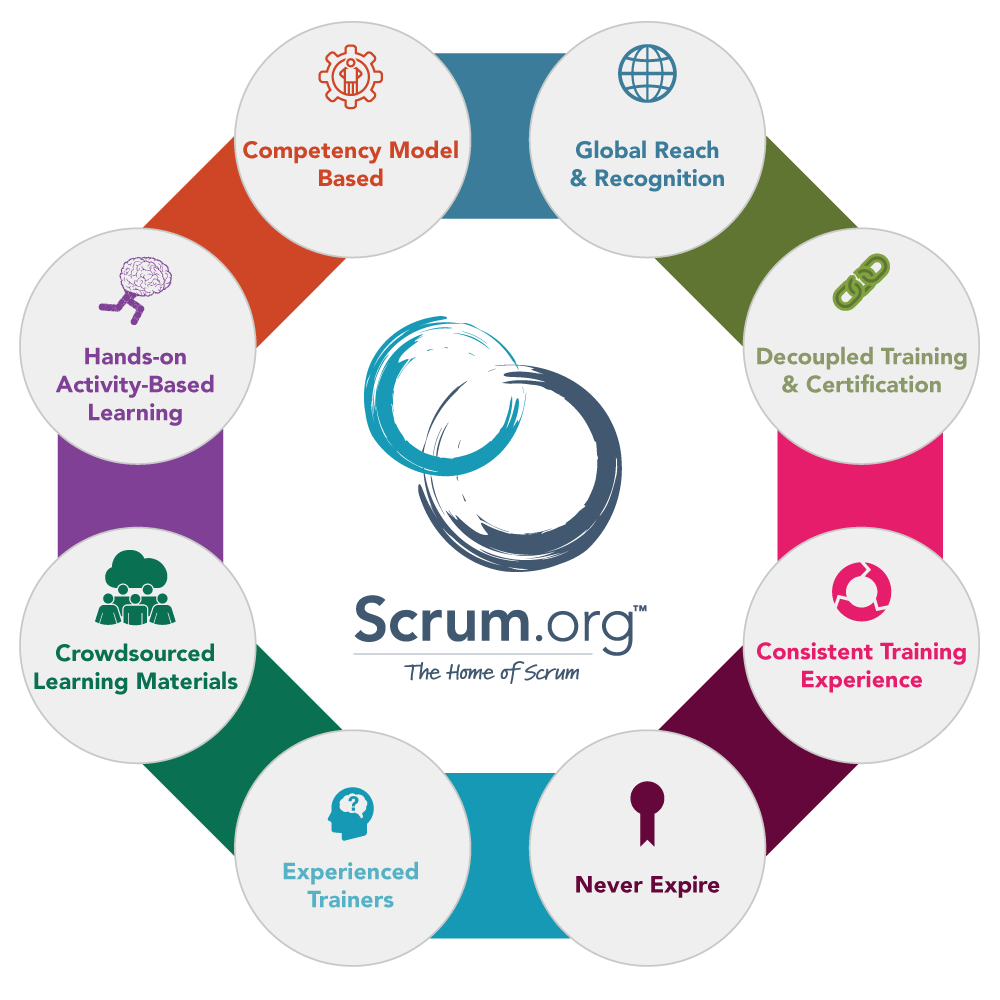
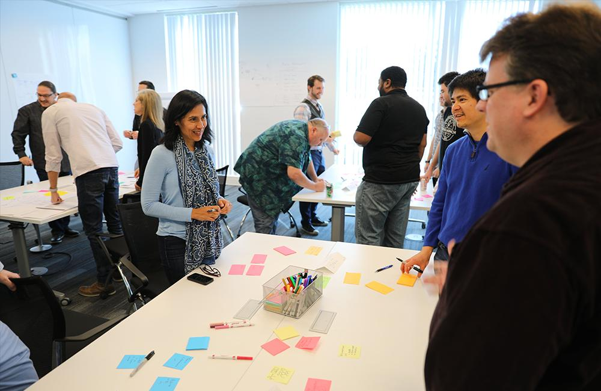

This is a question our agile trainers and coaches are frequently asked. It is certainly debatable whether a Scrum certification backed by a multiple-choice test and (potentially) a few days of training is worth it in terms of opening doors, getting jobs, and earning respect.

However, even if you or a potential employer couldn't care less about the “resume stamp” of an industry-recognized Scrum certification, there is still value in going for it anyway.

## What is a Scrum Certification?

Scrum is the most popular Agile framework used for solving complex problems. Several organizations provide training and subsequent tests in order to receive a certification.

The most popular Scrum certifications are from Scrum.org (PSM, PSPO, etc.) and the Scrum Alliance (CSM, CSPO, etc.). Improving is also the largest provider of Scrum.org training in North America and regularly hosts a variety of [Agile and Scrum training and certification courses](https://improving.com/services/training).

Both involve passing an online test in order to receive a certification. However, Scrum Alliance requires taking a class whereas Scrum.org does not.

These certifications can be controversial in the agile community, sometimes accused of being a money-making scheme to sell more training and consulting.

## Why Does Scrum Certification Training Matter?

After learning as a group in a classroom environment for two days, the challenge of a post-class test will encourage you as a participant to continue learning Scrum on your own. You will be much more likely to review the materials, do more research, and attempt some practice tests; as opposed to a non-certified class where students close books after class and likely never open them again.

## How do Scrum Certifications Help?

#### Review Materials

Answers to the majority of questions on certification assessments like the ones found at Scrum.org can be found directly in the course material. Making sure that this fact is clear to class participants is a great motivator to review everything from class.

#### Practice Tests

Another crucial part of passing a certification assessment is taking practice tests, like the Open Assessments at Scrum.org or any number of third-party sites. These practice tests typically provide explanations for why each answer is correct or incorrect. This information, along with the repetition and focus that comes with taking a test, make practice tests an invaluable learning tool.

#### Study Groups

For many, a great way to learn is with other people. Study groups provide cadence, accountability, and emotional support - which are challenging when studying alone in the midst of all your other work and personal responsibilities. The certification assessments provide a group of people with a common goal to work toward. Over the years, many of our class participants have formed small groups with the initial purpose of passing an assessment but stay together afterward. Sometimes groups stay together to study for next-level certifications, others even create book clubs or communities of practice (CoP).

## A Beginning, Not an End

So regardless of what you think about the value of a Scrum certification, those that take on the challenge of certification tend to have a higher minimum knowledge competency level and speak in a more consistent language.

That’s definitely worth more than an updated resume.

But more importantly, by introducing people to more learning resources, communities, and next-level certifications, these certifications signify the beginning of a journey, not the end.

Check out our list of [classes](https://improving.com/services/training/full-schedule/) available to start your Scrum journey today.
