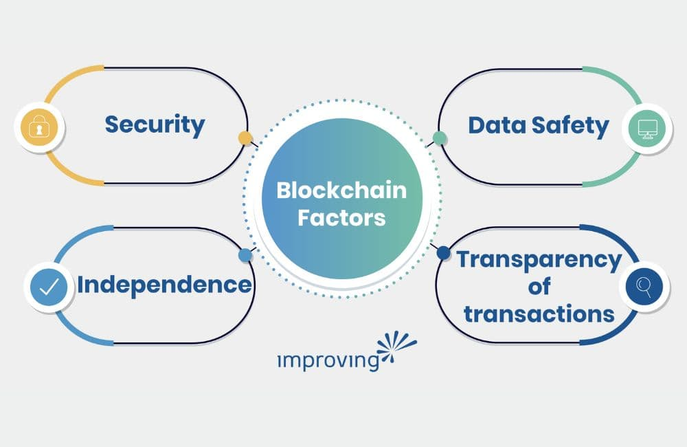

The world is changing rapidly, and IT outsourcing is no exception. The global pandemic brought to light all the traditional outsourcing model’s weaknesses and ignited the need for change. Now, three years later, we are seeing how those changes are affecting the IT industry and its trends.

## What is IT Outsourcing?

If you are unfamiliar with IT outsourcing, it's when a business uses an external resource service provider to deliver some or all its IT functions. These functions can include managing infrastructure, software development, directing strategy, etc.

Outsourcing gives companies a competitive advantage by reducing operating costs, enabling staffing flexibility, and saving time. Because of these benefits, more companies opt to outsource business processes, prompting outsourcing market growth.

IT outsourcing spending is predicted to be [$519 billion in 2023, a 22% increase over 2019’s numbers. ](https://explodingtopics.com/blog/outsourcing-stats)So, let’s look at some of the IT Outsourcing trends to watch closely in 2023.

## Top IT Outsourcing Trends in 2023

The following categories represent the top IT outsourcing trends as we head into 2023 and beyond.

### Artificial Intelligence (AI), Machine Learning (ML), and Automation

[A 2022 Grand View Research survey](https://www.grandviewresearch.com/industry-analysis/artificial-intelligence-ai-market) reported that the global AI and Machine Learning outsourcing market size was $93.5 billion in 2021. They also believe the AI and Machine Learning outsourcing market will expand at a compound annual growth rate (CAGR) of 38.1% from 2022 to 2030.

Artificial Intelligence stands to transform IT outsourcing by promoting efficiency through automation, reducing costs, providing control, increasing security, and improving negotiation terms for contracts. So, it’s easy to understand why implementing AI into business software will be a huge trend in 2023.* *

### Blockchain

Blockchain’s ability to increase the transparency of transactions, reduce risks and fraud, and ensure a higher resistance to outside attacks – all in a cost-effective manner - is proving transformative for industries as diverse as healthcare, real estate, insurance, etc.

Valued at $5.92 billion back in 2021, a [Grand View Research Study](https://www.grandviewresearch.com/industry-analysis/blockchain-technology-market) concluded that the global blockchain technology market size is expected to grow at a CAGR of 85.9% from 2022 to 2030.

What are the factors driving the increasing interest in Blockchain?

- Data safety: It is an immutable public digital ledger, which means when a transaction is recorded, it cannot be modified.
- Security: Due to the encryption feature, Blockchain is always secure.
- Transparency of transactions: The transactions are done instantly and transparently, as the ledger is updated automatically.
- Independence: As it is a decentralized system, no intermediary fee is required.

### Internet of Things (IoT)

The internet of things, or IoT, is a system of interrelated computing devices, mechanical and digital machines, objects, or people that are provided with unique identifiers ([UIDs](https://internetofthingsagenda.techtarget.com/definition/unique-identifier-UID)), and the ability to transfer data over a network without requiring human-to-human or human-to-computer interaction. [It is estimated that the global IoT market will grow from $243 billion this year to $575 billion in 2027. ](https://www.researchandmarkets.com/reports/5142956/iot-solutions-and-services-market-by-component)

The Internet of Things offers several benefits to organizations. Some of the common benefits of IoT enable businesses to:

- Monitor their overall business processes
- Improve the customer experience
- Save time and money
- Enhance employee productivity
- Integrate and adapt business models
- Make better business decisions
- Generate more revenue.

### **Hybrid Work Model **

Due to the Covid pandemic,** **remote work has become the new norm. [Recent surveys by Microsoft show that:](https://www.microsoft.com/en-us/worklab/work-trend-index/hybrid-work)

- 70% of employees want a hybrid work model that allows them the flexibility to operate remotely.
- 46% of employees are considering job switches due to a lack of remote working options.
- 66% of businesses plan to redesign their office space to accommodate a hybrid work environment and enable seamless interaction between in-house and remote teams.
- 53% are prioritizing their health and well-being over work. 47% prioritize family time and personal life over work.
- This clearly shows the shift in the mindset of employees, and companies need to change their business models and working styles to retain talent in their organizations.

### Outsourcing to Nearshore Countries

How could we not end with this one? A rapid change over the past few years: companies are nearshoring IT consulting more than ever.

[According to the Inter-American Development Bank (IDB)](https://www.iadb.org/en/news/nearshoring-can-add-annual-78-bln-exports-latin-america-and-caribbean), nearshore outsourcing will add $78 billion to the export sector in Latin America and the Caribbean after 2023. [A recent report by Bloomberg](https://www.bloomberg.com/news/articles/2022-07-05/us-factory-boom-heats-up-as-ceos-yank-production-out-of-china?sref=fDPa8NQZ&leadSource=uverify%20wall) revealed that 80% of companies in the United States were actively considering nearshoring.
