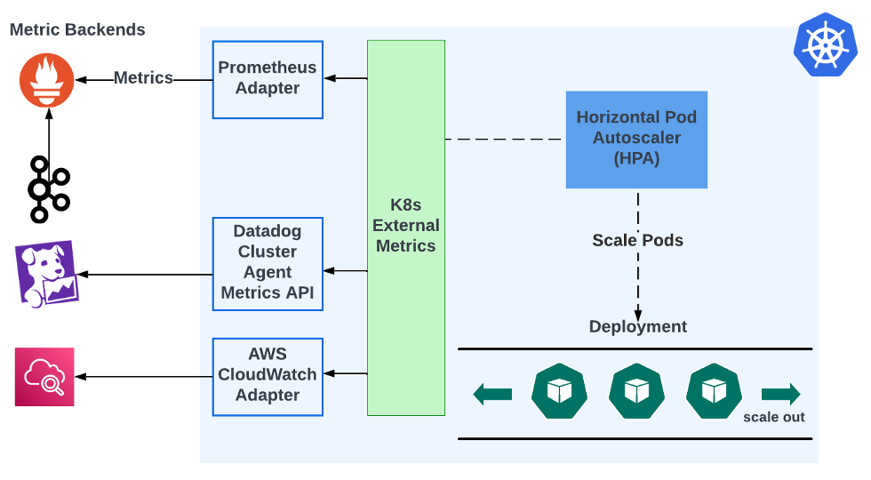
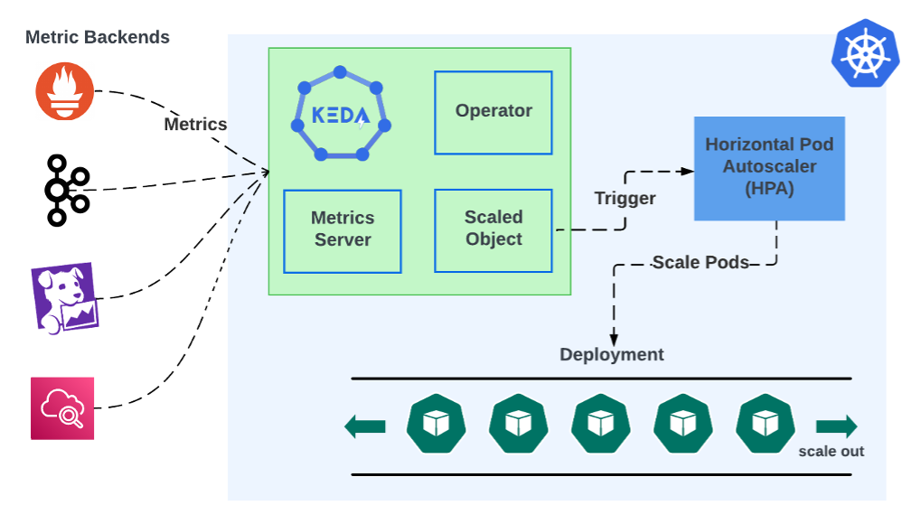

As cloud costs continue to rise, companies are compelled to utilize their cloud resources more efficiently. Kubernetes Event-Driven Autoscaling (KEDA) is a solution that offers optimization with precision. As a graduated project of the Cloud Native Computing Foundation (CNCF), KEDA’s event-based architecture proves effective for workloads that do not conform to typical CPU and memory metrics. It seamlessly integrates a wide array of event sources and brokers with Kubernetes. Additionally, KEDA has the unique ability to autoscale to zero. In comparison to third-party tools, KEDA stands out for its unparalleled maturity and completeness and is a gold standard for Kubernetes autoscaling.

Out of the box, Kubernetes Horizontal Pod Autoscaler (HPA) only supports scaling based on container level CPU and memory usage. This is not suitable for many use cases. For example, Kafka consumers typically want to scale based on event lag a metric not supported by HPA. There are third party adapters that can integrate Kubernetes external metrics with some metrics backend. It looks like this:



HPAs get data from the Kubernetes External Metrics module. This module does not store metrics, it simply fetches them from metric backends, but it does not natively support querying metric backends. It needs an adapter that can fetch and convert metrics. The user needs to install and configure that adapter. For example, Prometheus Adapter can pull Prometheus metrics and convert them for use by Kubernetes External Metrics. KEDA's event-driven scaling consolidates this into a single install:



KEDA’s architecture consists of two main components: the Operator and the Metrics Server. The Operator dictates how applications should scale in response to events via KEDA’s custom ScaledObjects that attach to deployments. The Metrics Server acts as a bridge between Kubernetes and external event sources. These components work together to intake metric events from any number of sources and use them to automatically trigger scaling based on those events. This design allows KEDA to dynamically scale Kubernetes workloads based on events from a wide range of sources.

The ability to integrate with a wide range of event sources and brokers is a testament to KEDA’s versatility as an autoscaling solution. Its extensive support includes popular systems like Kafka, RabbitMQ, and cloud-based event sources, making KEDA a comprehensive tool for developers working across a diverse technological ecosystem. To illustrate this, let us compare setting up Kafka consumer lag autoscaling in KEDA vs the “adapter” approach.

Setting up KEDA for Kafka consumer lag autoscaling involves creating a ScaledObject in Kubernetes that targets your Kafka consumer deployment.

```markup
apiVersion: keda.sh/v1alpha1
kind: ScaledObject
metadata:
  name: demo-kafka-scaledobject
spec:
  scaleTargetRef:
    name: demo
  pollingInterval: 60
  cooldownPeriod: 300
  minReplicaCount: 0
  maxReplicaCount: 10
  triggers:
    - type: kafka
      metadata:
        consumerGroup: demo.consumer-group.id
        bootstrapServersFromEnv: KAFKA_BOOTSTRAP_SERVERS
        # Lag must be higher than this to activate scaling
        activationLagThreshold: 3000
        # desiredReplicas = totalLag / lagThreshold
        lagThreshold: 1000
        sasl: plaintext
        tls: enable
      authenticationRef:
        name: keda-kafka-credentials
---
apiVersion: keda.sh/v1alpha1
kind: TriggerAuthentication
metadata:
  name: keda-kafka-credentials
spec:
  secretTargetRef:
    - parameter: username
      name: demo-kafka-secrets
      key: demo.username
    - parameter: password
      name: demo-kafka-secrets
      key: demo.password
```

You will specify Kafka as the trigger type in the ScaledObject and include details such as the Kafka bootstrap servers, consumer group, and topic. Additionally, you will define the lag threshold that triggers scaling. Authentication to Kafka can be handled via a TriggerAuthentication object, referencing Kubernetes secrets for secure connection parameters. This setup enables KEDA to monitor Kafka consumer lag and dynamically scale your deployment based on the defined criteria.

Setting up Prometheus Adapter for Kafka consumer lag autoscaling requires configuring Prometheus to collect metrics from Kafka, then using the Prometheus Adapter to expose these metrics to Kubernetes' Horizontal Pod Autoscaler (HPA). You will need to:

- Configure Prometheus to scrape Kafka metrics, including consumer lag.
- Install Prometheus Adapter in your Kubernetes cluster, ensuring it is configured to query Prometheus for the specific Kafka lag metrics.
- Create an HPA object that targets your consumer deployment, specifying the Kafka lag metric from Prometheus as the basis for scaling decisions.

This setup allows the HPA to scale your Kafka consumers based on lag, ensuring efficient processing of messages. However, it forces the user to maintain a chain of separate components, each deployed separately. If the metrics backend ever changes, the entire chain needs to be modified. In contrast, KEDA reduces the number of components because the single KEDA deployment can be reused for any number of backends. Moreover, KEDA’s autoscaling objects are decoupled from the backends it gets metrics from. This ensures that KEDA can be seamlessly adopted in various scenarios, serving as an all-in-one solution for event-driven scaling. This adaptability enhances KEDA's appeal, establishing it as a pivotal tool in modern application deployment and management strategies.

One of KEDA's standout features is its ability to scale workloads down to zero, a capability that sets it apart from traditional autoscaling solutions. This functionality means that when there is no demand or the event-driven workload is idle, KEDA can reduce the number of pods to zero, effectively pausing resource usage. This optimizes resource utilization and reduces costs associated with idle computing power. By aligning resource consumption with actual demand, KEDA ensures that efficiency and cost-effectiveness are at the forefront.

KEDA's status as a Cloud Native Computing Foundation (CNCF) graduate project further enhances its appeal. This graduation signifies a level of stability, maturity, and community trust that few projects achieve. It indicates that KEDA has met rigorous criteria for governance, commitment to community, and ecosystem adoption. The CNCF's endorsement of KEDA underscores its commitment to innovation and its dedication to maintaining a solution that meets the evolving needs of its users.

KEDA represents a new pattern in Kubernetes autoscaling, adeptly addressing the dynamic nature of modern, event-driven architectures. Its event-based scaling, comprehensive support for diverse event sources, ability to scale workloads to zero, and recognition as a CNCF-graduated project collectively underscore its unmatched capabilities. These features not only highlight KEDA's technical excellence but also its role in fostering cost-effective, efficient, and reliable application deployment. Through its innovation and community-backed evolution, KEDA clearly stands out as the gold standard for Kubernetes autoscaling, embodying the future of responsive and scalable cloud-native applications.
