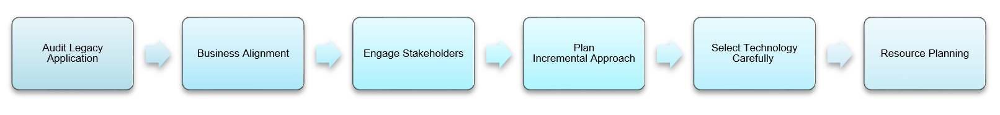
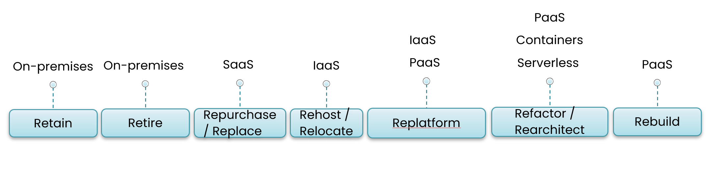

At Improving, it all starts with engaging key client stakeholders to align business goals and project objectives. We then move forward with a stage that involves evaluating constraints such as personnel, budgets and processes, and determine the necessary resources and personnel involved in the project, including technical and business stakeholders. Other factors to consider include the project timeline, scope, success metrics, and available budget. Careful consideration of these factors allows us to help organization identify the best approach to application modernization.

It is essential to understand the aspects of the legacy system that work well and those that do not.

## Evaluate Systems and Define Problems

At Improving, we have utilized the following approach to help our clients kickstart their application modernization process:

1. Begin by conducting a thorough audit of existing applications to pinpoint candidates for modernization, considering factors such as business criticality and technical debt. It's crucial to recognize the strengths of your legacy system.
2. Align modernization strategies with business objectives and digital transformation initiatives to guarantee that efforts drive tangible business value.
3. Engage key stakeholders, including business leaders, IT teams, and end-users, in the planning process to gather diverse perspectives and insights. Opt for an incremental modernization approach to prioritize critical applications, manage risks, and ensure a seamless integration with existing systems and processes.
4. Thoroughly assess modernization technologies, such as platforms, cloud providers, container orchestration tools, application design frameworks, and API management solutions, to support the modernization roadmap. Allocate resources, including skilled personnel, budget, and timeframes to facilitate the execution of the modernization roadmap and ensure successful implementation.

## Get Ready for a Significant Change

Initiating application modernization often requires a significant cultural shift, which can be challenging for employees accustomed to existing technologies.

Providing comprehensive training, open communication, and involving employees in decision-making can facilitate a smoother transition and help them embrace the benefits of modernization.

## Consider the "7 R" Modernization Strategies

There are multiple approaches to application modernization, which does not necessarily mean a complete replacement of your current system, as there are proven options to migrate, update, and optimize legacy systems to more modern architectures. Knowing and applying the right strategy can make the difference between success and frustration.

After identifying the opportunity to update a legacy application and defining the problem, the next course of action is to determine the strategy for modernizing the application:

- **Retain:** In this strategy, the application is kept as it is without any changes. This could be due to various reasons such as compliance, security, or budget constraints. The application continues to run on its existing infrastructure, which could be on-premises or in rare cases in the cloud (IaaS, PaaS, or SaaS). This strategy doesn’t typically involve containers or serverless computing.
- **Retire**: Remove applications with obsolete components and redundant functionalities.
- **Repurchase/Replace**: Replace existing applications with software delivered as a service, with a SaaS solution. The SaaS provider takes care of all the underlying infrastructure, platform, and software management, allowing the organization to focus on its core business.
- **Rehost/Relocate**: Also known as “lift and shift”, this strategy involves moving the application to a cloud provider’s infrastructure (IaaS) without making significant changes. The application might be containerized to make it portable and easy to manage.
- **Replatform:** This involves making minor optimizations to the application to take advantage of cloud capabilities while migrating it. The application might be moved to a PaaS offering or containerized for better scalability and management.
- **Refactor/Rearchitect: **This involves re-architecting and re-coding the application to fully leverage cloud-native features and capabilities. The application might be moved to a PaaS offering or re-architected to use a microservices architecture using containers or serverless computing for better scalability, performance, and cost-efficiency
- **Rebuild: **This involves discarding the existing application and completely rewriting it to take full advantage of cloud-native features and capabilities. The new application could be built on a PaaS offering or use serverless computing.

## Enable AI & Streaming Data, IoT & Data Analytics

By updating and adopting agile applications, organizations lay a robust foundation for the seamless integration of cutting-edge technologies like AI, IoT, cloud computing, data streaming, and data analytics.

This integration unlocks new growth opportunities and fosters innovation. Streaming data offers cost efficiency by allowing organizations the ability to process data in real-time, providing actionable insights, and preparing for AI integration, while also ensuring scalability and flexibility to handle large volumes of data. Furthermore, operational efficiency is enhanced through task automation. AI integration enhances application intelligence, identifies improvement areas, and utilizes predictive insights.

Enabling IoT enables real-time data gathering, personalized experiences, and predictive maintenance, while enhanced data analytics extracts actionable insights, improves decision-making, and drives innovation through product development, process optimization, and market expansion.

## Improve Security and Compliance

By modernizing your systems, you can significantly improve your security and compliance measures. Application modernization enhances data protection by strengthening security protocols and addressing privacy concerns, thereby mitigating the risks associated with legacy security vulnerabilities.

Moreover, it ensures regulatory alignment by allowing your organization to adhere to industry-specific regulations and compliance standards, which will safeguard your business against legal and operational risks. Additionally, application modernization strengthens the resilience of software systems against cyber threats, data breaches, and operational disruptions, ultimately ensuring business continuity and maintaining customer trust in your organization's ability to protect their sensitive information.

If you’re unsure where the opportunities to enhance your systems exist, Improving can help you find new ways and strategies to help you modernize your system. Check out [part 1 ](https://www.improving.com/thoughts/what-is-application-modernization-and-why-does-your-business-need-it)of our 3 part blog in the series for more insights and a deeper dive into the topic!

[Reach out to us today](https://www.improving.com/contact/) and we will walk you through the many aspects of application modernization and how it can help you stay growth-oriented, competitive and innovative.
