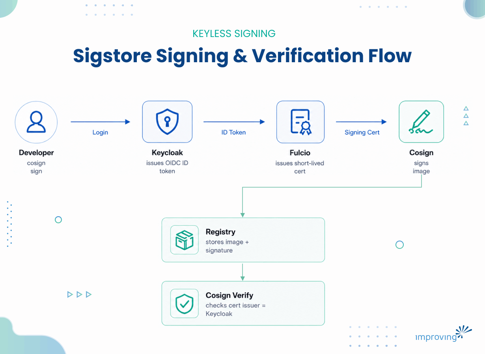
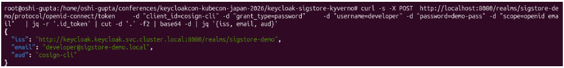
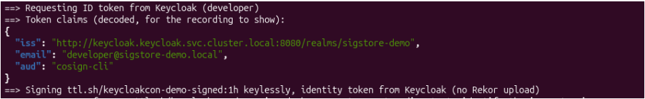
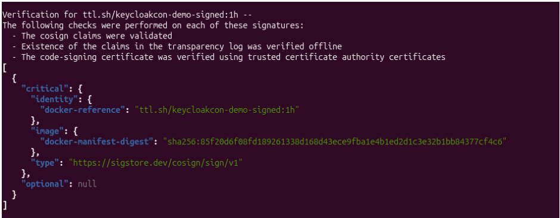
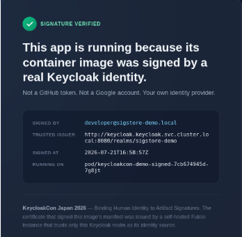

Every piece of software you run passed through a chain of hands before it reached you: a developer wrote source code, a build system compiled it, a registry stored the resulting artifact, and a deployment pipeline pulled it into testing and if all goes well then it goes into production. That chain - source, build, artifact, distribution, deploy - is what **software supply chain** means in practice, and it has the same underlying vulnerability any supply chain has: a weak link anywhere compromises everything downstream, regardless of how secure the rest of the chain is.

In 2024, a backdoor was found deliberately planted in [xz-utils](https://en.wikipedia.org/wiki/XZ_Utils_backdoor), a compression library embedded in most Linux distributions, inserted by someone who'd spent two years building trust as a legitimate contributor first. Different chains, same underlying failure: something downstream trusted something upstream that it shouldn't have.

Attackers compromised [SolarWinds' build pipeline](https://www.fortinet.com/resources/cyberglossary/solarwinds-cyber-attack) and slipped malicious code into a legitimately signed software update that shipped to roughly 18,000 organizations, including multiple U.S. federal agencies. The update was signed and the signature was valid, but nobody thought to ask whether the identity behind that signature should have been trusted with that kind of access in the first place.

In this blog post, we will explore that question - not whether an artifact was signed, but whether the signer is actually the one your organization says they are.

## Why Signing Alone has Historically Fallen Short?

Signing exists to make [supply chain harder to break](https://www.improving.com/thoughts/software-supply-chain-security-package-age-enforcement/) silently. It is a cryptographic signature traceable back to who produced an artifact that makes tampering detectable instead of invisible. Whether that promise holds up depends entirely on how the signing identity itself is managed.

Traditional code signing uses a long-lived private key: generate it once and use it for every release for months or years. A key that lives that long is a key that can leak for that long, and when it does, there's no clean way to know which past signatures to still trust.

There's a quieter problem even when the key never leaks: a signature proves someone with access to the key signed the artifact. It says nothing about whether that person still holds that access, is still employed, or has quietly shared the key beyond its original owner.

> The signature and the identity behind it can drift apart, and the signature itself would never reveal that.

## Sigstore: Signing without Long-Lived Keys

Notable mention for tools that provide signing without long-lived keys include [Sigstore](https://www.sigstore.dev/) and [Notary](https://notaryproject.dev/). In this blog, we'll cover Sigstore as it is one of the most popular in the community.

Sigstore is an open-source project that makes it easier to securely sign, verify, and track software artifacts. It provides keyless code signing, transparency logs, and identity-based verification, helping organizations protect their software supply chain without the complexity of managing signing keys.

Sigstore prevents long-lived keys altogether, via three components:

- [**Fulcio**](https://docs.sigstore.dev/certificate_authority/overview/) is a certificate authority that issues short-lived signing certificates - typically valid for around ten minutes - only after the requester authenticates to an OIDC identity provider and hands Fulcio the resulting token.
- [**Cosign**](https://docs.sigstore.dev/cosign/signing/overview/) is the signing tool. It requests a certificate from Fulcio and uses the fresh keypair bound to it to sign the artifact.
- [**Rekor**](https://docs.sigstore.dev/logging/overview/) is a public, append-only transparency log, so every signature is independently auditable and can't be quietly backdated or removed later.

There's no key to protect for months, because there's no key that lives that long. Every signature starts with proving identity fresh, through whichever OIDC provider Fulcio is configured to trust.

## Sigstore Trusts a Fixed List of Identity Providers

Sigstore's public infrastructure only trusts a fixed allow-list. [Google](https://www.improving.com/partners/google-cloud/), [Microsoft](https://www.improving.com/partners/microsoft/), and GitHub Actions are a reasonable choice for a shared, internet-scale service that can't vet arbitrary third-party providers.

But it means the certificate backing up your signature only proves "Google vouches for this email." It says nothing about whether your organization still recognizes that person as an employee, or whether they left last week, and their GitHub org membership just hasn't been revoked yet. For most organizations, the actual source of truth for "who is this person, right now" is an internal identity provider - and that source of truth is entirely absent from the public Sigstore trust chain.

Two ways these bites in practice:

1. **Offboarding doesn't propagate: **An engineer leaves the company. Their Google Workspace account is suspended on the same day. But a [GitHub Actions](https://www.improving.com/thoughts/webinars/getting-started-with-github-actions/) token still scoped to one of their repos doesn't get revoked on that same schedule. So, a signature produced in that gap looks exactly as "verified" as one from someone still on the team.
2. **CI and human identities live in unrelated trust domains:** A pipeline signs with a GitHub Actions token, and a developer signs with a personal Google account. There's no shared policy surface to reason under one identity model, because they were never issued from the same place.

None of this means a signature is fraudulent. It means the platform can't express the question that actually matters: is this identity, right now, someone my organization currently trusts to sign?

## Keycloak as the Trust Root

Fulcio's job is to decide which OIDC providers to trust, then issue certificates to anyone with a valid token from one of them. Which providers make to that list isn't hardcoded - its configuration. The catch is that on the public good instance, that configuration belongs to Sigstore's maintainers, not you.

You can run your own Fulcio as plenty of organizations do, precisely so they can control the trust list. Once you're running it yourself, adding Keycloak is just a configuration.

[Keycloak ](https://www.keycloak.org/)is an open-source identity and access management server - the kind of system many organizations already run as their actual source of truth for who's an employee and when their access should be revoked, speaking the same OIDC protocol Fulcio already knows. Point your** **self-hosted Fulcio at your Keycloak realm as a trusted issuer, and every certificate it issues is tied to an identity your organization actually manages. It is the same realm already governing your SSO and offboarding, not a third party's account system with no idea of your org chart.

## Why is GitHub's OIDC Issuer isn’t Enough?

GitHub Actions runners can mint their own OIDC token, and the public Fulcio instance already trusts GitHub as an issuer ***- cosign sign*** inside a GitHub Actions job typically just works without Fulcio or Keycloak.

That's the obvious objection: GitHub already issues OIDC tokens Fulcio already trusts. Why build anything else?

It works fine for a single-repo, GitHub-only shop. It stops working:

- when you need one policy covering both CI and humans signing locally as GitHub's issuer only covers the CI half), or
- the moment compliance asks, "show me every signature tied to a currently active employee," since GitHub org membership and your HR-driven identity provider are two systems that were never designed to agree.

If you're not on GitHub at all, there's nothing to build on.

## How It Fits Together?



This is what happens:

1. Developer authenticates Keycloak and gets an ID token.
2. Fulcio validates it against the realm it trusts
3. Fulcio issues a short-lived certificate binding the developer's identity to a fresh keypair.
4. Cosign signs with that keypair.

Anyone verifying later checks not just that the signature is cryptographically valid, but that it was issued by *this* Keycloak realm, for *this* identity - a check your organization can stand behind.

### Implementation: Wiring Keycloak into Fulcio

The demo below shows how to run Keycloak and a self-hosted Fulcio in a local Kubernetes cluster.

#### Step 1: Register Keycloak as a trusted issuer in Fulcio

```bash
config: 

  contents: 

    OIDCIssuers: 

      "http://keycloak.keycloak.svc.cluster.local:8080/realms/sigstore-demo": 

        IssuerURL: "http://keycloak.keycloak.svc.cluster.local:8080/realms/sigstore-demo" 

        ClientID: "cosign-cli" 

        Type: "email" 
```

Type: "email" tells Fulcio which claim becomes the identity baked into the certificate. Get the mapping wrong on the Keycloak side and the certificate still issues - it just binds to the wrong identity, silently.

#### Step 2: Map the claims Fulcio checks

Fulcio's email issuer type expects email_verified as a real boolean and aud matching the requesting client - both need explicit protocol mappers on the Keycloak client:

```bash
{ 

  "name": "email-verified", 

  "protocol": "openid-connect", 

  "protocolMapper": "oidc-usermodel-property-mapper", 

  "config": { 

    "user.attribute": "emailVerified", 

    "claim.name": "email_verified", 

    "jsonType.label": "boolean", 

    "id.token.claim": "true" 

  } 

}
```

#### Step 3: Authenticate and inspect the token

Decoding the token before doing anything else catches a claim-mapping mistake before it becomes a signing failure three steps later:

```bash
curl -s -X POST \ 

    http://localhost:8080/realms/sigstore-demo/protocol/openid-connect/token \ 

    -d "client_id=cosign-cli" -d "grant_type=password" \ 

    -d "username=developer" -d "password=demo-pass" -d "scope=openid email" \ 

  | jq -r '.id_token' | cut -d '.' -f2 | base64 -d | jq '{iss, email, aud}' 
```



#### Step 4: Sign

```bash
cosign signing-config create \ 

--fulcio="url=${FULCIO_URL},api-version=1,start-time=$(date -u +%Y-%m-%dT%H:%M:%SZ),operator=sigstore-demo" \ 

--output-file "${SIGNING_CONFIG}" 

 

cosign trusted-root create \ 

--fulcio="url=${FULCIO_URL},certificate-chain=${FULCIO_ROOT}" \ 

--out "${TRUSTED_ROOT}" 

 

cosign sign \ 

--signing-config "${SIGNING_CONFIG}" \ 

--trusted-root "${TRUSTED_ROOT}" \ 

--new-bundle-format \ 

--identity-token="${ID_TOKEN}" \ 

--yes \ 

"${IMAGE_SIGNED}" 
```



#### Step 5: Verify

Point Fulcio at your own realm, and the same verification now asserts something your organization governs:

```bash
cosign verify \ 

--new-bundle-format \ 

--trusted-root="${TRUSTED_ROOT}" \ 

--certificate-oidc-issuer="${ISSUER}" \ 

--certificate-identity="${IDENTITY}" \ 

--insecure-ignore-tlog=true \ 

--insecure-ignore-sct=true \ 

"${IMAGE}" | jq . 
```



The mechanics didn't change between those two calls. What changed is what the answer *means*. Worth testing the failure case too - verifying against the wrong identity should fail closed:

```bash
cosign verify --new-bundle-format --trusted-root=${TRUSTED_ROOT} \\" 

--certificate-oidc-issuer=${ISSUER} \\" 

--certificate-identity=someone-else@sigstore-demo.local \\" 

--insecure-ignore-tlog=true --insecure-ignore-sct=true ${IMAGE}" 
```


The below deployed app page shows the "signature verified" badge with the real signer identity, issuer, and timestamp.



You can view the repository with [complete code on GitHub](https://github.com/infracloudio/keycloak-fulcio-sigstore).

## Lessons Learned Building This

Building this setup came with a few challenges. If you're trying it for the first time, you'll likely run into some of the same issues. Here are a few things to watch out for:

1. **Decide early whether you need a transparency log:** Rekor and the certificate-transparency log alongside it both need a Trillian-backed store - a real operational commitment, a database, not a stateless service. If you're prototyping the identity-binding piece specifically, it's fine to run Fulcio alone and skip the log for now, but know you're trading away auditability.
2. **Fulcio's self-generated CA can be ephemeral by design:** In file-based CA mode, Fulcio can generate a fresh, unpersisted root on every restart. Anything that caches Fulcio's root certificate goes stale silently in the next restart - fetch it fresh from **/api/v1/rootCert** at the point of use, not once at setup.
3. **Pin your identity provider hostname before trusting its issuer claim:** Keycloak can derive ‘**iss’ **from whatever host header a client used to reach it, unless pinned. If Fulcio trusts one exact issuer string and your provider is reachable under multiple hostnames, tokens minted through the "wrong" one gets silently rejected - with no hint the hostname mismatch is the cause.
4. **Admission-time enforcement is the natural next step, and the tooling is still catching up:** Certificate-based verification without a transparency log has had real, reported issues across multiple admission-controller versions as of this writing. –This is a reason to test thoroughly against your specific tool and version before depending on it in production.

## Wrap Up

Sigstore's keyless signing model is a genuine improvement over long-lived keys, and nothing above argues against it. The gap is narrower: the public infrastructure trust boundary covers a small set of identity providers, and most organizations' actual source of truth for "who is this person" sits outside it. Self-hosting Fulcio and pointing it at your own identity provider closes that gap directly.

In this blog, we focused on getting the setup working in a local environment. Production deployments bring additional considerations around availability, certificate management, identity integration, and operational governance that are worth planning upfront.

These are the kinds of software supply chain security challenges the engineers at Improving work on with enterprise teams, helping them build secure, production-ready [applications](https://www.improving.com/expertise/applications/) and [platforms](https://www.improving.com/expertise/platform/). If you'd like to discuss this further, you can connect with [Oshi Gupta](https://www.linkedin.com/in/oshi-gupta-512716178/) on LinkedIn.
