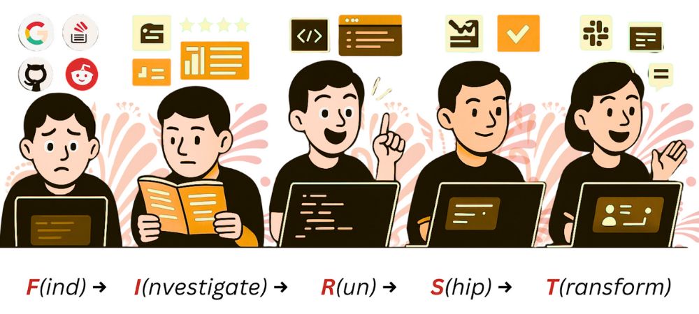
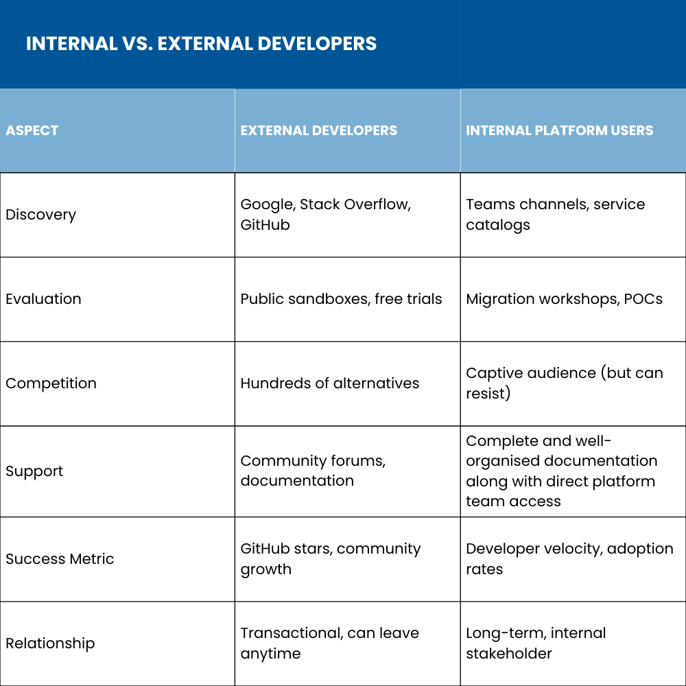

User experience is one of the major reasons that determines whether customers love or abandon your product right after trying it. Think about Spotify - the seamless music discovery experience, playback, and personalized recommendations changed how we consume music. Interestingly, the same principle applies to developer tools, except your “users” are engineers who must integrate, deploy, or maintain their solutions using your offerings.

Developer Experience (DX) is the sum of all developer interactions with your tool, including:

- Developers that interact with your product, documentation, and the website, i.e. *External Developers*
- *Internal developers* that are working with your APIs and platform

A great DX turns developers, [be it internal or external](https://2024.platformcon.com/talks/is-platform-engineering-only-about-idps-think-again), into advocates who evangelize your solution. Meanwhile, a poor DX makes them abandon your tool before even finishing the setup.

In this blog post, we’ll focus on understanding why your DX strategy needs distinct playbooks for external versus internal users and how to do it. I covered this during my keynote at KubeCon India, "Know Your Developer." You can watch the recording on YouTube:

## DX is The New UX

During my keynote at KubeCon India, I used an unexpected analogy to explain developer experience: Hyderabad's 400-year-old biryani culture. Just as people research restaurants, read reviews, taste the food, and become advocates for great biryani, developers follow the same pattern when discovering tools.

This universal journey - Find, Investigate, Run, Ship, Transform - (FIRST) happens whether someone evaluates your Kubernetes operator or adopts your [internal platform](https://www.infracloud.io/platform-engineering-consulting/). But here's where most companies go wrong: they apply identical strategies to completely different developer audiences.

External developers Googling "Helm chart errors" at 3 AM have different needs than internal teams migrating to your [platform engineering solution](https://www.improving.com/expertise/platform-engineering/). Understanding this distinction - what I call "Know Your Developer" - is important to separate successful developer tools from abandoned GitHub repos.

## Know Your Developer - The Framework That Changes Everything

Successful companies know their customers & users inside out. They understand buying patterns, pain points, and what drives loyalty. However, when it comes to showing the technical side of a product, like documentation, API integration, etc, most companies treat developers as a monolithic group. But if you are building for developers, you must understand their nuances as well.

The *Know your developer* mindset must be the foundation of every developer experience strategy. The principle is simple: different types of developers have fundamentally different behaviours, needs, and success metrics.

For instance, a senior engineer at a startup evaluating open-source monitoring solutions behaves nothing like a platform engineer at an enterprise migrating teams to an internal developer portal. Product discovery happens through different channels, evaluation relies on different criteria, success is measured differently, and support expectations vary completely.

External developers choose your tools, while internal developers often have tools chosen for them. External developers can walk away if your documentation frustrates them. Internal developers are a captive audience, but they can make your platform team's life miserable if the experience is poor. Plus, a poor developer experience will breed frustration and affect [developer productivity](https://medium.com/infracloud-technologies/all?topic=developer-productivity).

Understanding these distinctions helps with better resource allocation, strategy focus, and ultimately, whether your developer initiative succeeds or fails. In the following sections, we’ll look at various strategies to deal with external and internal developers.

## The External Developer Journey: Competing for Attention

External developers live in a world of infinite choices. When their Kubernetes deployment fails at 2 AM, they have dozens of monitoring solutions to evaluate. When they need a CI/CD pipeline, hundreds of tools compete for their attention. So how do they end up using a specific tool to solve their problem?

Let’s see!

### Discovery: Where They Actually Search

External developers usually don't browse vendor websites. They Google and use ChatGPT for specific problems. "kubectl apply failed," "Helm chart debugging," "Prometheus memory issues." They live on Reddit, have GitHub issues, and have technical blogs. They discover tools through conference talks and peer recommendations.

Your marketing strategy must meet them where they are, not where you want them to be. The content should be optimized for technical search queries, not business keywords. Participate in GitHub discussions, contribute to Stack Overflow answers, discuss on Reddit, and speak at conferences where engineers share real implementation stories.

### Evaluation: Technical Proof After Marketing Promises

External developers want working examples that help them in doing their job, not vague promises about "10x performance improvement." They need architecture diagrams, performance benchmarks, and honest capability statements: "handles 100,000 pods per minute, breaks at 10,000."

External developers expect immediate access, sandbox environments, one-command installations, and examples that actually work with their environments and projects. Everything gated behind "contact sales" is an immediate disqualifier for developers debugging production issues or just wanting to try out your product.

### Success Metrics: Mind Share and Community Growth

The goal is adoption and creating evangelists who multiply your product and services' reach organically. Success with external developers means building mind share in a crowded market. You're measuring GitHub stars and forks, Docker pulls, conference speaking opportunities, and community contributions. Your developers become advocates who speak at [major conferences like KubeCon](https://www.infracloud.io/blogs/kubecon-india-2025/), write blog posts, and recommend your tool in team meetings.

## Internal Developers: The Platform Engineering Reality

Internal developers exist in a fundamentally closed ecosystem. They're not choosing between dozens of products and solutions. They're adopting the platform their company has standardized on. This changes everything about discovery, evaluation, and success metrics.

Modern platform engineering teams [build internal developer platforms (IDPs)](https://www.improving.com/thoughts/maximizing-developer-productivity-security-and-operational-efficiency/) that abstract away infrastructure complexity while maintaining developer productivity. Instead of each team choosing their own CI/CD, monitoring, and deployment tools, platform engineers create golden paths - opinionated, pre-approved workflows that teams can adopt quickly. Internal developers are the consumers of these platform engineering solutions.

### Discovery via Internal Channels and Service Catalogs

Internal developers check the service catalog, browse the internal developer portal, or ask in the platform team's Teams/Slack channel for solutions. Discovery happens through lunch-and-learns, internal conferences, and team onboarding sessions.

Your "marketing" channels are fundamentally different: internal wikis, [Backstage catalogs](https://www.infracloud.io/blogs/starting-platform-engineering-journey-backstage/), Teams announcements, and direct team presentations. Search Engine Optimization (SEO) becomes documentation searchability within your company's knowledge base.

### Migration and Golden Paths

Unlike external developers who start fresh, internal developers need clear migration paths from existing legacy systems. Platform teams must provide step-by-step guides for moving from the old CI/CD pipeline to the new one, complete with side-by-side comparisons and rollback plans.

Golden paths, the pre-configured templates that work with existing security policies, monitoring standards, and deployment practices, become crucial. Internal developers want the path of least resistance that doesn't break their existing workflows.

### Internal Success Metrics

Success isn't measured in GitHub stars or community contributions. It's developer velocity, platform adoption rates, and operational efficiency. You're tracking time-to-first-deployment, reduction in support tickets, infrastructure cost per service, the number of teams that have migrated to the platform, and how actively developers are using the capabilities of your platform.

The goal is to make internal developers more productive while reducing operational complexity for the platform team.

## Key Differences & Strategic Implications

External and internal developers might follow the same FIRST framework, but their execution is very different. These distinctions directly impact resource allocation, success metrics, and strategic focus.

## What’s Next?

Understanding the KYD principle is just the beginning. Take a hard look at your current developer experience strategy and ask whether it matches your actual developer audience. Most teams we’ve talked to realized that they've been applying external marketing tactics to internal platform adoption, or building community programs, when they need migration workshops.

**If you're targeting external developers**, invest in developer relations programs, conference speaking, content marketing, and community building. Your team must be visible in developer communities and optimized for organic discovery.

**If you're building internal platforms**, focus on migration support, direct team engagement, and measurable productivity improvements. Your success depends on internal relationships and demonstrable business value, not public visibility.

My [KubeCon keynote](https://www.youtube.com/watch?v=nJHoCO7IZCc) reveals the full FIRST framework with specific examples, from 16GB hello world demos to companies transforming users into conference evangelists. Whether you're targeting external developers or building internal platforms, apply KYD to transform your approach and watch your results change dramatically.

Do you have questions about your developer experience challenges? Let’s chat on [LinkedIn](https://www.linkedin.com/in/atulpriyasharma/).
