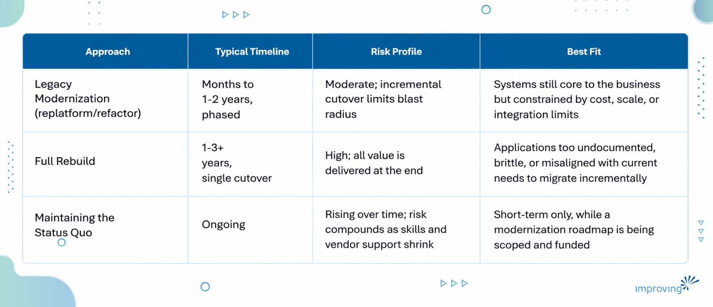
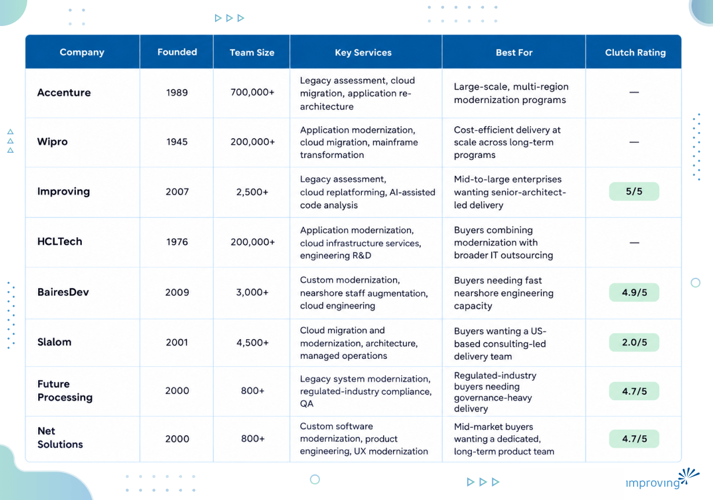

What happens when the system running your core operations was built for a business that no longer exists? For a lot of enterprises, that is not a hypothetical question. It is the reservation platform, the claims system, or the pricing engine that nobody wants to touch because everyone has quietly built their workflows around its limitations. Legacy modernization and cloud replatforming exists to answer that question on the enterprise's own timeline, before a vendor's end-of-life notice, a failed compliance audit, or a competitor's faster release cycle forces the issue. This guide walks through eight companies that do this work, from global integrators to nearshore specialists, and what actually separates a partner who can be trusted with a mission-critical migration from one who cannot.

## **Executive Summary**

Legacy modernization and cloud replatforming moves outdated, high-maintenance applications onto scalable, cloud-native architectures, replacing brittle monoliths and unsupported platforms with systems that can integrate with modern tooling, scale on demand, and support AI-driven initiatives. The core benefit to the buyer's organization is a direct reduction in the cost, risk, and talent dependency that legacy systems otherwise impose on the broader technology roadmap.

Ahead, you will find eight legacy modernization and cloud replatforming companies assessed on migration methodology, platform certifications, delivery governance, and proven, quantified outcomes, along with a look at how delivery models differ between large-scale systems integrators and specialized engineering providers, and how regional delivery choices affect the outcome. The goal is a framework buyers can use to match a partner to their specific legacy environment and risk tolerance.

## **Who Is This Guide For?**

- **CTOs and VPs of Engineering** deciding whether to replatform a legacy system in place, rebuild it entirely, or continue funding its maintenance.
- **Enterprise Architects** evaluating which cloud target (Azure, AWS, or Google Cloud) and which modernization pattern (rehost, replatform, refactor) fit an existing legacy estate.
- **CIOs and IT Directors** accountable for the operational risk and licensing costs tied to unsupported or end-of-life systems.
- **Procurement and Sourcing Leads** comparing vendor delivery models, pricing structures, and contract risk across global and boutique providers.

Each of these roles shares the same goal: retiring the risk and cost of a legacy system without disrupting the business that depends on it.

## **What Is Legacy Modernization & Cloud Replatforming & How Does It Work?**

Legacy modernization and cloud replatforming is the process of moving outdated applications, often running on unsupported languages, on-premises infrastructure, or end-of-life licensing agreements, onto modern, cloud-native architectures. It typically combines an architecture assessment, a phased migration or rebuild, and a change in how the application is deployed, monitored, and scaled. It rarely looks like a single one-time migration event.

**Common models and approaches:**

- **Rehosting (lift-and-shift):** moving an existing application to cloud infrastructure with minimal code changes, prioritizing speed and lower up-front risk over long-term optimization.
- **Replatforming:** migrating to cloud-native services (containers, managed databases, serverless compute) while making targeted code changes to fit the new environment's cost and performance model.
- **Refactoring and re-architecting:** restructuring a monolithic application into microservices or event-driven components, typically the highest-effort, highest-payoff approach for systems central to the business.
- **Full rebuild:** replacing the legacy application entirely with a new system built on current technology, reserved for applications too brittle or undocumented to migrate incrementally.

### **Legacy Modernization vs. Full Rebuild vs. Maintaining the Status Quo**

Not every legacy system needs the same treatment, and the wrong choice among these three paths can cost far more than the modernization project itself.

> *Bottom line: modernization is almost always the lower-risk path for systems the business still depends on, while a full rebuild should be reserved for applications too broken to migrate incrementally. *

## **When To Use Legacy Modernization & Cloud Replatforming**

A handful of signals reliably indicate it is time to start a modernization conversation instead of scheduling another maintenance sprint:

- The application runs on hardware, an operating system, or a database version that has reached, or is approaching, end-of-life support.
- Licensing costs for the underlying platform (for example, an on-premises Oracle or mainframe environment) are rising faster than the business value the system delivers.
- The system cannot integrate with newer platforms, APIs, or AI tooling without significant custom middleware.
- Deployment cycles are measured in weeks or months rather than days, slowing the business's ability to respond to market changes.
- The engineering talent that understands the legacy codebase is retiring or leaving faster than it can be replaced.
- A recent security or compliance audit flagged the system as a liability due to unpatched vulnerabilities or an unsupported platform.

## **How To Choose the Best Legacy Modernization & Cloud Replatforming Partner?**

The following criteria separate partners who can be trusted with a production-critical migration from those who cannot:

- **Proven migration methodology:** the partner should be able to walk through a phased assessment, migration, and validation approach for a system as complex as the buyer's, not a generic "lift-and-shift for everything" pitch.
- **Platform-specific certifications:** verify hands-on delivery credentials on the buyer's target cloud (Microsoft Azure, AWS, or Google Cloud), not just a reseller or sales partnership badge.
- **Legacy-language and platform bench depth:** ask whether the partner has verified staffing for the legacy language or platform the current system runs on (COBOL, Java Swing, VB6, and similar), instead of a generalist team learning the platform on the buyer's engagement.
- **Cost governance during migration:** consumption-based compute can spike well past the initial estimate once a migration is underway. Ask how the partner controls spend as the work progresses and after cutover, not only at the proposal stage.
- **Zero-downtime or minimal-downtime track record:** for systems the business cannot take offline, ask for a specific example of a production cutover completed with a defined, and met, downtime window.
- **Transparent, outcome-based case studies:** ask for named clients and specific, quantified metrics, such as an exact deployment-speed improvement or downtime reduction, rather than general claims of being "faster" or "more efficient."
- **Post-migration support model:** confirm whether the partner remains engaged for optimization and incident response after go-live, or hands off the system once the migration is complete.
- Buyers should also ask: *Can this partner show a reference client that modernized a system of comparable scale and criticality? What is the rollback plan if a migration phase fails validation? How is knowledge transferred to our internal team after the engagement ends?*

> *Bottom line: the right legacy modernization partner is judged less by size and more by whether its migration methodology, platform certifications, and case studies match the buyer's specific legacy environment and risk tolerance. *

## **Legacy Modernization & Cloud Replatforming Companies Compared**

## **Top 8 Legacy Modernization & Cloud Replatforming Companies**

### **1. Accenture**

Accenture is one of the largest professional services firms running legacy modernization work worldwide, anchored by application engineering practices spanning mainframe transformation, cloud migration, and AI-assisted code remediation. Accenture routinely coordinates multi-region modernization programs for the largest global enterprises, running concurrent workstreams across geographies without losing a single point of accountability.

**Quick Facts**

- Headquartered: Dublin, Ireland
- Team Size: 700,000+
- Key verticals: financial services, retail, healthcare, public sector
- Key platforms/technologies: Azure, AWS, GCP, mainframe transformation tooling
- Relevant strengths: global scale, cross-industry accelerators, AI-assisted code remediation

**Why Consider Accenture?** Staffing large, concurrent workstreams across geographies without outgrowing a single vendor relationship is where Accenture's scale matters most, particularly for multi-region legacy modernization programs spanning several business units at once.

**Talent Pool Access:** Accenture draws on a globally distributed workforce spanning delivery centers across the Americas, Europe, and Asia-Pacific.

**Proven Track Record:** Accenture publishes application modernization case studies across banking, retail, and healthcare clients as part of its broader technology transformation practice.

### **2. Wipro**

Wipro runs a dedicated application modernization practice built around mainframe transformation, cloud migration, and legacy re-engineering for large enterprise clients. At that scale, multi-year modernization programs run concurrently across banking, manufacturing, and telecom accounts without straining delivery capacity.

**Quick Facts**

- Headquartered: Bengaluru, India
- Team Size: 200,000+
- Key verticals: banking and financial services, manufacturing, telecom, healthcare
- Key platforms/technologies: Azure, AWS, mainframe modernization tooling, SAP
- Relevant strengths: delivery scale, cost efficiency, vertical-specific modernization accelerators

**Why Consider Wipro?** Cost-efficient delivery at scale across large, multi-year modernization programs, particularly in banking and manufacturing environments with complex mainframe estates, is where Wipro is strongest.

**Talent Pool Access:** Wipro maintains a large global delivery workforce concentrated in India, with additional regional delivery centers worldwide.

**Proven Track Record:** Case studies from Wipro's technology transformation practice cover application and infrastructure modernization work for banking, manufacturing, and telecom clients.

### **3. Improving**

Improving Enterprises modernizes legacy applications into cloud-native, microservices-based architectures on Azure, AWS, and Google Cloud, combining Fortune 500 migration experience with a hybrid delivery model that keeps senior engineers engaged from initial architecture assessment through post-deployment optimization. The practice holds Microsoft Solutions Partner status and delivers legacy modernization work through the Azure Migration and Modernization Program, alongside AWS and Google Cloud partnerships, and applies its proprietary Code Explorer accelerator to analyze and document complex legacy codebases before migration begins.

**Why Is Improving the Best Legacy Modernization & Cloud Replatforming Partner?**

Improving treats modernization as an AI-enabled discipline, not a manual rewrite exercise. Senior engineers stay engaged from the initial architecture assessment through go-live, supported by Code Explorer, Improving's proprietary AI accelerator that maps and documents a legacy codebase before a single line changes, so migration decisions are grounded in how the system actually behaves rather than what the original documentation claims.

- **NPS 90+:** among the highest in modern enterprise technology services
- **7.5-year average partnership length:** built around long-term relationships, not one-off projects
- **Global footprint:** 7+ countries, 3 continents, 21 offices, and 2,500+ consultants
- **Key verticals:** energy and utilities, healthcare, media and entertainment, financial services
- **Platform stack:** Azure, AWS, Google Cloud, Kubernetes, Kafka, React, Java, .NET Core
- **Relevant strengths:** AI-enabled modernization through the proprietary Code Explorer accelerator, Microsoft Solutions Partner status, AWS and Google Cloud modernization partnerships

**What a Real Modernization Partnership Looks Like Over Time**

[Norwegian Cruise Line Holdings](https://www.improving.com/case-studies/modern-reservation-system-cruise-lines) came to Improving with a reservation system that could not keep pace with global cruise operations. What followed was a multi-year modernization engagement spanning multiple systems, teams, and technology generations.

> *Improving Ottawa has been an integral partner in our technological growth for several years, consistently demonstrating dedication, expertise, and exceptional service.*

> *- Fidel Perez, Vice President, Emerging Technologies and Innovation, Norwegian Cruise Line Holdings*

**Global Delivery Access**

Improving operates 21 offices across the United States, Canada, Mexico, Guatemala, Chile, Argentina, and India, giving legacy modernization clients access to AWS and Google Cloud certified engineers alongside its Microsoft-focused delivery teams. That footprint lets Improving assemble a team fluent in a client's specific legacy stack, whether that is a Java Swing desktop application, a C++ system, or an on-premises SQL Server environment, without a lengthy staffing ramp.

**Proven Track Record**

[Berkshire Hathaway Energy](https://www.improving.com/case-studies/berkshire-hathaway-energy) was running a legacy Java Swing application tied to on-premises Oracle databases and restrictive licensing terms after acquiring new pipeline and processing assets. Improving modernized the application into a cloud-native, React and Java microservices architecture on Azure, using Kafka as the messaging backbone.

- **2 to 3 features deployed per sprint**, up from a single slow release cycle
- **5 microservices deployed on Azure** to serve the client's pipeline and processing operations
- **About 5 minutes** to spin up a replacement environment in the event of a failure

*Looking to achieve similar results with a trusted partner? Connect with our *[*legacy modernization experts*](https://www.improving.com/expertise/applications/legacy-modernization/#contact)* to explore how we can accelerate your cloud replatforming.*

**Strategic Advantage**

Improving's advantage in legacy modernization comes from combining Microsoft Solutions Partner status and delivery through the Azure Migration and Modernization Program with direct AWS and Google Cloud modernization partnerships and a proprietary Code Explorer accelerator that documents and de-risks complex legacy codebases before migration work begins, all reinforced by a 7.5-year average client tenure that points to a firm built for the long life of a modernized system, not just the migration event.

### **4. HCLTech**

HCLTech pairs an application modernization practice with legacy re-engineering, cloud infrastructure services, and engineering R&D services for enterprise clients. That combination lets HCLTech bundle a modernization project with broader infrastructure and engineering outsourcing under one contract, an advantage for buyers consolidating vendors.

**Quick Facts**

- Headquartered: Noida, India
- Team Size: 200,000+
- Key verticals: financial services, manufacturing, technology, telecom
- Key platforms/technologies: Azure, AWS, mainframe modernization tooling, engineering R&D platforms
- Relevant strengths: combined modernization and infrastructure outsourcing, engineering R&D depth

**Why Consider HCLTech?** Buyers who want to pair a legacy modernization project with broader infrastructure management or engineering R&D services under a single vendor relationship will find that fit at HCLTech.

**Talent Pool Access:** HCLTech's delivery centers span India and additional regional hubs worldwide, supporting large-scale modernization staffing needs.

**Proven Track Record:** Financial services, manufacturing, and technology clients feature across HCLTech's published application modernization and infrastructure transformation engagements.

### **5. BairesDev**

As a nearshore software development company, BairesDev staffs legacy modernization and cloud engineering work with senior engineers drawn primarily from Latin America. Its model is built around fast team assembly, giving buyers a way to add modernization capacity without the longer procurement cycles typical of large systems integrators.

**Quick Facts**

- Headquartered: San Francisco, California, USA
- Team Size: 3,000+
- Key verticals: technology, financial services, media, healthcare
- Key platforms/technologies: AWS, Azure, Java, .NET, React
- Relevant strengths: fast nearshore team assembly, senior-engineer staffing model

**Why Consider BairesDev?** BairesDev's nearshore staffing model gives buyers a faster path to senior modernization engineers than a traditional systems-integrator procurement cycle typically allows.

**Talent Pool Access:** BairesDev draws engineering talent primarily from across Latin America, supporting close time-zone alignment with US-based clients.

**Proven Track Record:** BairesDev has completed engineering engagements for clients including Google, Pinterest, and Adobe, per its published client list, and holds a 4.9/5 Clutch rating across 63 reviews.

### **6. Slalom**

Slalom operates as a US-based consulting firm offering cloud migration and modernization services, including architecture, migration, and managed operations, across AWS, Microsoft Azure, and Google Cloud Platform. Its consulting-led model pairs strategy and architecture work with hands-on delivery within a single engagement team.

**Quick Facts**

- Headquartered: Seattle, Washington, USA
- Team Size: 4,500+
- Key verticals: financial services, healthcare, technology, retail
- Key platforms/technologies: AWS, Azure, Google Cloud Platform
- Relevant strengths: consulting-led delivery, multi-cloud migration and managed operations

**Why Consider Slalom?** Buyers who want strategy and architecture consulting paired with hands-on cloud migration delivery from the same US-based team, instead of splitting advisory and execution across two vendors, tend to land here.

**Talent Pool Access:** Slalom's footprint spans 45 markets across eight countries, concentrated in North American metro markets.

**Proven Track Record:** Slalom has delivered multi-cloud migration and modernization engagements across financial services, healthcare, and retail clients.

### **7. Future Processing**

Since 2000, Future Processing has built a reputation for modernizing complex legacy systems in regulated industries, including finance and healthcare, while maintaining strict quality, governance, and compliance standards throughout the migration. Its engagements have included updating legacy code from VB6 to Java and restructuring monolithic platforms into microservices.

**Quick Facts**

- Headquartered: Gliwice, Poland
- Team Size: 800+
- Key verticals: financial services, healthcare, insurance
- Key platforms/technologies: Java, .NET, Azure, AWS
- Relevant strengths: regulated-industry compliance depth, legacy language migration (VB6 to Java)

**Why Consider Future Processing?** Future Processing's governance-heavy delivery model and specific experience migrating legacy languages like VB6 to modern platforms make it a fit for regulated-industry buyers who cannot treat compliance as an afterthought.

**Talent Pool Access:** Future Processing operates from Poland, giving European clients close time-zone alignment and EU-based data handling.

**Proven Track Record:** Future Processing has completed legacy migrations that included updating code from VB6 to Java and rebuilding a monolithic platform into microservices for regulated-industry clients, and it appears on Clutch's rankings of top cloud consulting and enterprise software development companies.

### **8. Net Solutions**

For mid-market and enterprise clients, Net Solutions combines legacy application modernization with broader custom software and UX modernization work. Its model emphasizes long-term, dedicated product teams instead of project-based staffing that rotates between clients.

**Quick Facts**

- Headquartered: Chandigarh, India
- Team Size: 800+
- Key verticals: healthcare, retail, financial services, media
- Key platforms/technologies: .NET, Java, React, Azure, AWS
- Relevant strengths: dedicated long-term product teams, combined modernization and UX redesign

**Why Consider Net Solutions?** A single, dedicated team that can modernize both the legacy application's back end and its outdated user experience together is what sets Net Solutions apart for mid-market buyers.

**Talent Pool Access:** Net Solutions is based in Chandigarh, India, with additional client-facing offices in Toronto, London, New York, and Los Angeles.

**Proven Track Record:** Net Solutions has operated as a software development and product engineering partner since 2000, with client-facing offices across North America and the UK supporting healthcare, retail, and financial services clients on modernization and custom product work.

## **Building a Legacy Modernization Partnership Built to Last**

Legacy modernization and cloud replatforming is no longer a project a business can defer indefinitely. Every year a critical system stays on unsupported infrastructure, the licensing costs, security exposure, and talent risk compound, while the AI and automation initiatives the business wants to pursue stay blocked behind a data and application layer that cannot support them. The right partner depends less on brand size than on migration methodology, platform certifications, and a track record of specific, quantified outcomes rather than general claims. Global integrators bring scale and cross-industry breadth. Boutique and nearshore specialists bring focused delivery and faster team assembly. The right fit depends on the buyer's system complexity, industry, and risk tolerance.

**From COTS Dependency to Cloud-Native, Without Stopping Operations**

We have seen this play out firsthand. NCLH was locked into a rigid commercial booking system that took months to update and could not operate reliably at sea. Improving rebuilt the platform using Domain-Driven Design and Reactive Architecture, a cloud-native, microservices system that ships features in days and keeps running when connectivity is gone, with 40+ Improving engineers on the engagement and a multi-year active partnership still delivering today.

If your organization is evaluating a legacy modernization partner, [explore Improving's legacy modernization and cloud replatforming services](https://www.improving.com/expertise/applications/legacy-modernization/) to discuss your specific environment.

## **Frequently Asked Questions**

**1) What is the difference between legacy modernization and a simple cloud migration?**

A cloud migration typically moves an existing application to cloud infrastructure with minimal changes, often called a lift-and-shift. Legacy modernization goes further, restructuring the application's architecture, code, and deployment model to take advantage of cloud-native scalability, resilience, and integration capabilities rather than simply relocating the existing system.

**2) How long does a typical legacy modernization project take?**

Timelines vary widely by scope and system complexity, from a few months for a single application to over a year for enterprise-wide programs involving multiple interdependent systems. Buyers should ask each prospective partner for a realistic timeline to the first production cutover rather than the full program end date.

**3) Should we rehost, replatform, refactor, or rebuild?**

The right approach depends on how well-documented and business-critical the system is. Rehosting suits systems needing a fast, low-risk move to the cloud. Replatforming and refactoring suit systems central to the business that need real architectural improvement. A full rebuild is reserved for systems too undocumented or brittle to migrate incrementally.

**4) What certifications should a legacy modernization partner have?**

Look for certifications specific to the buyer's target cloud platform, such as Microsoft Solutions Partner designations, AWS Advanced Tier Partner status, or Google Cloud Partner status, rather than general cloud experience claims alone.

**5) Is nearshore or offshore delivery a good fit for legacy modernization work?**

Nearshore delivery can reduce time-zone and cultural-alignment friction compared to fully offshore delivery, while offshore delivery typically offers the deepest bench at scale. The right choice depends on how much real-time collaboration the migration planning phase requires.
